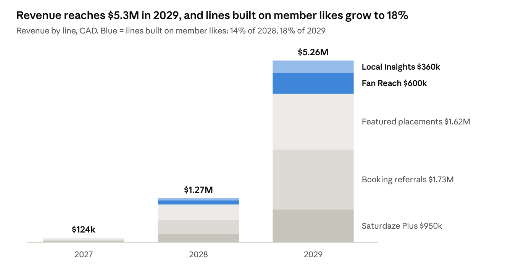
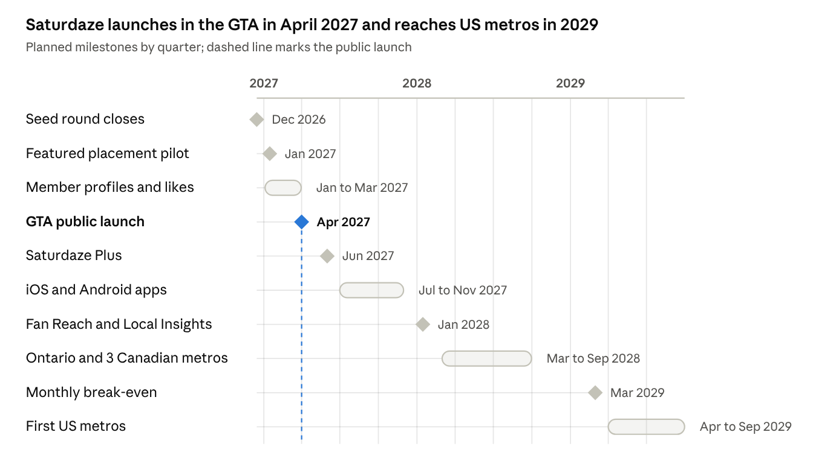

# Saturdaze Business Plan

October 15, 2026 · Live version: [Saturdaze Business Plan](https://claude.ai/code/artifact/be03e2ea-3736-4e52-a607-2264471f8e8a)

## Executive summary

Saturdaze turns a family's preferences, commitments, errands and the weather into a ready-to-use weekend plan, and the plan projects revenue of CAD $5.3M in year 3 (2029), with profit in that year.

- **Product:** a working full-stack planner (.NET 10, Angular 21) with itinerary generation, family member sign-in, restaurant votes, saved weekends, and AI-driven discovery of local events, activities and restaurants.
- **Customer:** parents of children aged 2 to 14 in large metro areas, starting in the Greater Toronto Area.
- **Revenue:** a free planner with a paid Saturdaze Plus tier, booking referral fees, clearly labelled featured placements for local venues, and two lines built on adult member profiles: Fan Reach alerts and anonymised Local Insights.
- **New feature proposed here:** each adult with a login gets a personal profile of likes. Plans then satisfy the whole family, and the same likes create the most valuable revenue lines.
- **Ask:** CAD $2.0M seed to fund 24 months of build and launch in Ontario before a 2029 expansion into Canadian and US metros.

Figures are in Canadian dollars and calendar years; the projections are planning estimates, not forecasts backed by traction data.

## Problem and solution

Families spend hours each week planning weekends and still end up repeating the same few outings. Saturdaze removes that work by producing a feasible, enjoyable plan in one tap.

**The problem**

- The information is scattered. Events sit on municipal sites, Eventbrite and Instagram; restaurants sit on Google and OpenTable; the weather is in another app.
- The constraints are personal. A plan has to fit hockey at 9, a nap at 1, a toddler who can't drive 90 minutes, and a budget.
- Taste is split. Two adults rarely want the same restaurant, so the choice falls back to whatever is closest.
- Nothing learns. Generic "things to do" lists don't remember that the family loved the zoo and hated the escape room.

**The solution**

| Need | What Saturdaze does today |
| --- | --- |
| One place to look | AI-driven ingestion pulls fresh local events, activities and restaurants into one catalog |
| Fit around commitments | The planner locks recurring commitments and fills the gaps by kids' ages, drive time and weather |
| Agreement on food | Family members vote on restaurants; the planner places meals near the main activity |
| Less repetition | Recency scoring, favourites, a "try something new" bonus, and saved weekend history |
| Errands handled | Errands are placed into the plan near where the family already is |

## Market

North America has about 39.6 million families with children. Saturdaze targets the roughly 12 million of them in large metros and aims to reach 400,000 registered families, about 3% of that segment, by the end of 2029.

**Target customer.** Two-parent and one-parent households with children aged 2 to 14, living in a metro area with plenty to do. Typical household income is CAD $90k or more. Both parents use smartphones and share planning. The first market is the Greater Toronto Area, where the catalog is already seeded.

| Segment | Families | Basis |
| --- | --- | --- |
| Total addressable: families with children, Canada + US | ~39.6M | 6.0M in Canada ([Statistics Canada, 2021 Census](https://www.statcan.gc.ca/o1/en/plus/1375-infographic-portrait-canadas-families-2021)) + 33.6M in the US with children under 18 ([FRED / US Census, 2025](https://fred.stlouisfed.org/series/TTLFMCU)) |
| Serviceable: top 15 Canadian and top 20 US metros | ~12M | Estimate: about 30% of families with children live in those metros |
| First market: Greater Toronto Area | ~1.0M | Estimate: Toronto CMA population share applied to the national count |
| Year-3 target: registered families | 400,000 | About 3% of the serviceable segment |

Statistics Canada counts 4.29M couple families with children and 1.69M one-parent families; 1.64M families have a child aged 0 to 5. The serviceable and GTA rows are estimates and should be checked against census table 98-10-0124-01.

**Competition**

| Alternative | What it does well | Where it falls short |
| --- | --- | --- |
| Google Search and Maps | Finds any place, reviews, hours | No plan; ignores commitments, ages, weather and taste |
| Eventbrite, Facebook Events | Event listings and tickets | Not family-filtered; no itinerary |
| Local parenting guides (SavvyMom, Macaroni KID) | Curated local ideas | Static lists; no personalisation or scheduling |
| Family calendars (Cozi, Skylight) | Shared schedule of commitments | Track what is booked; don't suggest what to do |
| OpenTable, Yelp | Restaurant booking and reviews | One adult's choice; no family consensus |

Saturdaze's edge is the combination: it knows the family's fixed commitments, each member's taste and the weekend's weather, and turns that into a plan rather than a list.

## Product

The core planner is built and deployed; the next 18 months add the features that drive retention and revenue.

**Built today**

- Weekend itinerary generation with locked blocks, regeneration, favourites, errands, restaurant picks and saved weekend history.
- Family profile with members, recurring commitments, budget preference, and family-level likes and dislikes.
- Family member sign-in: the account owner invites adults by a shareable link, and each signs in with their own password.
- Restaurant voting by family member.
- Weather-aware planning through Open-Meteo.
- AI-driven catalog ingestion that finds local events, activities and restaurants with grounded web search, on demand or on a schedule.
- Community event submissions with moderation.

**Next on the roadmap**

1. **Adult member profiles and likes** (detailed in the next section). Today's likes belong to the family, not the person.
2. **Memories and ratings that feed the planner.** The [experience-first pivot plan](../experience-first-pivot-plan.md) proposes scoring for "story potential" and using weekend ratings, which are stored but unused today.
3. **Budget-aware planning.** The budget setting exists but the planner ignores it.
4. **Bookings in the plan.** Tickets and reservations booked through partners without leaving the itinerary; this is the referral revenue line.
5. **Native mobile apps** for iOS and Android, wrapping the existing Angular app first.
6. **Partner portal** where venues claim listings, buy featured placements and Fan Reach alerts, and view Local Insights.

The dated roadmap is drawn under [Risks, privacy and milestones](#risks-privacy-and-milestones).

## Adult member profiles and likes

Every adult family member who signs in gets a personal profile of likes, so the planner can serve the whole household instead of one shared list, and Saturdaze learns individual taste it can match to partners with consent.

**Who gets a profile**

- Adults with a login get a full profile they control.
- Children who never sign in keep the age-based profile they have today. A parent can note a child's favourites for planning, but children's data is never used for offers, alerts or insights.

**What a member can do**

| Action | Example | Visible to |
| --- | --- | --- |
| Like or pass on a place | Loves the Royal Ontario Museum; passes on escape rooms | Family (default) or only me |
| Like a category or cuisine | Thai food, live music, hiking | Family (default) or only me |
| Follow a venue | Gets told when a liked venue posts an event | Only me |
| Rate a past weekend block | 5 stars for the zoo morning | Family |
| Keep a wish list | "Try the new ramen place" | Family or only me |

**How likes change the plan**

- **Shared likes first.** The planner scores a place higher for every adult who likes it; places both adults like win ties.
- **Taking turns.** When tastes split, the planner alternates whose pick anchors a meal or activity across weekends and says so ("Sam's pick this week").
- **Adults-only slots.** When a commitment covers the kids, such as a birthday party, the planner can suggest a coffee or lunch both parents like.
- **Vetoes respected.** A pass from any adult removes the place unless they undo it.

**Changes to today's design**

- Likes move from the family `Preference` record to a per-member record: member, target (place, event or category), sentiment, visibility, and when it was set.
- Restaurant votes key on the member instead of a typed voter name.
- Consent is stored per adult and per use: planning (always on), Fan Reach alerts (opt-in) and anonymised Local Insights (opt-out).

Under the project's ATDD rules, this feature needs a requirement, a detailed design and a mock before any code is written.

## Business model and monetization

Saturdaze earns from families who want more planning power and from local businesses that want to reach families ready to go out. Member likes make the business side worth paying for.

**Revenue lines**

| Line | Who pays | Price | How it works |
| --- | --- | --- | --- |
| Saturdaze Plus | Families | $6.99/month or $59.99/year per family, all adults included; about $66/year net average | Unlimited regeneration, taste blending across adults, adults-only slots, budget planning, memories, early event access |
| Booking referrals | Ticketing, reservation and class partners | About $3 per completed booking | Families book tickets, tables and classes from inside the plan |
| Featured placements | Local venues | $200 to $300/month | A labelled "Featured" slot, shown only when the venue fits the family's ages, drive time and weather |
| Fan Reach | Venues | $100 to $125/month | Alerts to adults who liked or follow the venue; opt-in, at most 2 per adult per week |
| Local Insights | Tourism boards, business improvement areas, chains, municipalities | $500 to $750/month | Anonymised demand reports by area, age band and category; groups under 50 families are never shown |

The free tier keeps the full planner and member profiles, because every like improves the plan and the value of the partner lines.

**Ways to monetize member likes**

| Idea | Who pays | How likes make it work | Starts |
| --- | --- | --- | --- |
| Fan Reach alerts | Venues | A like or follow is an opt-in audience, like a newsletter list the venue never sees | 2028 |
| Household-match offers | Restaurants, attractions | When both adults like a place, Saturdaze shows a bookable time and a partner perk; matched households convert more, so partners pay a higher referral fee | 2028 |
| Date-night bundles | Restaurants, theatres, sitters | An adults-only slot pairs a restaurant and an event both parents like; Saturdaze takes a bundle commission | 2028 |
| Wish-list gifting | Gift card and experience partners | A partner can buy a gift from the other's wish list for a birthday or Mother's Day; 5 to 10% commission | 2029 |
| Local Insights | Tourism boards, chains | Aggregated likes show unmet demand, for example "Thai food liked by 2,300 Mississauga families, 4 Thai places nearby" | 2028 |
| Taste blending in Plus | Families | Free profiles collect likes; Plus adds turn-taking, adults-only suggestions and "why this pick" | 2027 |

**What Saturdaze will not do**

- Sell or share any identifiable person's likes. Partners see aggregates or reach opted-in members through Saturdaze.
- Use children's data for offers, alerts or insights.
- Let a paid placement override an adult's pass or a family constraint.

## Go-to-market

Win the Greater Toronto Area in 2027, extend to Ontario and three Canadian metros in 2028, and open selected US metros in 2029.

**Families**

- **The invite loop.** Every family that signs up invites a second adult; profiles make the app better with two adults, so the invite is built into onboarding.
- **Shareable plans.** A plan can be sent to grandparents or another family as a link, with a sign-up prompt.
- **Parent communities.** Partnerships with school councils, daycare networks, and local parenting newsletters and groups.
- **Seasonal pushes.** March Break, summer, Thanksgiving and holiday weekends, when planning pain peaks.
- **Search content.** A weekly "this weekend with kids" page per city, generated from the live catalog.

**Businesses**

- **Claim your listing.** Venues already in the catalog get a free listing to claim, then an upgrade to Featured or Fan Reach.
- **City partners.** Tourism boards and business improvement areas get Local Insights pilots in exchange for promotion.
- **Booking partners.** Affiliate agreements with ticketing and reservation platforms before building direct venue integrations.

**Targets**

| Metric | 2027 | 2028 | 2029 |
| --- | --- | --- | --- |
| Registered families, year end | 25,000 | 120,000 | 400,000 |
| Share of families with two adult profiles | 40% | 55% | 60% |
| Paying venues, average | 20 | 250 | 850 |
| Cost to acquire a family (blended, including invites) | $6 | $5 | $4 |

## 3-year revenue projection

Revenue grows from about $124k in 2027 to $1.27M in 2028 and $5.26M in 2029. Fan Reach and Local Insights exist only because adults have profiles, and they reach $960k in 2029.

*Saturdaze planning model · CAD, calendar years 2027 to 2029*

**Assumptions**

| Driver | 2027 | 2028 | 2029 |
| --- | --- | --- | --- |
| Registered families, year end | 25,000 | 120,000 | 400,000 |
| Active families, yearly average | 8,000 | 45,000 | 160,000 |
| Paying Plus families, average (share of active) | 500 (6%) | 3,600 (8%) | 14,400 (9%) |
| Plus net revenue per paying family per year | $66 | $66 | $66 |
| Bookings per active family per month | 0.15 | 0.25 | 0.30 |
| Referral fee per booking | $3 | $3 | $3 |
| Featured venues, average × monthly price | 20 × $200 | 150 × $250 | 450 × $300 |
| Fan Reach venues, average × monthly price | 0 | 100 × $100 | 400 × $125 |
| Local Insights subscribers × monthly price | 0 | 10 × $500 | 40 × $750 |

Each line is volume × price × 12 months; Plus is paying families × $66. Profiles also lift booking conversion through household-match offers, but that uplift is not counted here.

**Downside case.** If paid conversion and bookings come in at half the plan, 2029 revenue is about $3.9M instead of $5.26M.

## Costs, team and funding

Saturdaze burns about $1.44M across 2027 and 2028 and turns a $1.24M profit in 2029, so a $2.0M seed covers the plan with about six months of slack.

| CAD | 2027 | 2028 | 2029 |
| --- | --- | --- | --- |
| Revenue | $124k | $1.27M | $5.26M |
| Team (average headcount) | $550k (4) | $1.10M (8) | $2.10M (15) |
| Marketing (new families × blended acquisition cost) | $150k | $475k | $1.12M |
| Infrastructure, AI ingestion, app store and payment fees | $70k | $200k | $500k |
| Legal, privacy, insurance and other | $90k | $200k | $300k |
| **Total costs** | **$860k** | **$1.98M** | **$4.02M** |
| **Net** | **−$736k** | **−$702k** | **+$1.24M** |

**Team**

- **2027 (4):** Founder and Chief Product Officer, two full-stack engineers, one growth and partnerships lead.
- **2028 (8):** adds a mobile engineer, a data engineer for the taste graph and insights, a partner manager, and a product designer.
- **2029 (15):** adds two engineers, a US partnerships team of three, a privacy and trust lead, and customer support.

**Use of the $2.0M seed**

| Use | Share | Amount |
| --- | --- | --- |
| Product and engineering | 55% | $1.10M |
| Family acquisition | 25% | $500k |
| Venue partnerships | 10% | $200k |
| Privacy, legal and operations | 10% | $200k |

A Series A in 2029 would fund the US expansion faster than profits allow; the plan does not depend on it.

## Risks, privacy and milestones

The biggest risks are slow paid conversion and losing trust over personal data; the plan answers both by keeping planning free and keeping every like under the member's control.

**Risks**

| Risk | Effect | Mitigation |
| --- | --- | --- |
| Families plan for free and few pay | Plus revenue falls short | Partner lines carry 82% of 2029 revenue; Plus is not the only path |
| Venues won't pay until there is an audience | Featured and Fan Reach start slowly | Free claimed listings first; price by results in the first year |
| Catalog goes stale or wrong | Bad plans, lost trust | Scheduled AI ingestion with audit records, community submissions with moderation, venue-claimed listings |
| A privacy misstep with member likes | Churn and regulatory exposure | Consent per adult and per use, no sale of identifiable data, minimum group of 50 in insights |
| Large platforms add family planning | Pressure on acquisition | Depth on commitments, multi-adult taste and local partners that a general platform won't match |
| Seasonality | Summer peaks, winter dips | Indoor catalog, holiday-weekend campaigns, annual Plus pricing |

**Privacy and trust**

- Comply with PIPEDA and Quebec's Law 25 in Canada, and CCPA/CPRA and COPPA in the US.
- Each adult sees and edits every like and every consent in one screen, and can export or delete them.
- Fan Reach is opt-in; Local Insights is opt-out and aggregate only.
- Children's data stays inside the family's own plans.

**Milestones**

*Saturdaze planned milestones · Dec 2026 to Sep 2029*

Revenue lines start as their features ship: Featured in January 2027, Plus in June 2027, and Fan Reach and Local Insights in January 2028.

## Sources

- [Statistics Canada, A portrait of Canada's families in 2021](https://www.statcan.gc.ca/o1/en/plus/1375-infographic-portrait-canadas-families-2021)
- [FRED, Total Families with Children under 18 Years Old (US Census Bureau data)](https://fred.stlouisfed.org/series/TTLFMCU)
