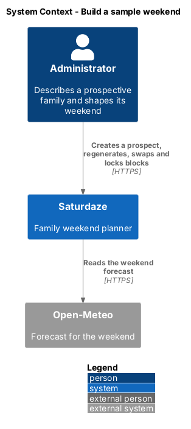
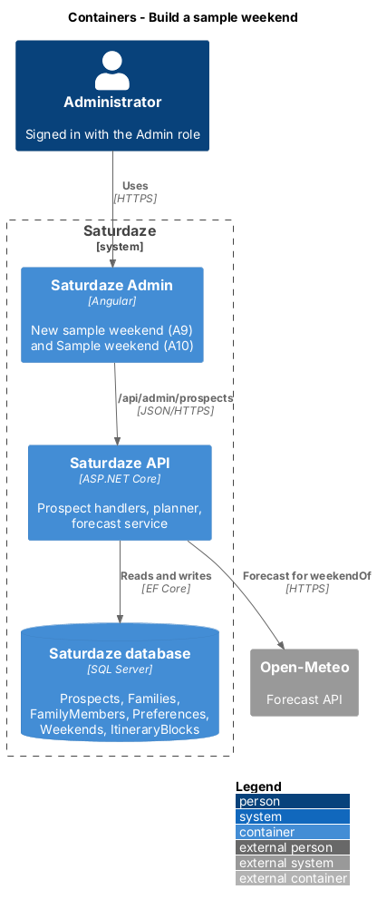
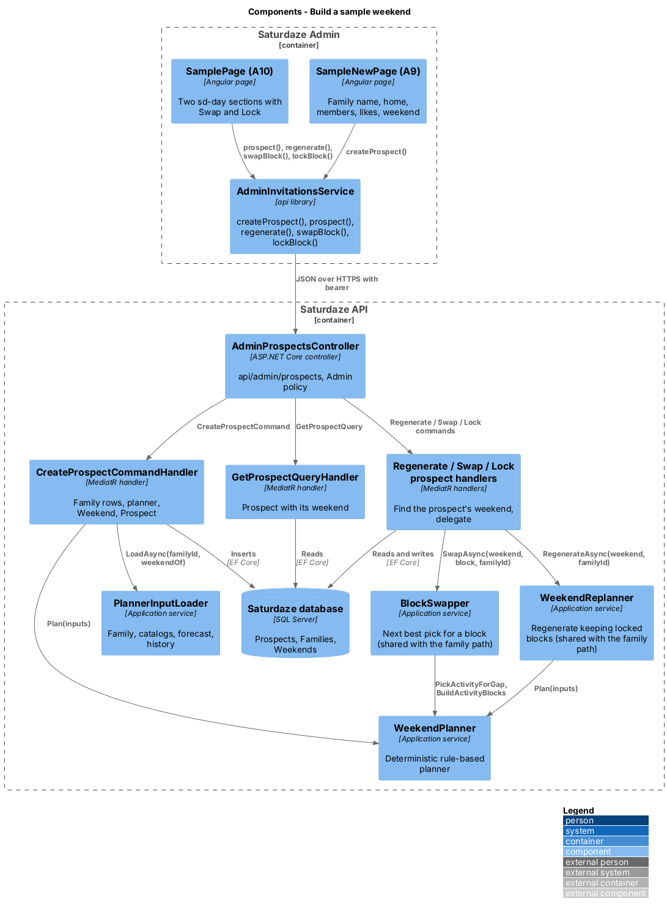
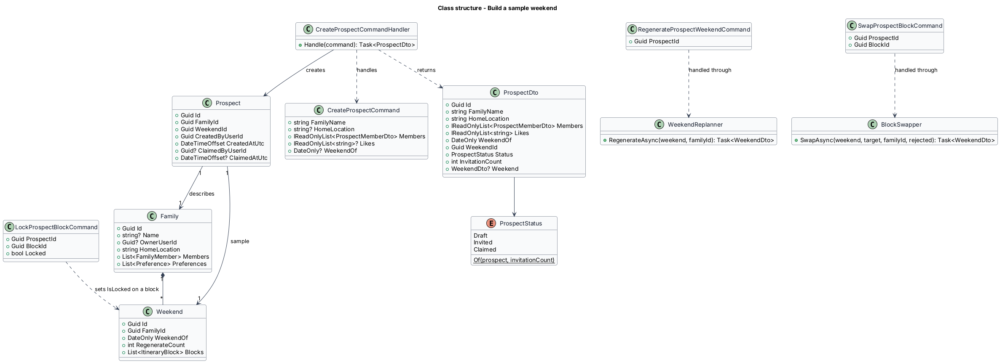
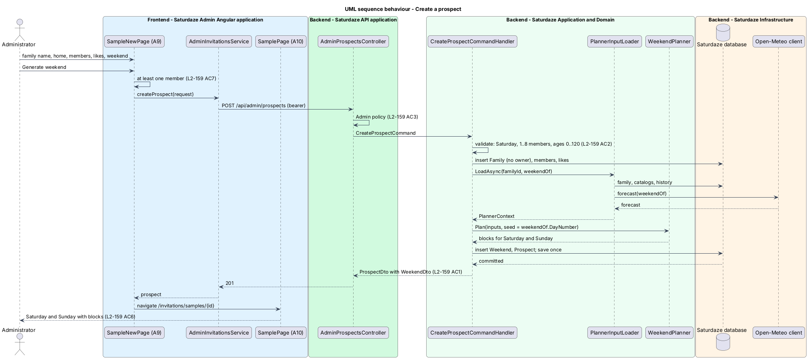
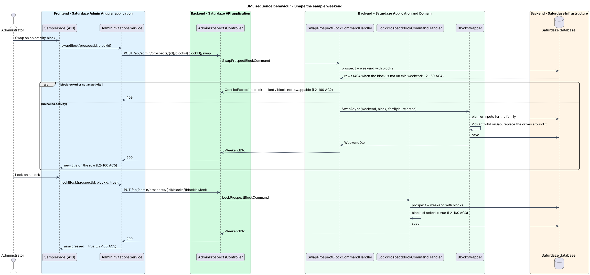

# Build a sample weekend

## Overview

Saturdaze is a web application that plans personalized family weekends. A family that has not signed up has nothing to look at: the planner only works on a family profile, and a profile only exists behind an account. This feature lets an administrator describe a prospective family in Saturdaze Admin, generate a weekend for it with the same planner that serves real families, shape that weekend, and hand it to `invite-families-to-saturdaze` so the invitation shows the family what Saturdaze would do for them. When an invitee accepts (`join-from-invitation`), the prospect family and its weekend become theirs.

*prospect* — prospective family an administrator described, with a sample weekend planned for it, that no account owns until an invitee claims it

*sample weekend* — the prospect's `Weekend` row, planned and shaped by an administrator

*prospect status* — derived state of a prospect: `Draft` (no invitation sent), `Invited` (at least one invitation outstanding or accepted), `Claimed` (an invitee owns the family)

The prospect family is an ordinary `Family` row with members and preferences but no owner and no account, so the planner (`PlannerInputLoader`, `WeekendPlanner`) reads it without change. The shaping operations reuse the family's own regenerate, swap and lock rules through two small services extracted from the existing handlers; the admin routes differ only in how they find the weekend.

## Description

### Domain

`Prospect` (`Saturdaze.Domain/Entities/Prospect.cs`) carries `Id`, `FamilyId`, `WeekendId`, `CreatedByUserId`, `CreatedAtUtc`, `ClaimedByUserId` and `ClaimedAtUtc`. `FamilyId` and `WeekendId` reference `Families` and `Weekends` with `Restrict` delete; `IAppDbContext` exposes `Prospects`. `ProspectStatus.Of(prospect, invitationCount)` answers `Claimed` when `ClaimedByUserId` is set, `Invited` when at least one invitation references the prospect, and `Draft` otherwise.

### Application

`CreateProspectCommand(FamilyName, HomeLocation, Members, Likes, WeekendOf)` in `Saturdaze.Application/Admin/Prospects/` is validated by `CreateProspectCommandValidator`: family name 1 to 100 characters, 1 to 8 members with names of at most 100 characters and ages 0 to 120, likes of at most 60 characters each, `WeekendOf` a Saturday when given. `CreateProspectCommandHandler` resolves the weekend date (`GetCurrentWeekendQueryHandler.ResolveUpcomingSaturday` when omitted), inserts the `Family` (no `OwnerUserId`), its `FamilyMember` rows and `Like` preferences, loads planner inputs with `PlannerInputLoader.LoadAsync(familyId, weekendOf)`, plans with `IWeekendPlanner.Plan` using the date's day number as seed (as `GenerateWeekendCommandHandler` does), inserts the `Weekend` and the `Prospect`, saves once and returns `ProspectDto` with the `WeekendDto` from `WeekendMapper`.

`ListProspectsQuery` returns `ProspectDto` rows newest first without weekends, each with `invitationCount`; `GetProspectQuery(Id)` returns one with its weekend and forecast (404 when unknown). `ProspectDto` carries `id`, `familyName`, `homeLocation`, `members` (`name`, `age`), `likes`, `weekendOf`, `weekendId`, `status`, `createdAtUtc`, `invitationCount` and `weekend`.

`RegenerateProspectWeekendCommand(ProspectId)`, `SwapProspectBlockCommand(ProspectId, BlockId)` and `LockProspectBlockCommand(ProspectId, BlockId, Locked)` load the prospect and its weekend with blocks (404 when the prospect is unknown or the block is not on its weekend) and delegate to `WeekendReplanner.RegenerateAsync(weekend, familyId)` (extracted from `RegenerateWeekendCommandHandler`) and `BlockSwapper.SwapAsync(weekend, block, familyId, rejected)` (extracted from `SwapBlockCommandHandler`). The family handlers call the same services after resolving the family through `ICurrentFamilyAccessor`, so the rules (locked blocks stay, only unlocked activity blocks swap, `block_locked` and `block_not_swappable` conflicts) have one implementation.

### API

`AdminProspectsController` (`api/admin/prospects`, `[Authorize(Policy = "Admin")]`) exposes `GET` (list), `POST` (create, 201), `GET {id}`, `POST {id}/weekend/regenerate`, `POST {id}/blocks/{blockId}/swap` and `PUT {id}/blocks/{blockId}/lock`.

### Frontend (`api` library)

`IAdminInvitationsService` (shared with `invite-families-to-saturdaze`) offers `prospects()`, `prospect(id)`, `createProspect(request)`, `regenerate(id)`, `swapBlock(id, blockId)` and `lockBlock(id, blockId, locked)`. `toProspectRow` projects a `ProspectDto` into the "Sample weekends" row (title, "Sat 24 – Sun 25 Oct · Dani 38, Mateo 7 · Port Credit", status chip); `projectWeekend` from `weekend-projection.ts` turns the prospect's `WeekendDto` into the `WeekendView` the days render from.

### Frontend (admin application)

`SampleNewPage` (`/invitations/samples/new`, screen `sample-new`) is the form of A9: family name, home, member rows (name and age, "Add a member", remove), likes (`sd-chip-input`) and the weekend select of the next four Saturdays. "Generate weekend" validates (at least one member), calls `createProspect` once and navigates to `/invitations/samples/{id}`. `SamplePage` (`/invitations/samples/:id`, screen `sample`) renders the header (family name, members, home, likes), the status chips, and the two `sd-day` sections with `sd-block` rows that project "Swap" and "Lock" into `[slot=actions]`; "Regenerate" calls `regenerate`, "Edit family" returns to A9 (`<TO SUPPLY>`: editing a created prospect is not in L2-159; the link opens a new form), and "Send invite" opens `InviteDialog` with the prospect preselected.

### Tests

`Saturdaze.Api.Tests/Admin/AdminProspectsTests.cs` covers L2-159 and L2-160. `e2e/pages/admin/admin-sample-new.page.ts` and `admin-sample.page.ts` own the selectors; `e2e/tests/admin/sample-weekend.spec.ts` drives generation, swap, lock and the handoff to AD7.

## Requirements

The following L2 requirements refine the cited L1 capabilities.

| L2 ID | Refines (L1) | Requirement |
|-------|--------------|-------------|
| `L2-159` | `L1-038` | `POST /api/admin/prospects` shall accept `{familyName, homeLocation?, members: [{name, age}], likes?: string[], weekendOf?}` and create a prospect: a `Family` row with no owner, its members and likes, and a weekend for `weekendOf` (a Saturday; the upcoming Saturday when omitted) planned by the same planner and rules as `POST /api/weekends/plan` (L2-010). It shall return 201 with the prospect and its `weekend` as a `WeekendDto`. `GET /api/admin/prospects` shall list prospects newest first without their weekends; `GET /api/admin/prospects/{id}` shall return one with its weekend. No account belongs to a prospect family until it is claimed, so family-scoped endpoints never return it. The "New sample weekend" screen (A9) at `/invitations/samples/new` shall collect the family name, home, members, likes and the weekend date, and "Generate weekend" shall open the sample weekend screen. |
| `L2-160` | `L1-038` | An administrator shall be able to shape a prospect's weekend the way a family shapes its own: `POST /api/admin/prospects/{id}/weekend/regenerate` shall re-plan every unlocked block and keep locked ones (L2-011); `POST /api/admin/prospects/{id}/blocks/{blockId}/swap` shall replace an unlocked activity block with the next best pick (L2-015); `PUT /api/admin/prospects/{id}/blocks/{blockId}/lock` shall lock or unlock a block (L2-016). Each shall return the prospect's `WeekendDto`. The sample weekend screen (A10) at `/invitations/samples/{id}` shall show the weekend like the family's Weekend screen with "Swap" and "Lock" on each activity block, "Regenerate" in the header and "Send invite", which opens AD7 with this sample weekend preselected. |

## Diagrams

### System context

The context view places the administrator beside the API's planner and the weather provider the planner consults.

### Containers

The container view shows the admin application, the API with the planner and the database rows a prospect spans.

### Components

The component view names the two screens, the service, the controller, the handlers and the two extracted services that both the family and the admin paths call.

### Class structure

The class view shows `Prospect` with its family and weekend, the commands, the DTOs and the shared `WeekendReplanner` and `BlockSwapper`.

### Behaviour — create a prospect

The sequence follows A9 through the family rows, the planner and the saved weekend to A10 (`L2-159`).

### Behaviour — shape the weekend

The sequence follows a swap and a lock from A10 through the shared services (`L2-160`).

