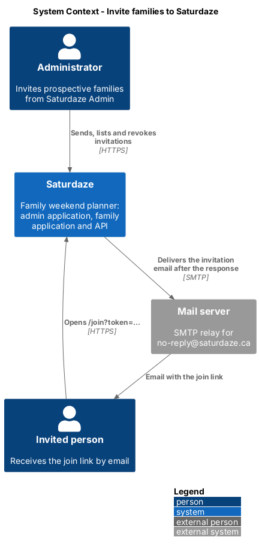
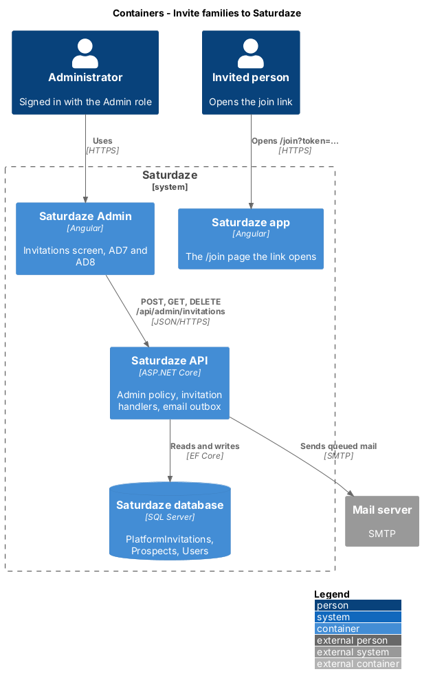
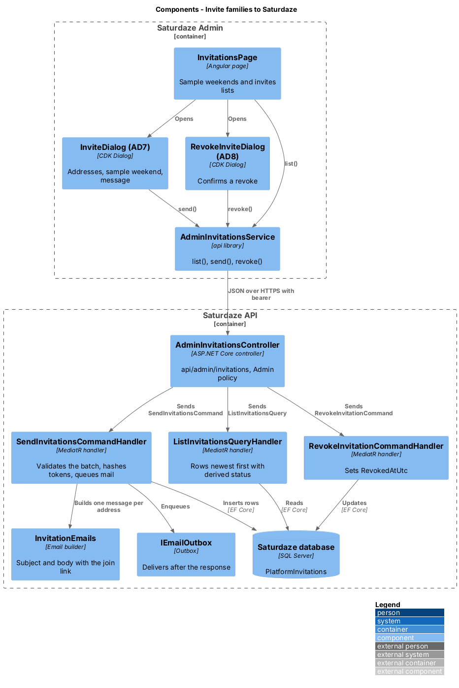
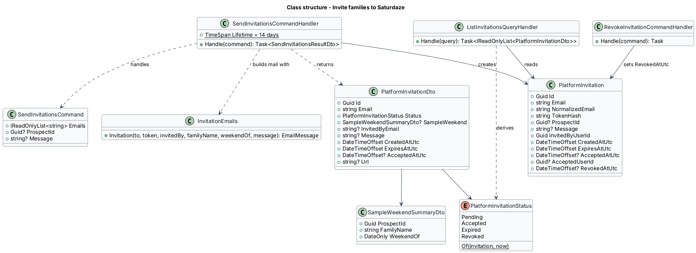
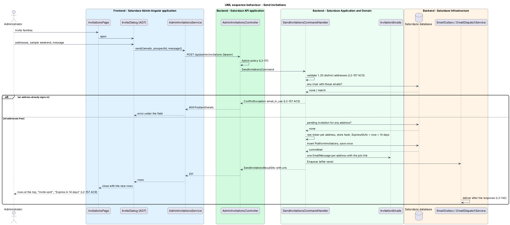
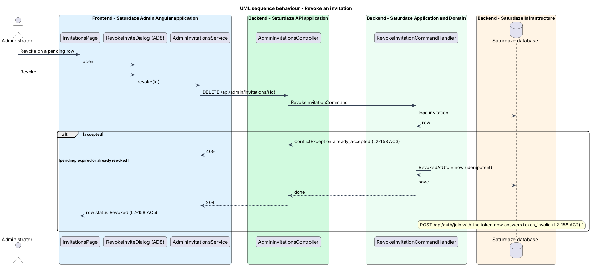

# Invite families to Saturdaze

## Overview

Saturdaze is a web application that plans personalized family weekends. Until now a family joined by registering on its own (`register-family-account`) or by an invitation from the owner of a family it belongs to (`manage-family-members`). This feature adds a third door: an administrator invites a prospective family to the platform from Saturdaze Admin, by email, one or more addresses at a time, and can see and revoke what was sent. The companion feature `build-sample-weekend` lets the administrator plan a weekend for that family first and attach it to the invitation; `join-from-invitation` (identity-and-access) is the invitee's side of the link.

*platform invitation* — single-use, time-limited invitation an administrator sends to one email address to create a Saturdaze account

*prospect* — prospective family an administrator described in Saturdaze Admin, with a sample weekend planned for it, that no account owns until an invitee claims it

*invitation status* — derived state of a platform invitation: `Pending`, `Accepted`, `Expired` or `Revoked`

*join link* — URL `{Share:AppOrigin}/join?token=…` carried by the invitation email and returned to the administrator

The feature sits in the administration subsystem beside `scaffold-admin-application`, whose shell, gate and `Admin` policy it reuses. Mail goes out through the outbox introduced by L2-142, so a request never waits on delivery. The token is handled like a family invitation (ADR-016 decision 3): only its hash is stored, and the link is handed to the person entitled to send it.

## Description

### Domain

`PlatformInvitation` (`Saturdaze.Domain/Entities/PlatformInvitation.cs`) carries `Id`, `Email`, `NormalizedEmail`, `TokenHash`, `ProspectId` (nullable), `Message` (nullable, at most 500 characters), `InvitedByUserId`, `CreatedAtUtc`, `ExpiresAtUtc`, `AcceptedAtUtc`, `AcceptedUserId` and `RevokedAtUtc`. The table `PlatformInvitations` has a unique index on `TokenHash` and an index on `NormalizedEmail`; `ProspectId` references `Prospects` with `Restrict` delete so a prospect with invitations is never removed underneath them. `IAppDbContext` exposes `PlatformInvitations`.

The status is not stored. `PlatformInvitationStatus.Of(invitation, now)` in the Application layer answers `Accepted` when `AcceptedAtUtc` is set, `Revoked` when `RevokedAtUtc` is set, `Expired` when `ExpiresAtUtc` is at or before `now`, and `Pending` otherwise.

### Application

`SendInvitationsCommand(Emails, ProspectId, Message)` in `Saturdaze.Application/Admin/Invitations/` is validated by `SendInvitationsCommandValidator`: 1 to 20 addresses, each a valid email of at most 256 characters, no duplicates after trimming and lower-casing, message at most 500 characters. `SendInvitationsCommandHandler` loads the prospect when `ProspectId` is given (400 `prospectId` when it does not exist), refuses the whole batch with 409 `email_in_use` when any address belongs to a `User` and with 409 `already_invited` when any address has a pending invitation, then creates one row per address with `IJwtTokenService.CreateRawRefreshToken()` as the token and `HashRefreshToken` as the stored hash, a 14-day `ExpiresAtUtc` (`SendInvitationsCommandHandler.Lifetime`), saves once, enqueues one `EmailMessage` per address through `IEmailOutbox`, and returns `SendInvitationsResultDto` with each `PlatformInvitationDto` and its `url`.

`InvitationEmails` (`Saturdaze.Application/Email/InvitationEmails.cs`) builds the plain-text mail from `EmailOptions.AppOrigin`: subject "You're invited to Saturdaze" without a prospect, "A weekend planned for {familyName} on Saturdaze" with one; the body names the inviting administrator, the weekend date when there is a sample, the optional message, the join link and the sentence "The link works for 14 days."

`ListInvitationsQuery` returns `PlatformInvitationDto` rows newest first (`CreatedAtUtc` descending) with `status`, `sampleWeekend` (`SampleWeekendSummaryDto`: prospect id, family name, `weekendOf`) and `invitedByEmail` resolved in one query each. `RevokeInvitationCommand(Id)` sets `RevokedAtUtc` on a pending or expired invitation, answers 409 `already_accepted` for an accepted one, 404 for an unknown id, and is idempotent for an already revoked one.

`PlatformInvitationDto` carries `id`, `email`, `status`, `sampleWeekend`, `invitedByEmail`, `message`, `createdAtUtc`, `expiresAtUtc`, `acceptedAtUtc` and `url` (set only in the send response).

### API

`AdminInvitationsController` (`api/admin/invitations`, `[Authorize(Policy = "Admin")]`) exposes `GET` (list), `POST` (send, 201) and `DELETE {id}` (revoke, 204). The join link is made absolute from `Saturdaze:Share:AppOrigin` the way `FamilyController` does for member invites.

### Frontend (`api` library)

`IAdminInvitationsService` behind `ADMIN_INVITATIONS_SERVICE` offers `list()`, `send(request)`, `revoke(id)` and the prospect calls described in `build-sample-weekend`. `AdminInvitationsService` is the HTTP implementation; `toInvitationRow` projects a `PlatformInvitationDto` into `InvitationRow` (`email`, `sample` line, `meta` line with "Invited by … · … · Expires in N days", the status chip and `canRevoke`).

### Frontend (admin application)

`InvitationsPage` (`/invitations`, nav key `invitations`, screen `invitations`) renders the page header with "New sample weekend" and "Invite families", the "Sample weekends" section (rows from `prospects()`) and the "Invites" list. "Invite families" opens `InviteDialog` (AD7): an `sd-chip-input` for addresses, an `sd-select` of prospects and an optional message; "Send invites" calls `send` once, closes with the new rows and the page prepends them. "Revoke" on a pending row opens `RevokeInviteDialog` (AD8); confirming calls `revoke` once and the row re-renders as `Revoked`. `ADMIN_NAV_ITEMS` in `components` gains `{ key: 'invitations', label: 'Invitations', icon: 'mail', route: '/invitations' }` so `sd-admin-nav` shows the destination in both apps' chrome.

### Tests

`Saturdaze.Api.Tests/Admin/AdminInvitationsTests.cs` covers L2-157 and L2-158 against the in-process API with `CapturingEmailSender`. `e2e/pages/admin/admin-invitations.page.ts` owns the screen's selectors; `e2e/tests/admin/invitations.spec.ts` drives AD7 and AD8.

## Requirements

The following L2 requirements refine the cited L1 capabilities.

| L2 ID | Refines (L1) | Requirement |
|-------|--------------|-------------|
| `L2-157` | `L1-038` | `POST /api/admin/invitations` shall accept `{emails: string[], prospectId?: Guid, message?: string}` (1 to 20 distinct addresses, each a valid email address of at most 256 characters; a message of at most 500 characters), create one single-use platform invitation per address that expires 14 days after it is created, store only a SHA-256 hash of each token, and return 201 with the invitations, each carrying the `url` `{Share:AppOrigin}/join?token=…`. After the response is sent, one email per address shall be sent (L2-142). The whole batch shall succeed or fail together. On `/invitations`, "Invite families" shall open the "Invite families to Saturdaze" dialog (AD7). |
| `L2-158` | `L1-038` | `GET /api/admin/invitations` shall return every platform invitation newest first with `id`, `email`, `status` (`Pending`, `Accepted`, `Expired` or `Revoked`), `sampleWeekend` or `null`, `invitedByEmail`, `createdAtUtc`, `expiresAtUtc` and `acceptedAtUtc`. `DELETE /api/admin/invitations/{id}` shall revoke a pending invitation so its link no longer works. Saturdaze Admin shall gain the "Invitations" destination at `/invitations` (A8), which lists the invitations with a status chip per row and offers "Revoke" on pending rows through the "Revoke this invite?" confirmation (AD8). |

## Diagrams

### System context

The context view places the administrator, the invited person and the mail server around the two applications and the API.

### Containers

The container view shows the admin application sending through the API, the API writing invitations and queuing mail, and the family application that the join link opens.

### Components

The component view names the controller, the three handlers, the mail builder and the outbox on the API side, and the page, dialogs and service on the admin side.

### Class structure

The class view shows `PlatformInvitation`, its derived status, the commands and the DTOs the admin application consumes.

### Behaviour — send invitations

The sequence follows the administrator from AD7 to the batch write, the response with the join links and the mail sent after it (`L2-157`).

### Behaviour — revoke an invitation

The sequence follows "Revoke" through AD8 to the revoked row and the link that no longer works (`L2-158`).

