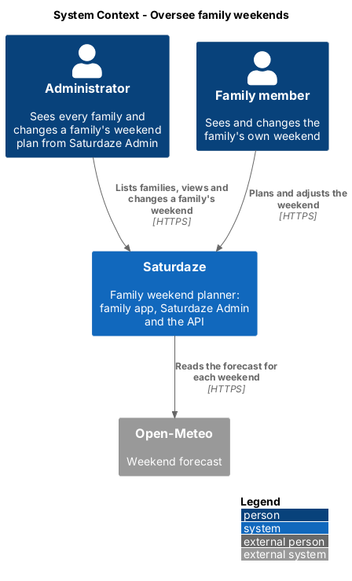
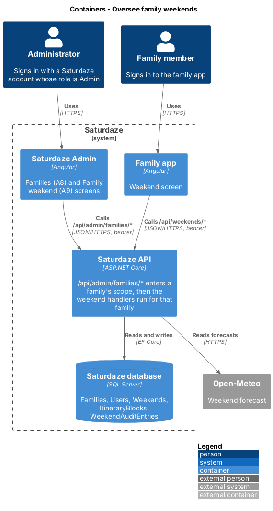
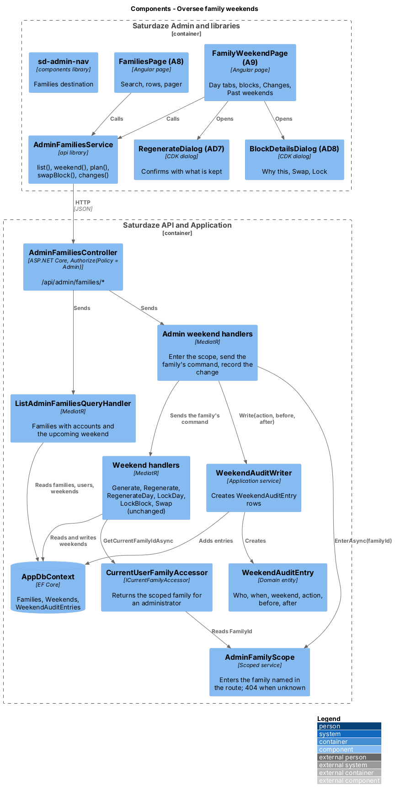
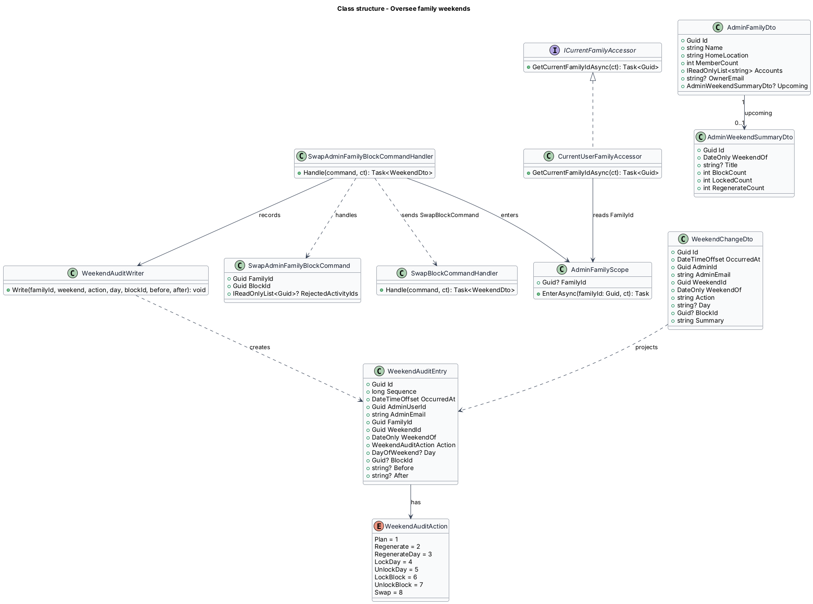
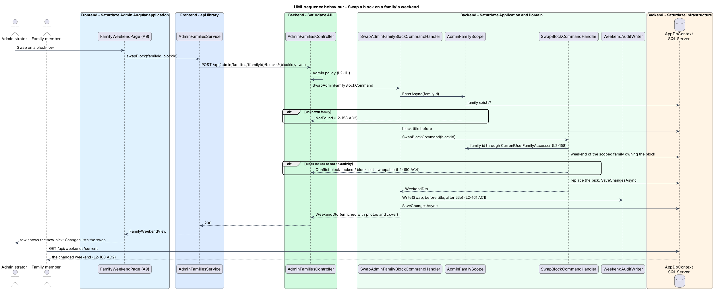
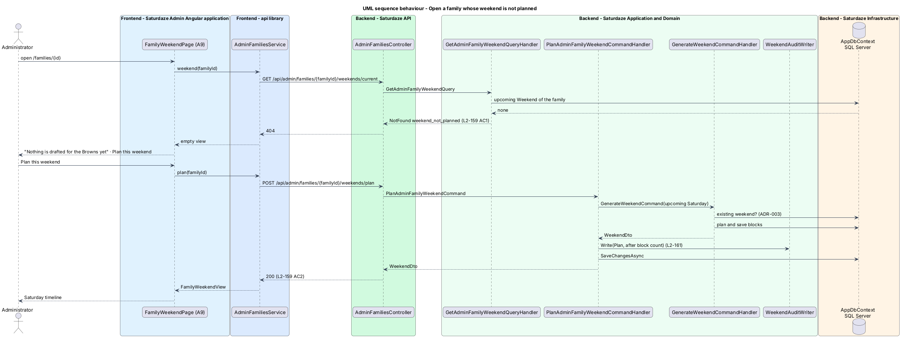

# Oversee family weekends

## Overview

Saturdaze is a web application that plans personalized family weekends. Each family signs in to the family app, where the planner drafts a Saturday and Sunday itinerary and the family locks, swaps and regenerates its blocks. Saturdaze Admin (`scaffold-admin-application`, ADR-014) is the second application in the workspace; until this feature it manages catalog photos only and sees nothing of the families.

This feature gives an administrator a view of every family on the service and the family's own controls over that family's upcoming weekend. The administrator opens a family, sees the same timeline the family sees, plans the weekend when nothing is drafted, and regenerates, locks or swaps exactly as the family could. Every administrator change is recorded and shown on the family's page.

*family scope* — the family a request acts on; for a family member it is the member's own family (ADR-008), for an administrator on an admin family route it is the family named in the route

*upcoming weekend* — the family's `Weekend` whose `WeekendOf` is the upcoming Saturday as `GetCurrentWeekendQueryHandler.ResolveUpcomingSaturday` resolves it

*weekend audit entry* — `WeekendAuditEntry` row recording one administrator change to a family's weekend: who, when, which weekend, which day or block, and the values before and after

The feature shares the admin shell, the `Admin` policy and the audit conventions of `manage-place-photos`, and reuses the weekend handlers of `weekend-planning` unchanged.

## Description

### Domain

`WeekendAuditEntry` (`Id`, `Sequence`, `OccurredAt`, `AdminUserId`, `AdminEmail`, `FamilyId`, `WeekendId`, `WeekendOf`, `Action`, `Day`, `BlockId`, `Before`, `After`) is a new entity. `WeekendAuditAction` is a stable integer enum: `Plan = 1`, `Regenerate = 2`, `RegenerateDay = 3`, `LockDay = 4`, `UnlockDay = 5`, `LockBlock = 6`, `UnlockBlock = 7`, `Swap = 8`. `Sequence` is an identity column so entries written in the same instant still list newest first, as `PhotoAuditEntry` does. The table carries an index on `(FamilyId, Sequence)`.

No existing entity changes.

### Family scope

`CurrentUserFamilyAccessor` resolves the caller's family from `Users.FamilyId` (ADR-016). The feature adds `AdminFamilyScope`, a scoped service with `FamilyId` and `EnterAsync(familyId)`. `EnterAsync` requires the current user's role to be `Admin`, loads the family and throws `NotFoundException` when it does not exist (L2-158 AC2), then records the id. `CurrentUserFamilyAccessor.GetCurrentFamilyIdAsync` returns `AdminFamilyScope.FamilyId` when it is set and the caller is an administrator, before its own cache. Every existing weekend, block and day handler therefore runs for the scoped family without change, including the ownership filters that make another family's weekend id a 404 (L2-158 AC3). ADR-019 records the decision.

### Application

All handlers live in `Saturdaze.Application/Admin/Families`.

| Handler | Route | Behaviour |
|---------|-------|-----------|
| `ListAdminFamiliesQueryHandler` | `GET /api/admin/families?q&page` | Every `Family` with its member count, its users' emails (owner first) and the upcoming `Weekend` when one exists, as `AdminFamilyDto`; `q` filters by name, home location or email; pages of 50 ordered by display name (L2-157). |
| `GetAdminFamilyQueryHandler` | `GET /api/admin/families/{familyId}` | The family as the list shows it plus `upcomingWeekendOf`, members and commitments, as `AdminFamilyDetailDto`; 404 when unknown. |
| `GetAdminFamilyWeekendQueryHandler` | `GET …/weekends/current` | Enters the scope and reads the upcoming `Weekend` directly; `WeekendMapper.ToDto` with the forecast, enriched by `WeekendEnrichmentBehavior`; throws `NotFoundException("weekend_not_planned")` when none exists, creating nothing (L2-159 AC1). |
| `PlanAdminFamilyWeekendCommandHandler` | `POST …/weekends/plan` | Enters the scope and sends `GenerateWeekendCommand` for the upcoming Saturday (idempotent, ADR-003); writes a `Plan` entry when a weekend was created (L2-159 AC2). |
| `GetAdminFamilyHistoryQueryHandler` | `GET …/weekends/history?take` | Enters the scope and sends `GetWeekendHistoryQuery` (L2-159 AC6). |
| `RegenerateAdminFamilyWeekendCommandHandler` | `POST …/weekends/{id}/regenerate` | Enters the scope, counts the blocks, sends `RegenerateWeekendCommand`, writes a `Regenerate` entry with the block counts before and after. |
| `RegenerateAdminFamilyDayCommandHandler` | `POST …/weekends/{id}/days/{day}/regenerate` | As above with `RegenerateWeekendDayCommand` and a `RegenerateDay` entry carrying `Day`. |
| `LockAdminFamilyDayCommandHandler` | `PUT …/weekends/{id}/days/{day}/lock` | Sends `LockWeekendDayCommand`; writes `LockDay` or `UnlockDay`. |
| `LockAdminFamilyBlockCommandHandler` | `PUT …/blocks/{blockId}/lock` | Sends `LockBlockCommand`; writes `LockBlock` or `UnlockBlock` with the block title; the 409 `commitment_locked` of the inner handler passes through (L2-160 AC3). |
| `SwapAdminFamilyBlockCommandHandler` | `POST …/blocks/{blockId}/swap` | Sends `SwapBlockCommand`; writes `Swap` with the title before and after; 409 `block_locked` passes through (L2-160 AC4). |
| `ListWeekendChangesQueryHandler` | `GET …/weekend-changes?page` | The family's `WeekendAuditEntry` rows newest first, 50 per page, each as `WeekendChangeDto` with a one-line `summary` (L2-161). |

`WeekendAuditWriter` is the one place that creates `WeekendAuditEntry` rows, mirroring `PhotoAuditWriter`: it reads the administrator from `ICurrentUserAccessor`, the time from `IDateTimeProvider`, and adds the entry to the unit of work; the admin handler's save persists it after the inner handler's save. The family's own routes never reach the writer (L2-161 AC3).

`AdminFamiliesController` exposes the routes under `[Route("api/admin/families")]` and `[Authorize(Policy = "Admin")]` on top of the global fallback (L2-111, ADR-008), parsing `day` as `WeekendsController` does.

### Frontend

The `api` library gains `IAdminFamiliesService` with the `ADMIN_FAMILIES_SERVICE` token and the HTTP `AdminFamiliesService`: `list(query)`, `family(id)`, `weekend(familyId)` (a 404 `weekend_not_planned` becomes the `empty` view), `plan(familyId)`, `regenerate`, `regenerateDay`, `lockDay`, `lockBlock`, `swapBlock`, `history(familyId)` and `changes(familyId)`. The weekend reads reuse `projectWeekend`, so the admin timeline shows the same `DayView` and `BlockRow` rows as the family's Weekend screen. The models live in `lib/models/admin/`: `AdminFamilyDto`, `AdminFamilyPageDto`, `AdminFamilyDetailDto`, `WeekendChangeDto`, `FamilyRow`, `FamilyWeekendView` and `WeekendChangeRow`.

`ADMIN_NAV_ITEMS` in `components` gains `families` (icon `user`, route `/families`) after Photo health (L2-162); `sd-admin-nav` renders it from the data and the Storybook story lists it.

`FamiliesPage` (A8, `/families`) is the Places pattern: a search field that writes `q` to the URL, the count line, `sd-list card` rows (`.family-row` with the name, meta, accounts and the Upcoming chip) and `sd-pager`.

`FamilyWeekendPage` (A9, `/families/:id`) composes `sd-page-header` (eyebrow back to Families, the family's name and meta, Regenerate weekend), `sd-segments` day tabs, `sd-day` with `sd-leg` and `sd-block` rows and their Why / Swap / Lock actions, the empty state with "Plan this weekend", the Changes section (the Activity log's feed rows) and the Past weekends list. `RegenerateDialog` (AD7) is the confirmation with the "Keeping" well; `BlockDetailsDialog` (AD8) shows the planner's reason with Swap and Lock. Both open through the CDK `Dialog` with the admin `DIALOG_OPTIONS`.

### Tests

`Saturdaze.Api.Tests/Admin/AdminFamiliesTests.cs`, `AdminFamilyWeekendTests.cs` and `AdminFamilyChangesTests.cs` cover the list, the scope, the reads, each mutation and the audit entries. `e2e/tests/admin/families.spec.ts` and `family-weekend.spec.ts` drive the screens through `AdminFamiliesPage` and `AdminFamilyPage`.

## Requirements

The following L2 requirements refine the cited L1 capabilities.

| L2 ID | Refines (L1) | Requirement |
|-------|--------------|-------------|
| `L2-157` | `L1-038` | `GET /api/admin/families` shall return a page of 50 families ordered by display name, each with `id`, `name`, `homeLocation`, `memberCount`, `accounts`, `ownerEmail` and `upcoming`; `q` shall match the name, home location or any account email. The Families screen (A8) shall list each family with its name, "N members · M accounts", the accounts, an "Upcoming" chip, a search field that writes `q` to the URL and a pager; every row opens the family's weekend (A9). |
| `L2-158` | `L1-038`, `L1-012` | Every `/api/admin/families/{familyId}/…` request shall resolve the family from the route, never from the administrator's own account, and shall apply the family's rules unchanged. An unknown `familyId` shall be 404. A weekend or block id that belongs to another family shall be 404. |
| `L2-159` | `L1-038`, `L1-003` | `GET /api/admin/families/{familyId}` shall return the family with `upcomingWeekendOf`, members and commitments. `GET …/weekends/current` shall return the upcoming weekend as the family would see it and shall be 404 `weekend_not_planned` when none exists, creating nothing. `POST …/weekends/plan` shall plan the upcoming Saturday idempotently. `GET …/weekends/history` shall return past weekends newest first. The Family weekend screen (A9) shall show the family's name and meta, Saturday and Sunday tabs with the timeline, the empty state with "Plan this weekend", and "Past weekends". |
| `L2-160` | `L1-038`, `L1-004` | The admin regenerate, day regenerate, day lock, block lock and block swap routes shall apply the same rules as the family's endpoints and return the updated weekend. The Family weekend screen shall offer Regenerate (AD7) and Lock day on each day, and Why this (AD8), Swap and Lock on each block. |
| `L2-161` | `L1-038`, `L1-012` | Each administrator change shall write a `WeekendAuditEntry` with who, when, the weekend, the action, the day or block and the values before and after. A family's own actions shall not be recorded. `GET …/weekend-changes` shall return the entries newest first with a `summary`; the screen shall show them in a "Changes" section or "No changes yet". |
| `L2-162` | `L1-038`, `L1-011` | `sd-admin-nav` shall carry a "Families" destination after Photo health, current on `/families` and `/families/{id}`; the mocks `admin.families.html`, `admin.family.html`, AD7 and AD8 define the screens, stamped `data-screen="families"` and `"family"`. |

## Diagrams

### System context

The context view places the administrator beside the families whose weekends they oversee; both reach the same API, and the weather provider feeds the forecast every timeline shows.

### Containers

The container view shows Saturdaze Admin and the family app sharing the API and database, with the admin family routes entering a family's scope before the weekend handlers run.

### Components

The component view names the two pages and their dialogs, the admin families service, the controller, the scope, the admin handlers that wrap the family's weekend handlers, and the audit writer and entity.

### Class structure

The class view shows `AdminFamilyScope` beside `CurrentUserFamilyAccessor`, the admin commands, `WeekendAuditWriter` and `WeekendAuditEntry`, and the DTOs the screens consume.

### Behaviour — swap a block on a family's weekend

The sequence view traces a swap from the Family weekend screen through the scope, the family's own `SwapBlockCommandHandler` and the audit entry, and shows the family reading the changed weekend afterwards (`L2-158`, `L2-160`, `L2-161`).

### Behaviour — open a family whose weekend is not planned

The sequence view traces the read that creates nothing, the empty state, and the plan that follows (`L2-159`).

