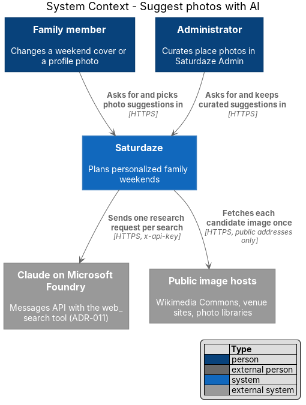
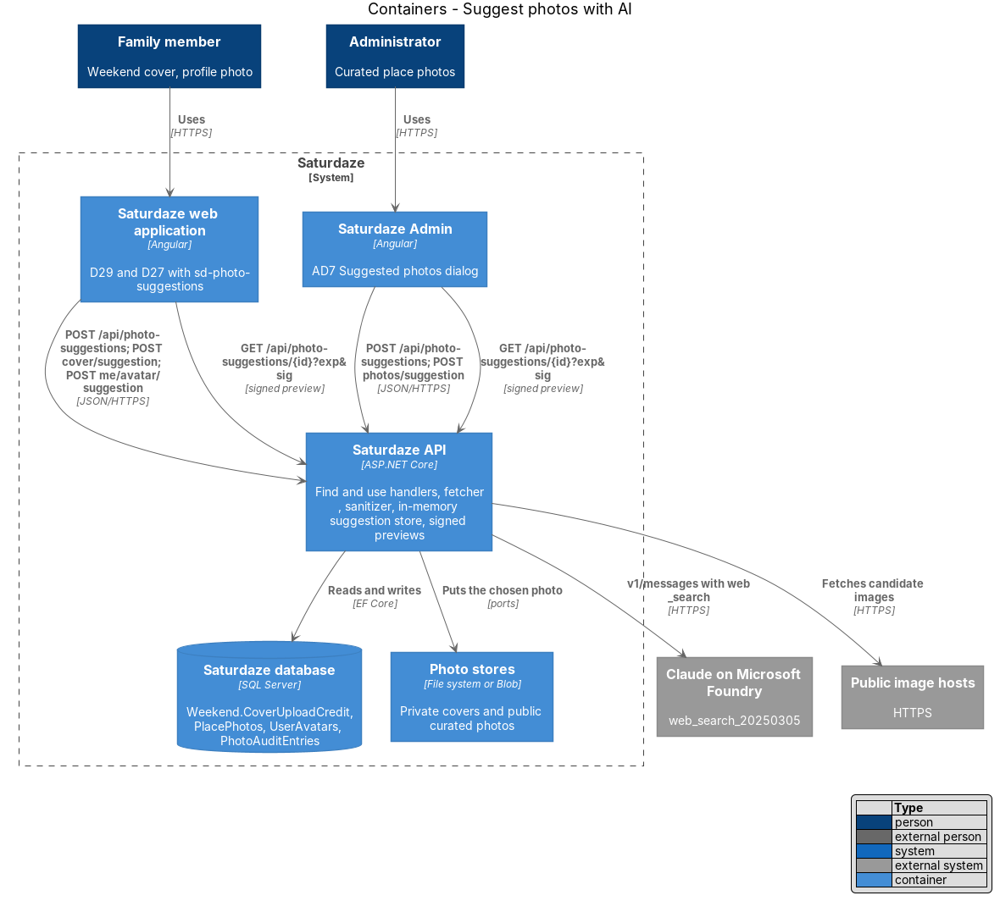
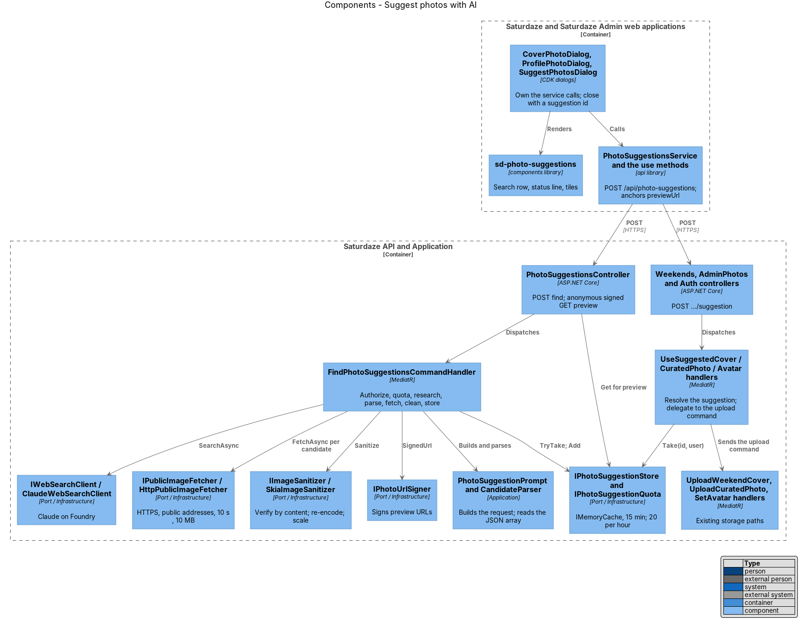
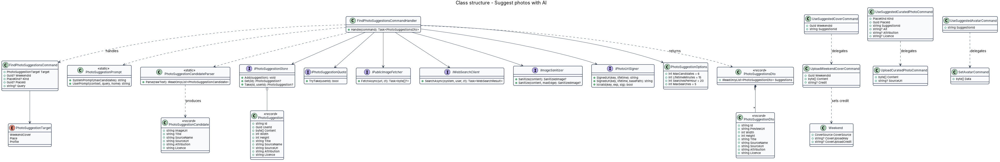
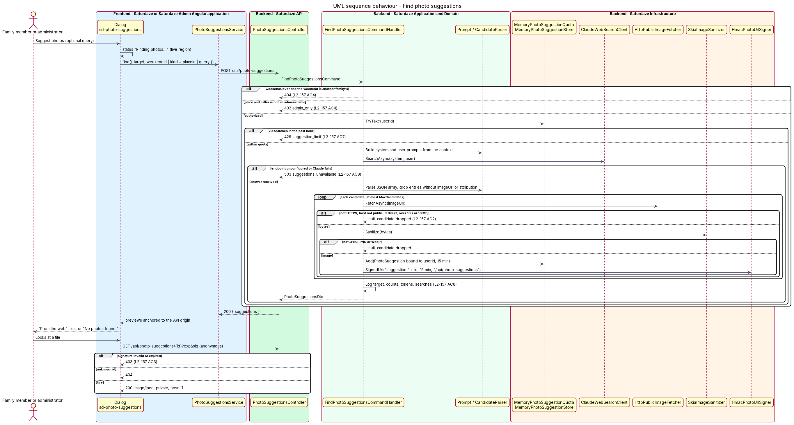
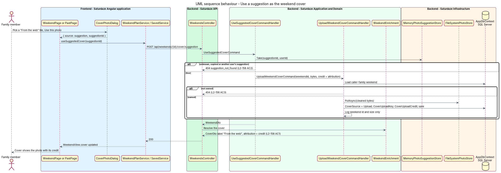
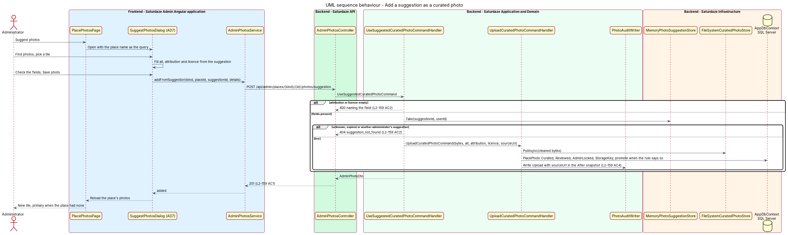
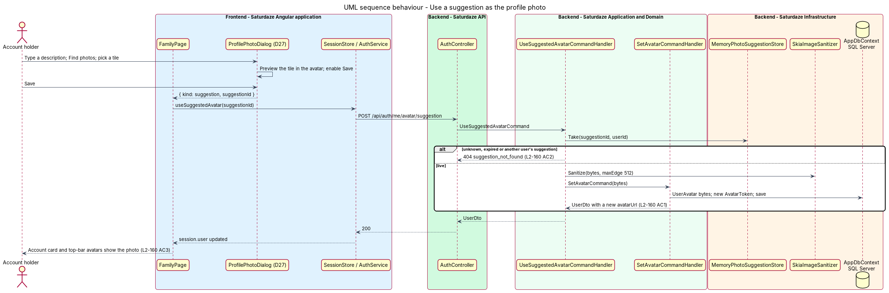

# Suggest photos with AI

## Overview

Saturdaze is a web application that plans personalized family weekends. Three screens let a person change a photo: the Weekend screen's cover (`weekend-planning/choose-weekend-cover-photo`, D29), the Family screen's profile photo (`identity-and-access/manage-profile-photo`, D27), and Saturdaze Admin's Place photos screen (`administration/manage-place-photos`, AD1 and AD2). Each of them accepts a file from the person's device; the admin screen also accepts an allow-listed URL. None of them helps find a photo.

This feature adds photo suggestions to all three. Claude, served through Microsoft Foundry (ADR-011), researches the web for licensed photographs that fit the context, the API fetches and cleans each candidate, and the person picks one from a grid that sits beside the existing choices (`docs/mocks/pages/dialogs.html` D29b, D27e, AD7). A chosen suggestion is stored through the same path as an upload, so the private store, the curated store, the signing, the sanitizer, the audit log and the cover rules stay as they are.

*suggestion* — one candidate photograph Claude found, fetched and cleaned by the API, held for 15 minutes under a random id bound to the person who asked

*candidate* — one entry in Claude's JSON answer: an image address, a title, a source name and page, an attribution and a licence

*target* — what the suggestion is for: `weekendCover`, `place` or `profile`; the target decides the research context and the authorization rule

*preview URL* — API-relative signed URL (`/api/photo-suggestions/{id}?exp=&sig=`) through which the browser loads a suggestion's cleaned image

*public address* — IP address outside the loopback, private, link-local, multicast and cloud-metadata ranges

*credit* — the attribution shown with a photo wherever it appears

The feature keeps two rules from ADR-015 and L2-101 intact. The family's browser loads images only from the API origin and the allow-listed origins, so the preview URL lives on the API and third-party hosts never see a family's requests. No image is hot-linked: the bytes a family or an administrator keeps are the bytes the API fetched, verified and re-encoded.

## Description

### Finding suggestions

`FindPhotoSuggestionsCommand(Target, WeekendId?, Kind?, PlaceId?, Query?)` lives in `Saturdaze.Application/PhotoSuggestions/`. `FindPhotoSuggestionsCommandValidator` enforces the target set, the 3 to 120 character `query` for `profile`, and the 120 character cap on every query. `FindPhotoSuggestionsCommandHandler` runs the slice in order:

1. **Authorization.** `weekendCover` loads the weekend through `ICurrentFamilyAccessor`, so another family's id is a 404 (L2-157 AC4). `place` requires `ICurrentUserAccessor.Role == Admin`, else `ForbiddenException` (`admin_only`). `profile` needs only a signed-in user.
2. **Quota.** `IPhotoSuggestionQuota.TryTake(userId)` allows 20 searches per rolling hour (`PhotoSuggestionOptions.SearchesPerHour`); a refusal is `TooManyRequestsException` (`suggestion_limit`), mapped to 429 by `ExceptionHandlingMiddleware`, and Claude is not called (AC7).
3. **Research.** `PhotoSuggestionPrompt` builds the system prompt and the user prompt. The context is the weekend's title and each stop's name and address, the place's name, kind and address, or the person's query; the family's home location (`HomeLocationOptions.Name`) anchors the search. The prompt asks for at most `MaxCandidates` (default 6) photographs from openly licensed or official sources, answered as a JSON array of `{ imageUrl, title, sourceName, sourceUrl, attribution, licence }`. The handler sends it through `IWebSearchClient`, the port `ingest-catalogs` already defines, so the API reuses `ClaudeWebSearchClient` with its retry and `pause_turn` handling. A `ClaudeApiException`, an unconfigured endpoint or any other failure of the client becomes `ServiceUnavailableException` (`suggestions_unavailable`), mapped to 503 (AC6).
4. **Parsing.** `PhotoSuggestionCandidateParser` finds the first JSON array in the answer, ignores code fences and prose, and drops entries without an `imageUrl` or an `attribution`. Claude's text goes no further than this step (AC2).
5. **Fetching.** For each candidate, `IPublicImageFetcher.FetchAsync(uri)` returns the bytes or null. `HttpPublicImageFetcher` accepts HTTPS only, resolves the host, refuses any address that is not public, connects to the resolved address so the check cannot be bypassed by a second DNS answer, follows no redirects, and reads at most 10 MB within 10 s. `IImageSanitizer.Sanitize` then verifies the bytes by content and re-encodes them to JPEG without metadata, as every upload is (AC2, AC3).
6. **Storing.** `IPhotoSuggestionStore.Add(PhotoSuggestion)` keeps the cleaned bytes with the candidate's text and the user's id for `LifetimeMinutes` (default 15) and returns the id. `MemoryPhotoSuggestionStore` uses `IMemoryCache` with an absolute expiry, so nothing is written to disk or the database.
7. **Response.** `PhotoSuggestionsDto(Suggestions)` lists `PhotoSuggestionDto(Id, PreviewUrl, Width, Height, Title, SourceName, SourceUrl, Attribution, Licence)`. `PreviewUrl` is `IPhotoUrlSigner.SignedUrl("suggestion:" + id, lifetime, "/api/photo-suggestions")`; the signer gains a base-path overload and keeps `IsValid` unchanged. The handler logs the target, the ids, the candidate and accepted counts, the token usage and the search count, never the bytes (AC8).

`PhotoSuggestionsController` exposes `POST /api/photo-suggestions` under the authenticated fallback policy and `GET /api/photo-suggestions/{id}` with `[AllowAnonymous]`, mirroring `PhotosController`: a missing or invalid signature is 403, an unknown or expired id is 404, and a valid one is served with `Cache-Control: private, max-age=300` and `X-Content-Type-Options: nosniff` (AC3).

`PhotoSuggestionOptions` (`Saturdaze:PhotoSuggestions`) holds `MaxCandidates`, `LifetimeMinutes`, `SearchesPerHour` and `MaxSearches`, the web-search budget per research request. The Claude client registration moves out of `AddIngestion` into `AddClaudeWebSearch`, which `AddInfrastructure` and `AddIngestion` both call, so the API host reads the same `Saturdaze:Ingestion:Claude` section and `ANTHROPIC_FOUNDRY_API_KEY` that `eng/infra/main.bicep` already writes for the ingestion WebJob (ADR-019).

### Using a suggestion

Each surface keeps its upload command and gains one command that resolves a suggestion and delegates to it. `IPhotoSuggestionStore.Take(id, userId)` returns the suggestion only when the id is live and bound to the caller, else the handler throws `NotFoundException` with code `suggestion_not_found`.

- **Weekend cover.** `POST /api/weekends/{id}/cover/suggestion` with `{ suggestionId }` dispatches `UseSuggestedCoverCommand`, which sends `UploadWeekendCoverCommand(weekendId, bytes, credit)` with the suggestion's attribution as the credit. `Weekend` gains `CoverUploadCredit` (nullable, 300 characters) through the migration `AddWeekendCoverUploadCredit`; the upload handler stores it and clears it for a device upload. `WeekendEnrichment` labels an upload with a credit "From the web" and uses the credit as the attribution; an upload without one keeps "Your photo" (L2-158 AC1). Past cards and the shared page inherit the label through `CoverDto`.
- **Curated place photo.** `POST /api/admin/places/{kind}/{id}/photos/suggestion` with `{ suggestionId, alt, attribution, licence }` dispatches `UseSuggestedCuratedPhotoCommand`, which sends `UploadCuratedPhotoCommand` with the bytes and the administrator's fields plus the suggestion's `sourceUrl`. The upload handler records `sourceUrl` in the audit snapshot when it is present (L2-159 AC4). The photo is stored in the curated store with `Source = Curated`, `ReviewState = Reviewed`, `AdminLocked = true` and its `StorageKey`, and it becomes primary under `PlacePhotoSet.ShouldPromoteCurated`.
- **Profile photo.** `POST /api/auth/me/avatar/suggestion` with `{ suggestionId }` dispatches `UseSuggestedAvatarCommand`, which scales the cleaned image to at most 512 px on the long edge through `IImageSanitizer.Sanitize(bytes, maxEdge)` and sends `SetAvatarCommand(bytes)`, so the 2 MB rule of L2-087 holds (L2-160 AC1).

### Frontend

`IPhotoSuggestionsService` and the `PHOTO_SUGGESTIONS_SERVICE` token live in the `api` library with `PhotoSuggestionsService`, which posts to `/api/photo-suggestions` and anchors each `previewUrl` to `API_BASE_URL`, as cover URLs are. `IWeekendPlanService` and `ISavedService` gain `useSuggestedCover(suggestionId)`, `IAdminPhotosService` gains `addFromSuggestion(kind, placeId, suggestionId, details)`, and `ISessionStore` gains `useSuggestedAvatar(suggestionId)`.

`sd-photo-suggestions` is a new `components` component that mirrors `.photo-suggest` in `docs/mocks/styles/app.css`: a search row (`sd-text-input` plus a quiet button with the sparkle icon), a status line with `role="status"` that reads "Finding photos…" with an `sd-spinner`, "{n} photos found on the web." or "No photos found. Try a different search.", an `sd-banner` for a failure, and an `sd-photo-pick` of `sd-photo-pick-option` tiles captioned with the source name. Its inputs are `label`, `placeholder`, `query`, `suggestions`, `state` (`idle | loading | done | error`), `selected`, `name` and `minQuery`; it emits `search(query)` and `picked(id)`. The dialogs own the service call so the component stays presentational and gets a story and a perf-test scenario (ADR-012, ADR-014).

`CoverPhotoDialog` renders `sd-photo-suggestions` under the stop photos with the heading "From the web" and an optional refinement query, keeps the stop and upload choices usable while a search runs or fails, and closes with `{ source: 'suggestion', suggestionId }`; the page calls `useSuggestedCover` (L2-158 AC4 to AC6). `PastPage` passes the same callback. `SuggestPhotosDialog` (AD7) is a new admin dialog opened by the "Suggest photos" header action: it prefills the query with the place name, requires a picked suggestion plus attribution and licence, fills the three fields from the pick, and calls `addFromSuggestion` (L2-159 AC5, AC6). `ProfilePhotoDialog` adds a "Find a photo" row whose button enables at 3 characters, previews a picked suggestion in the avatar, and closes with `{ kind: 'suggestion', suggestionId }` (L2-160 AC3, AC4).

Each dialog uses the two- and three-column `.photo-pick` grid, so suggestion tiles fit 390 px and 1440 px without horizontal scroll (L2-158 AC7, L2-160 AC5).

### Tests

API tests replace `IWebSearchClient` with `FakePhotoSuggestionSearch`, which records the prompts and answers with a scripted JSON array, and `IPublicImageFetcher` with `FakePublicImageFetcher`, which serves bytes per address and records what was asked for. `HttpPublicImageFetcher` has unit tests for the address rules with a resolver stub. Playwright specs stub `/api/photo-suggestions` and the `use` endpoints through the page objects of the three screens.

## Requirements

The following L2 requirements refine the cited L1 capabilities.

| L2 ID | Refines (L1) | Requirement |
|-------|--------------|-------------|
| `L2-157` | `L1-038`, `L1-012` | `POST /api/photo-suggestions` shall accept `{ target, weekendId?, kind?, placeId?, query? }` where `target` ∈ {`weekendCover`, `place`, `profile`}. For `weekendCover` the weekend shall belong to the caller's family; for `place` the caller shall be an administrator; for `profile` a `query` of 3 to 120 characters is required, and for the other targets `query` is an optional refinement. The handler shall build one research request naming the context and send it through the same Claude web-search client that ingestion uses, asking for at most `Saturdaze:PhotoSuggestions:MaxCandidates` (default 6) candidate images as JSON, preferring openly licensed or official-source photographs. For each candidate the server shall accept only an HTTPS `imageUrl` whose host resolves to a public address, fetch it once with a 10 s timeout and a 10 MB cap, verify it by content and re-encode it without metadata, and keep the result in a suggestion store for 15 minutes under a random id bound to the requesting user. The response shall list `{ id, previewUrl, width, height, title, sourceName, sourceUrl, attribution, licence }`; `previewUrl` shall be an API-relative signed URL that an anonymous `GET` serves while the signature is valid and that returns 403 after expiry or on a tampered signature. Candidates that fail any check shall be dropped silently. Claude's text shall never reach the client unparsed. A caller shall be allowed 20 searches per rolling hour. Logs shall record the target, the weekend or place id, the candidate and accepted counts, token usage and the search count, and never image content. |
| `L2-158` | `L1-038`, `L1-034` | The Cover photo dialog (D29) shall offer a "Suggest photos" action with an optional refinement field. While the search runs the dialog shall show a spinner and announce "Finding photos…" in a live region; on success it shall add one radio tile per suggestion, captioned with the source name, under a "From the web" heading; on an empty result it shall say "No photos found. Try a different search."; on failure it shall show the error banner and keep the stop and upload choices usable. Choosing a suggestion and "Use this photo" shall send `POST /api/weekends/{id}/cover/suggestion` with `{ suggestionId }`. The server shall store the suggestion's cleaned bytes exactly as a family upload and record the suggestion's attribution as `CoverUploadCredit`. The cover's label shall read "From the web" and its credit shall show the attribution; an upload without a credit keeps "Your photo". The same dialog shall offer suggestions from a Past card's "Add a photo". |
| `L2-159` | `L1-038`, `L1-036` | The Place photos screen shall gain a "Suggest photos" header action that opens the Suggested photos dialog (AD7): a search field prefilled with the place name, a "Find photos" button, the suggestion grid, and the alt text, attribution and licence fields of AD1. Picking a suggestion shall fill alt text, attribution and licence from it; the administrator may edit all three and Save shall stay disabled until a suggestion is chosen and attribution and licence are filled. Save shall send `POST /api/admin/places/{kind}/{id}/photos/suggestion` with `{ suggestionId, alt, attribution, licence }`. The server shall store the cleaned bytes in the curated store and save a `PlacePhoto` exactly as an upload does, promote it to primary under the upload rule, and write an audit entry whose `After` snapshot includes the suggestion's `sourceUrl`. |
| `L2-160` | `L1-038`, `L1-001` | The Profile photo dialog (D27) shall gain a "Find a photo" field: typing a description and pressing "Find photos" shall show suggestion tiles below the preview; picking one shall show it in the avatar preview and enable Save; Save shall send `POST /api/auth/me/avatar/suggestion` with `{ suggestionId }`. The server shall scale the suggestion's cleaned image to at most 512 px on its long edge, store it as the profile photo through the same path as an upload, and return the user with a new `avatarUrl`. |

## Diagrams

### System context

The context view adds Claude on Microsoft Foundry, which the API asks for candidates, and the public web hosts the API fetches images from; the family member, the administrator and the browser never reach those hosts.

### Containers

The container view shows the two Angular applications calling the API, the API calling Claude and the image hosts, and the suggestion store held in the API's memory; the chosen photo lands in the private store, the curated store or the avatar table.

### Components

The component view names the dialogs, the shared component, the controller actions, the find and use handlers, the prompt, the parser, the fetcher, the store, the quota and the Claude client.

### Class structure

The class view shows the command, the suggestion record and its store, the ports the handler depends on, and the three use commands that delegate to the existing upload commands.

### Behaviour — find suggestions

The sequence covers one search: authorization, the quota, the research request, parsing, the per-candidate fetch and clean, storage, and the signed preview, with the 403, 404, 429 and 503 alternates (`L2-157`).

### Behaviour — use a suggestion as the weekend cover

The family picks a "From the web" tile in D29; the use command resolves the suggestion and stores it as an upload with its credit (`L2-158`).

### Behaviour — add a suggestion as a curated photo

The administrator picks a tile in AD7, checks the attribution and licence, and saves; the photo enters the curated store and the audit log records the source page (`L2-159`).

### Behaviour — use a suggestion as the profile photo

The user describes a photo in D27, picks a tile and saves; the use command scales the image and stores it as the avatar (`L2-160`).

