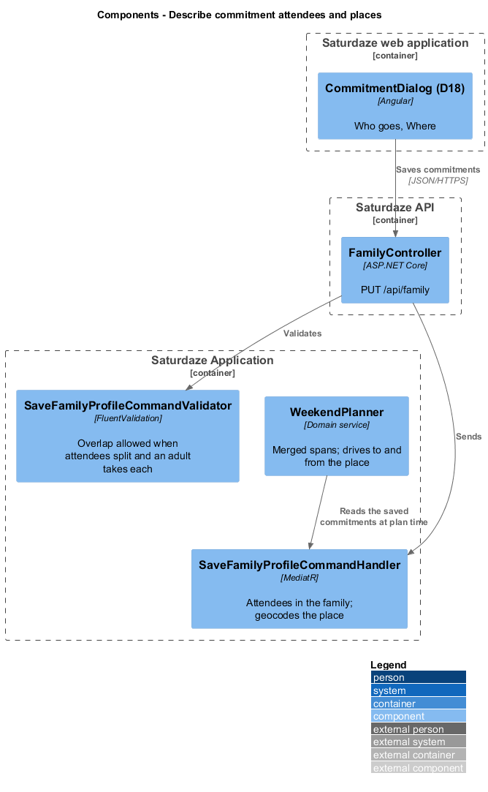
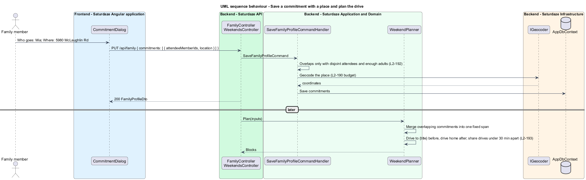

# Describe commitment attendees and places

## Overview

Saturdaze is a web application that plans personalized family weekends. A *commitment* is a recurring weekly event the plan goes around, such as swim lessons or church (`family-profile/materialize-commitments`, L2-011). Until now a commitment was family-wide and had no place. Two consequences followed. Two children's overlapping swims could not be saved, though two parents could split them. And the plan never drove to Heartland and back (`docs/schedule-generation-evaluation.md`, runs 14, 15 and 21). This design adds who goes and where.

*attendees* — the family members a commitment is for; none means everyone

*split* — overlapping commitments with different attendees, each taken by a different adult

*commitment drive* — a drive block to or from a commitment's place, planned with the weekend

## Description

`Commitment` gains `AttendeeMemberIds` (a list of member ids stored as JSON) and `Location` (an owned `GeoLocation`, nullable), both in the migration `AddPlanningBoundaries`. `SaveCommitmentInput` and `CommitmentDto` gain `AttendeeMemberIds` and `Location` (`{ address, latitude?, longitude? }`).

`SaveFamilyProfileCommandValidator.NoOverlapWithinSameDay` becomes `OverlapsAreSplittable`. On each day, a group of commitments running at once is allowed only when every one names attendees, no member appears twice, and the group is no larger than the family's adult count. Adults are members aged 18 or older, counted from the request's members when supplied and otherwise from the stored family. The validator cannot read the stored family, so `SaveFamilyProfileCommandHandler` repeats the check with the stored adults and answers the same 400 message (L2-192). The handler also refuses attendee ids that are not members of the family. When a location has an address but no coordinates, the handler geocodes it with `IGeocoder` under the 5-second budget (`family-profile/set-planning-boundaries`). Unlike home, a commitment's place is only useful with coordinates, so an address the geocoder cannot resolve answers 400 on `Commitments[i].Location` rather than saving the commitment without its place (L2-192 AC7); the commitment dialog shows the message under Where.

In the planner (`weekend-planning/fit-plans-to-the-family`), each commitment becomes its own locked block, and the fixed-block overlap check accepts the overlaps the save allowed. Gap computation runs over the union of fixed spans, so no activity, meal or errand lands inside a split. `CommitmentDrives` adds the drive blocks of L2-193 from `FamilyDriveTime`, sharing them between commitments at the same coordinates less than 30 minutes apart. `ItineraryBlock` carries no attendee field. The weekend page reads the commitment's attendees from the profile it already loads and shows them under the block ("Mia, Ava").

`CommitmentDialog` (D18, D18b) adds the "Who goes" checkboxes (one `sd-checkbox` per member) and the optional "Where" `sd-text-input`, as drawn in `docs/mocks/pages/dialogs.html`. The commitments list on `/family` shows "{day} · {start} to {end} · {attendees} · {address}".

## Requirements

The following L2 requirements refine the cited L1 capabilities.

| L2 ID | Refines (L1) | Requirement |
|-------|--------------|-------------|
| `L2-192` | `L1-041`, `L1-002` | A commitment shall carry `attendeeMemberIds` (empty means everyone) and an optional `location`; same-day commitments may overlap only when both name attendees, the attendee sets are disjoint, and the family has at least as many adults as commitments at once, otherwise 400; attendee ids outside the family shall answer 400; the planner shall treat overlapping commitments as one fixed span. |
| `L2-193` | `L1-041`, `L1-003` | For a commitment with coordinates, the planner shall add "Drive to {title}" before it and "Drive home from {title}" after it, shared between consecutive commitments at the same place less than 30 minutes apart, never overlapping another fixed block. |
| `L2-197` | `L1-041`, `L1-002`, `L1-011`, `L1-014` | The commitment dialog (D18, D18b) shall add "Who goes" (none ticked means everyone) and an optional "Where" address, saved through `PUT /api/family`. |

## Diagrams

The context and container views are those of `family-profile/manage-family-profile`.

### Components

The component view shows the dialog saving commitments through the controller, the validator and handler that allow only splittable overlaps, and the planner that reads the saved commitments at plan time.

### Behaviour — save a commitment with a place and plan the drive

This sequence traces `L2-192` and `L2-193`: the split check, the geocoded place, and the drives the planner adds around the commitment.

