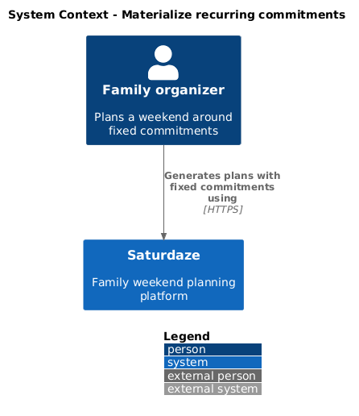
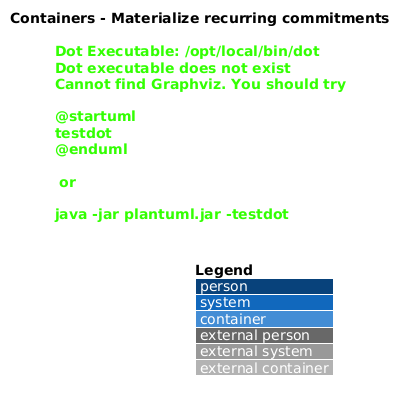
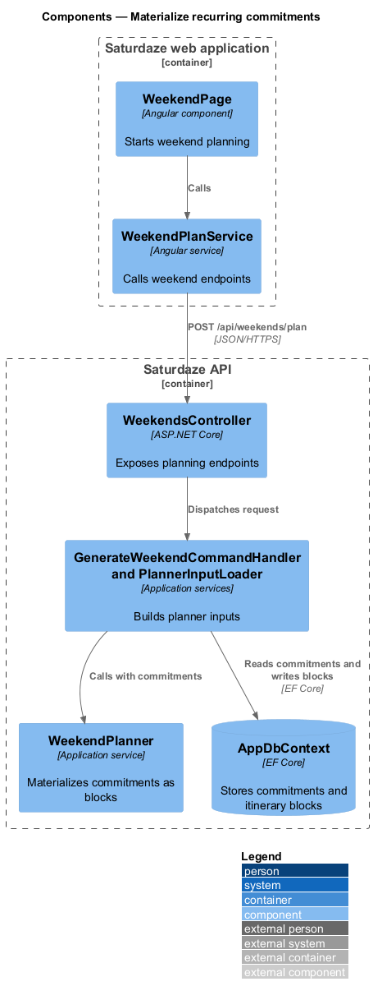
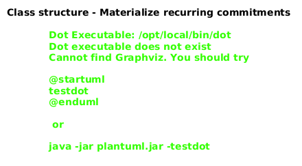
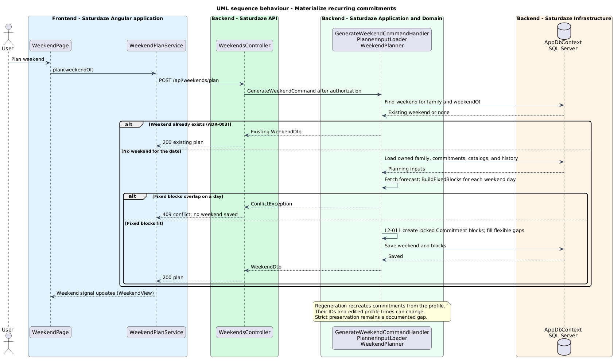

# Materialize recurring commitments

## Overview

Saturdaze is a web application that plans personalized family weekends. Recurring commitments reserve fixed time windows before flexible activities, meals, errands, and downtime are placed.

*commitment block* — itinerary block derived from a recurring family commitment

`WeekendPlanner.BuildFixedBlocks()` converts matching Saturday and Sunday commitments before computing free gaps. The generated block uses the current profile's commitment title and time window.

## Description

`FamilyPage` and `CommitmentDialog` maintain single-day weekly commitments. `WeekendPage` requests planning through `WeekendPlanService` and `WeekendsController`.

`PlannerInputLoader` loads the family and planning inputs. `WeekendPlanner.BuildFixedBlocks()` selects commitments matching Saturday or Sunday and creates locked Commitment blocks at their configured local times.

`GenerateWeekendCommandHandler` returns the existing weekend unchanged when one already exists for the family and date (ADR-003). `WeekendPlanner` throws `ConflictException` when fixed blocks overlap on one day; the API returns 409 and persists no weekend. `SaveFamilyProfileCommandValidator` rejects overlapping same-day commitments before they reach the profile.

`LockBlockCommandHandler` returns 409 `commitment_locked` when asked to unlock a commitment. `LockWeekendDayCommandHandler` also preserves commitment locks.

Regeneration carries existing commitment blocks over as locked blocks, so their IDs and time windows survive (L2-011 AC2, L2-016 AC1). `BuildFixedBlocks()` materializes a profile commitment only when no carried-over commitment block on that day has the same title or an overlapping window; a commitment edited in the profile therefore takes effect on newly generated weekends, while an already planned weekend keeps the block it had.

Calendar commitments (L2-169) join the same path. `PlannerInputLoader` adds the weekend's events from the family's connected Google Calendars (`ICalendarCommitmentSource`, designed in `weekend-planning/sync-weekend-to-calendar`) to `PlannerInputs.CalendarCommitments`. `BuildFixedBlocks()` places them last: after the profile commitments and the carried-over locked blocks, each calendar commitment that does not overlap a block already placed that day becomes a locked `Commitment` block with `FromCalendar = true`, titled with the event's summary. An event that overlaps a profile commitment is left out, so the profile commitment wins and `EnsureNoOverlap()` never raises a conflict for a calendar event. Calendar blocks are carried over on regeneration like profile commitment blocks, so a calendar change takes effect on a newly generated weekend.

## Requirements

The following L2 requirements refine the cited L1 capabilities. Implementation gaps stated in Description do not waive these obligations.

| L2 ID | Refines (L1) | Requirement |
|-------|--------------|-------------|
| `L2-011` | `L1-002`, `L1-004` | Every `Commitment` on the family profile shall materialize as a locked itinerary block on every generated weekend at the commitment's day and time window. |
| `L2-169` | `L1-039`, `L1-002`, `L1-003`, `L1-004` | When the planner loads a family's inputs for a weekend (generate, regenerate, regenerate a day, swap), it shall read, from every connection in the family that is `connected` and has "plan around my calendar" on, the events of that account's primary calendar between Saturday 00:00 and Monday 00:00 in the configured time zone, with recurring events expanded. All-day events, cancelled events, events the person has declined, events marked "free" (transparent) and events Saturdaze wrote (L2-168) shall be left out. Each remaining event shall be split by day, clipped to the planner's day (9:00 to 21:00), and dropped when nothing is left. The result shall join the planner's fixed blocks through `WeekendPlanner.BuildFixedBlocks()`, after the profile commitments (L2-011) and the carried-over locked blocks: an event that overlaps any fixed block already placed that day (a profile commitment, a locked block or an earlier event) shall be left out, so profile commitments win and fixed blocks never overlap. Each event shall become a locked commitment block whose title is the event's summary (or "Busy" when it has none, truncated to 160 characters) and which is marked as coming from a calendar. Such blocks behave as commitment blocks (L2-011): they cannot be unlocked or swapped, and regeneration carries them over, so a calendar change takes effect on a newly generated weekend. The weekend page shall show such a block with the "Commitment" chip and a "Calendar" chip and the line "From your calendar · planned around". The share link's projection (L2-086) shall title such a block "Busy". A read that fails shall not fail or delay planning beyond 5 seconds (L2-170). (Added 2026-10-20.) |

## Diagrams

### System context

The context view identifies the family member using the capability and the Saturdaze system that owns the weekend state.

### Containers

The container view follows the interaction from the Angular web application through the API to SQL Server.

### Components

The component view names the page, client service, controller, handler, domain type, and persistence boundary involved in the slice.

### Class structure

The class view shows the request path and the state relationships used by the feature.

### Behaviour — reserve commitment time

The sequence view traces the primary behaviour to `L2-011`. Its alternate path preserves valid existing state when the request cannot proceed.

