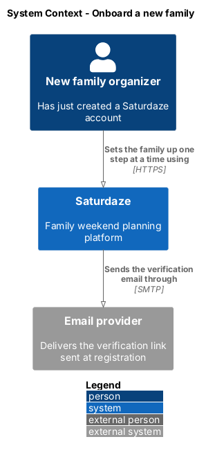
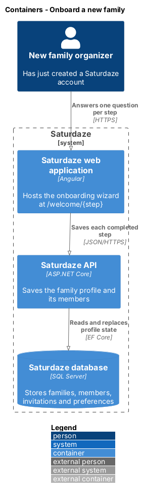
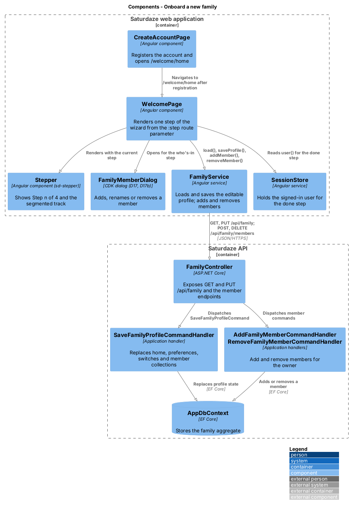
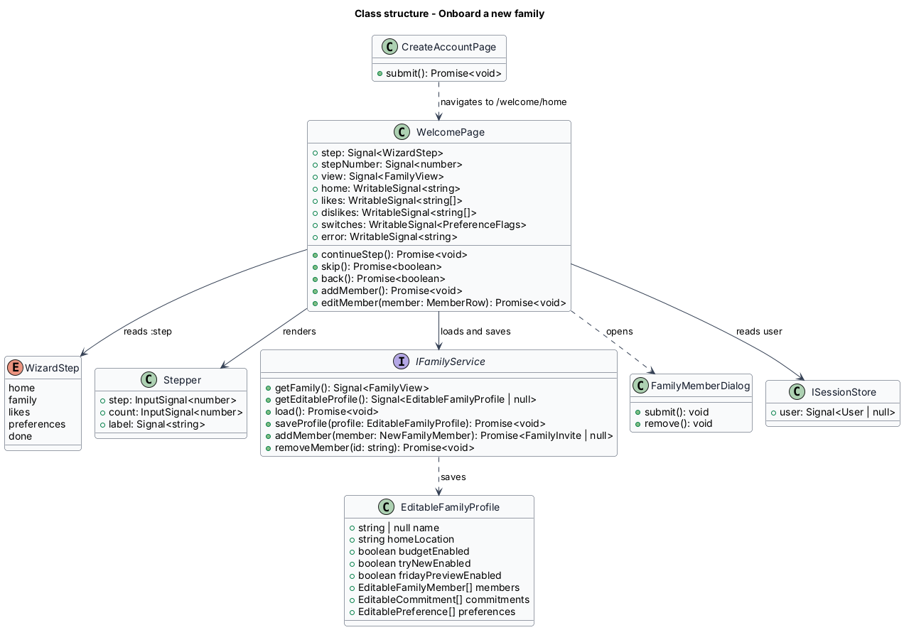
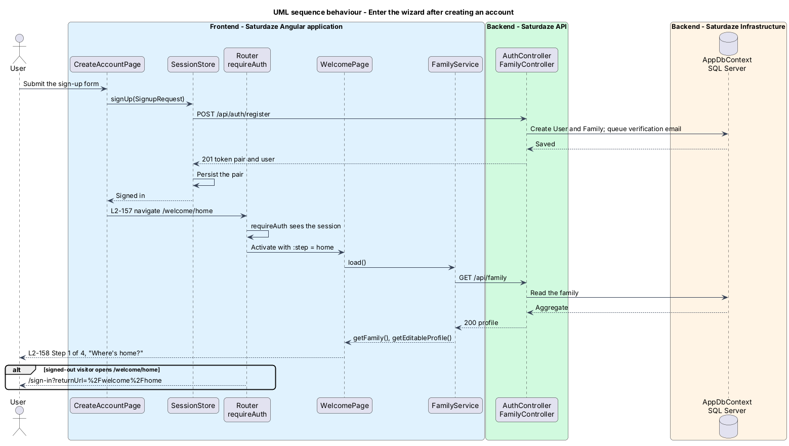
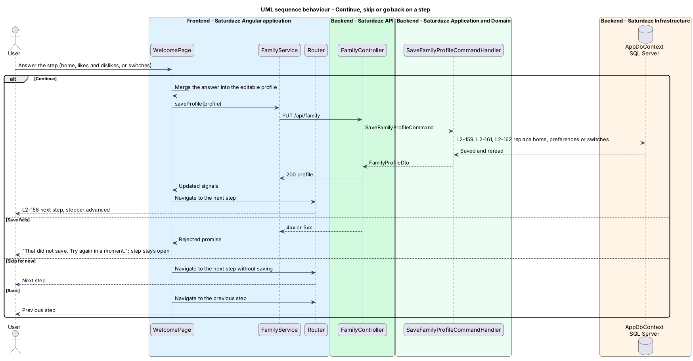
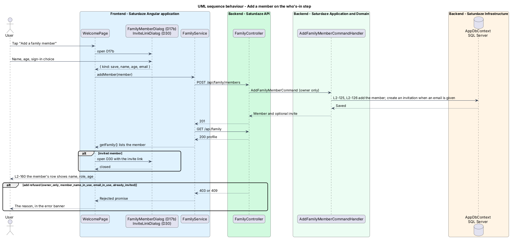
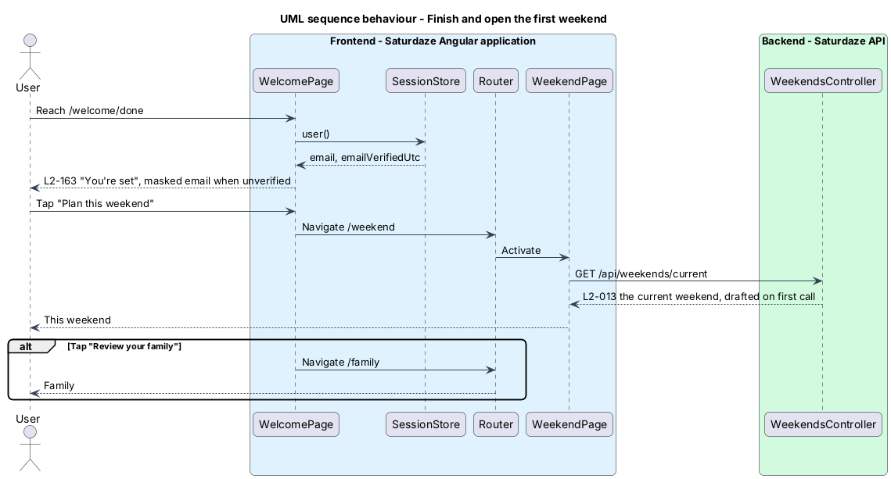

# Onboard a new family

## Overview

Saturdaze is a web application that plans personalized family weekends. Every plan is drawn from the family profile: where home is, who is in the family and how old they are, what the family likes and dislikes, and three planning switches. A family that creates an account and never fills that profile in receives a weekend planned around nothing.

*onboarding wizard* — sequence of single-focus screens, reached right after an account is created, that fills the family profile one question at a time

The wizard lives at `/welcome/{step}` in the bare shell used by the auth screens: one centred card per step, a stepper reading "Step n of 4" above it, and no top bar or bottom navigation. Its four steps are home, who's in, likes and dislikes, and preferences; a fifth screen, done, sends the family to its first weekend. Each step saves as soon as it is completed, so the person can stop at any point and still find what they entered on `/family`. "Skip for now" moves on without saving, "Back" returns to the previous step, and the browser's Back button does the same because each step is a route.

This feature introduces no API endpoint. It reuses the profile save (`PUT /api/family`, L2-010) and the member endpoints (`POST` and `DELETE /api/family/members`, L2-125 to L2-128), so the Family page and the wizard write the same records through the same rules.

## Description

`CreateAccountPage` at `/create-account` keeps its form and its call to `SessionStore.signUp()`. On success it navigates to `/welcome/home` instead of `/verify-email` (L2-157). The verification email is still queued at registration (L2-142); `/verify-email` keeps serving the emailed link and the resend flow (L2-006).

`WelcomePage` is routed at `welcome/:step` with route data `{ shell: 'bare', page: 'welcome' }` and the `requireAuth` guard; `welcome` with no step redirects to `welcome/home`. The component reads the `step` parameter as a signal, maps an unknown value to `home`, and renders one of five templates with a `@switch`. Each template is an `sd-auth-shell` holding an `sd-stepper` (steps 1 to 4) and an `sd-auth-card`. The page also stamps `data-page="welcome"` on `<body>` through the shell's route data, which the e2e page object anchors on.

`Stepper` (`sd-stepper`, in the `components` library) takes `step` and `count` (default 4). It renders the text "Step n of N" and an `aria-hidden` track of `count` segments, carrying `.stepper`, `.stepper__label`, `.stepper__track` and `.stepper__seg` (`--done`, `--current`) from `docs/mocks/styles/app.css`. The track is decoration; the text is the accessible progress (L2-158 AC5).

`WelcomePage` depends on `FAMILY_SERVICE` for `load()`, `getFamily()`, `getEditableProfile()`, `saveProfile()`, `addMember()` and `removeMember()`, on `SESSION_STORE` for the signed-in user, and on the CDK `Dialog` for `FamilyMemberDialog` (D17 and D17b), `InviteLinkDialog` (D30) and the D21 confirmation. The page loads the family on construction and seeds each step's local state from the editable profile the first time that step renders: the home field from `homeLocation`, the two tag editors from the `Like` and `Dislike` preferences, the switches from the three flags.

Continue on the home, likes and preferences steps merges the step's answer into the editable profile and calls `saveProfile()`, which sends the full editable profile to `PUT /api/family`; the server replaces the collection the step changed and keeps the rest (L2-159, L2-161, L2-162). The home step keeps Continue disabled while its field is blank. A rejected save leaves the step open and shows "That did not save. Try again in a moment." in an `sd-banner`. Continue on the who's-in step saves nothing: members were already saved as they were added (L2-160).

The who's-in step lists the family's members as on `/family`, through `MemberRow` (name, role and age subtitle, invite status). "Add a family member" opens D17b; the result goes to `addMember()`, which posts the member, reloads the family and returns the invite when an email was given, in which case the page opens D30. Tapping a row opens D17; a rename or re-age goes through `saveProfile()` with the member replaced in `members`, and Remove opens D21 and then calls `removeMember()`. The owner-only, duplicate-name, email-in-use and already-invited refusals surface in the banner with the same copy as the Family page.

The done step reads `user()` from `SESSION_STORE`. While `emailVerifiedUtc` is null, the subtitle names the masked email (`maskEmail`, as on `/verify-email`) and says the link works for 24 hours; once verified, it only says the first weekend is ready. "Plan this weekend" opens `/weekend`, where the current weekend is drafted on first visit (L2-013); "Review your family" opens `/family` (L2-163).

The wizard has no notion of completion. A signed-in person may open `/welcome/home` again at any time and walk through the steps with their current values prefilled; nothing redirects a family that skipped it back into it.

## Requirements

The following L2 requirements refine the cited L1 capabilities. Implementation gaps stated in Description do not waive these obligations.

| L2 ID | Refines (L1) | Requirement |
|-------|--------------|-------------|
| `L2-157` | `L1-038` | A successful sign-up on `/create-account` shall land on the first step of the onboarding wizard, `/welcome/home`, signed in, instead of on `/verify-email`. Registration shall still create the family and send the verification email (L2-001, L2-142). |
| `L2-158` | `L1-038` | The wizard lives at `/welcome/{step}` for the steps `home`, `family`, `likes`, `preferences` and `done`, rendered in the bare shell as one centred card per step. Every step except `done` shows a stepper reading "Step n of 4" with four segments. Every step offers "Continue"; steps 2 to 4 offer "Back"; steps 1 to 4 offer "Skip for now", which moves on without saving. |
| `L2-159` | `L1-038` | Step 1, "Where's home?", asks for the neighbourhood or address weather and drive times start from, prefilled with the family's current home location. "Continue" saves it through `PUT /api/family` and moves to step 2. |
| `L2-160` | `L1-038` | Step 2, "Who's in?", lists the family's members and offers "Add a family member", which opens the add-member dialog D17b. An added member is saved at once through `POST /api/family/members`; an invited member's link shows in D30. Tapping a member opens D17 to rename or re-age them or remove them. "Continue" moves on; nothing further is saved on it. |
| `L2-161` | `L1-038` | Step 3, "What does your family like?", offers the Likes and Dislikes tag editors from D20. "Continue" saves them as the family's `Like` and `Dislike` preferences through `PUT /api/family` and moves to step 4. |
| `L2-162` | `L1-038` | Step 4, "A few preferences", shows the three switches from the Family page at their current values. "Continue" saves them through `PUT /api/family` and opens the done step. |
| `L2-163` | `L1-038` | The last screen, "You're set", tells the person their first weekend is ready and reminds them to verify their email from the link already sent. "Plan this weekend" opens `/weekend`; "Review your family" opens `/family`. |

## Diagrams

### System context

The context view places the new family organizer, the Saturdaze system and the email provider that carries the verification link sent at registration.

### Containers

The container view follows each completed step from the Angular web application through the API to SQL Server.

### Components

The component view names the sign-up page that opens the wizard, the wizard page and its stepper, the member dialog, the two client services and the controller and handlers the saves reach.

### Class structure

The class view shows the wizard's step enumeration, the page's signals and actions, the stepper's inputs, and the family service contract the page saves through.

### Behaviour — enter the wizard after creating an account

The sequence traces `L2-157`: registration persists the session, the router sends the new account to `/welcome/home`, and the page loads the family before showing step 1 (`L2-158`). Its alternate path shows the guard sending a signed-out visitor to sign in.

### Behaviour — continue, skip or go back on a step

The sequence traces the saving steps (`L2-159`, `L2-161`, `L2-162`): Continue merges the answer into the editable profile and replaces it through `PUT /api/family`, a failed save keeps the step open, and Skip and Back only navigate.

### Behaviour — add a member on the who's-in step

The sequence traces `L2-160`: D17b posts the member through the member endpoint, the family is reloaded, an invited member's link opens D30, and a refusal reaches the banner.

### Behaviour — finish and open the first weekend

The sequence traces `L2-163`: the done step reads the signed-in user to decide whether to mention verification, and "Plan this weekend" opens the Weekend screen, whose first request drafts the weekend (`L2-013`).

