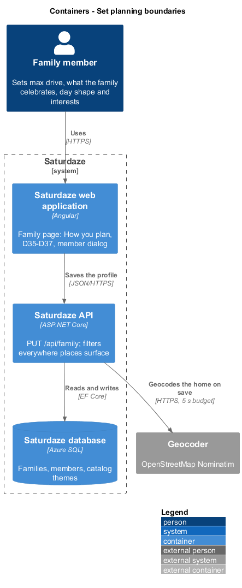
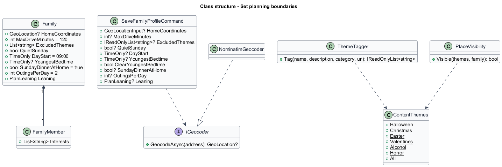
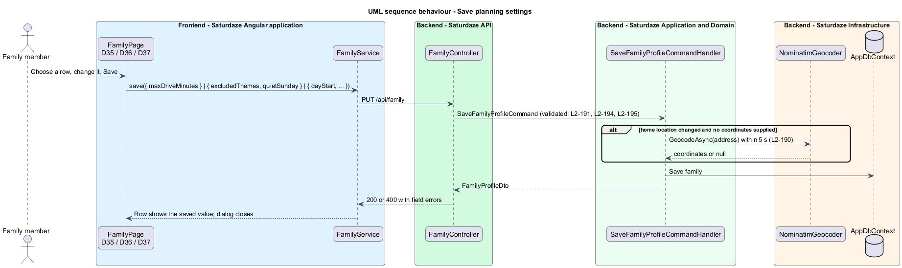

# Set planning boundaries

## Overview

Saturdaze is a web application that plans personalized family weekends. The family profile (`family-profile/manage-family-profile`) holds who the family is and what it likes. This design adds the settings the evaluation family could not express (`docs/schedule-generation-evaluation.md`, "Configuration gaps"): a home that is geocoded, so drives and weather start from it; how far the family will drive; what it does not celebrate; the shape of its day; and what each member is into. The planner (`weekend-planning/fit-plans-to-the-family`) and the agents (`weekend-planning/plan-with-agents`) both keep to them.

*excluded theme* — a content theme from a fixed vocabulary (`halloween`, `christmas`, `easter`, `valentines`, `alcohol`, `horror`) that the family does not want planned or listed

*theme tag* — a theme attached to a catalog place by ingestion or by `ThemeTagger`

*quiet Sunday* — at most one outing on Sunday, for worship and rest

*leaning* — the family's indoor or outdoor preference (`Either`, `Indoor`, `Outdoor`)

## Description

### Model

`Family` gains these fields:
- `MaxDriveMinutes` (int, default 120);
- `ExcludedThemes` (a string list stored as JSON, like `Activity.WeatherTags`);
- `QuietSunday` (bool);
- `DayStart` (time, default 09:00);
- `YoungestBedtime` (time, nullable);
- `SundayDinnerAtHome` (bool, default true);
- `OutingsPerDay` (int, default 2);
- `Leaning` (`PlanLeaning`, default `Either`).

`FamilyMember` gains `Interests` (string list as JSON). `ContentThemes` (Domain) defines the vocabulary. The migration `AddPlanningBoundaries` adds the columns with their defaults, so existing families keep today's behaviour apart from Sunday dinner (L2-187).

`FamilyProfileDto` carries `homeCoordinates`, `maxDriveMinutes`, `excludedThemes`, `quietSunday`, `dayStart`, `youngestBedtime`, `sundayDinnerAtHome`, `outingsPerDay`, `leaning`, and each member's `interests`.

### Saving

`SaveFamilyProfileCommand` takes each new field as optional (a partial save, L2-010): `HomeCoordinates`, `MaxDriveMinutes`, `ExcludedThemes`, `QuietSunday`, `DayStart`, `YoungestBedtime` with `ClearYoungestBedtime`, `SundayDinnerAtHome`, `OutingsPerDay` and `Leaning`. `SaveMemberInput` gains `Interests`.

`SaveFamilyProfileCommandValidator` enforces:
- `MaxDriveMinutes` 15–240;
- themes in the vocabulary;
- `DayStart` 07:00–11:00 on the half hour;
- `YoungestBedtime` 18:00–22:00 on the half hour;
- `OutingsPerDay` 1–3;
- at most 8 interests of 1–40 characters, unique per member.

When the home text changes and no coordinates came with it, `SaveFamilyProfileCommandHandler` calls `IGeocoder.GeocodeAsync(text)` under a 5-second token. A result sets `HomeCoordinates`; null or an error keeps the previous value (L2-190).

`NominatimGeocoder` (Infrastructure, named `HttpClient` `geocoder`) calls `https://nominatim.openstreetmap.org/search?format=jsonv2&limit=1&countrycodes=ca&q=…` with a `User-Agent` naming Saturdaze and a contact. It respects the service's one-request-per-second policy with a `SemaphoreSlim` and 1-second spacing, and is used only on profile saves. `Saturdaze:Geocoding:Enabled=false` swaps in `NullGeocoder`. Tests replace `IGeocoder` with `FakeGeocoder`.

### Where the boundaries apply

- **Drive times.** `FamilyDriveTime.Minutes(home, place, fallback)` replaces the stored `DriveMinutes` in `PlannerInputLoader`, `GetActivitySuggestionsQueryHandler`, `GetLocalEventsQueryHandler` and `IdeaResolver`. The weekend forecast is fetched for the family's home: `WeekendForecastService.GetAsync(weekendOf, home)`.
- **Max drive (L2-191).** The planner's `CandidateFilter` and restaurant choice keep to it. `GET /api/activities` and `GET /api/events` use `min(query, family)` when a query value is given. Ideas preview and add answer 409 `beyond_max_drive`.
- **Themes (L2-194).** `PlaceVisibility.Visible(themes, family)` hides a place carrying an excluded theme. The planner and both list endpoints use it, Ideas answers 409 `excluded_theme`, and the agents' tools use it. `ThemeTagger.Tag(name, description, category, url)` adds keyword-matched themes on seed, ingestion and upsert. The `halloween` keywords are listed in L2-194. The other themes have their own lists in `ThemeTagger`.
- **Day shape and pace (L2-195).** These reach the planner as `PlannerProfile`.
- **Interests and likes (L2-196).** The planner scores them.

### Family page

`FamilyPage` adds the "How you plan" section after "Preferences", as drawn in `docs/mocks/pages/family.html`. Its rows open three CDK dialogs:
- `MaxDriveDialog` (D35): a select with 30 min, 45 min, 1 h, 1 h 30, 2 h, 3 h.
- `CelebrationsDialog` (D36): `sd-checkbox` groups "We don't celebrate" and "Leave out", and the "Keep Sunday quiet" `sd-toggle`.
- `DayShapeDialog` (D37): selects for day start and bedtime, `sd-seg-radio` for outings and leaning, and the "Sunday dinner at home" toggle.

Each dialog returns its value. The page saves it through `FamilyService.save()` (`PUT /api/family`) and shows the row value: "Up to 2 h each way", "Not Halloween · quiet Sunday", "Starts 9:00 · 2 outings a day". A 400 shows the field error inside the dialog. `FamilyMemberDialog` adds the "Interests" `sd-chip-input`, up to 8. `FamilyPage` page-object methods drive the e2e specs.

## Requirements

The following L2 requirements refine the cited L1 capabilities.

| L2 ID | Refines (L1) | Requirement |
|-------|--------------|-------------|
| `L2-190` | `L1-041`, `L1-002`, `L1-009` | Saving the home location shall geocode it through `IGeocoder` and store `HomeCoordinates` (failures keep the previous value; 5-second budget); drive times shall be computed per family from home to place with `TravelEstimator`, falling back to the stored `DriveMinutes`; the forecast and daylight shall be for the family's home. |
| `L2-191` | `L1-041`, `L1-002`, `L1-005`, `L1-007` | The profile shall hold `maxDriveMinutes` (15–240, default 120); the planner shall not exceed it; the activity and event lists shall use the family's limit (or the smaller of it and the query value); adding an idea beyond it shall answer 409 `beyond_max_drive`. |
| `L2-194` | `L1-041`, `L1-002`, `L1-005`, `L1-007` | The profile shall hold `excludedThemes` from a fixed vocabulary; places shall carry `themes` from ingestion and `ThemeTagger`; a place with an excluded theme shall not be planned, listed, placed through Ideas (409 `excluded_theme`) or offered to the agents; an "Indoor" or "Outdoor" dislike shall match the indoor flag. |
| `L2-195` | `L1-041`, `L1-002`, `L1-003` | The profile shall hold `dayStart`, `youngestBedtime`, `sundayDinnerAtHome`, `outingsPerDay`, `quietSunday` and `leaning`; the planner's day and Sunday wind-down shall follow them; out-of-range values shall answer 400. |
| `L2-196` | `L1-041`, `L1-002`, `L1-003` | Members shall carry up to 8 interests; likes shall add 3 and member interests 2 per match. |
| `L2-197` | `L1-041`, `L1-002`, `L1-011`, `L1-014` | `/family` shall show "How you plan" with "Max drive" (D35), "What you celebrate" (D36) and "Day shape" (D37), each a CDK dialog saving through `PUT /api/family`; the commitment and member dialogs shall gain "Who goes", "Where" and "Interests"; no horizontal scroll at 390 px and 1440 px. |

## Diagrams

The context view is that of `family-profile/manage-family-profile`, with the geocoder added as an external system in the container view below.

### Containers

The container view shows the family page saving the profile to the API, which geocodes the home within its budget and stores the settings in Azure SQL.

### Class structure

The class view shows the new family and member fields, the save command's optional parts, the geocoder port and its Nominatim adapter, and the theme vocabulary with its tagger and visibility rule.

### Behaviour — save planning settings

This sequence traces `L2-190` → `L2-197`: a dialog's value saved through `PUT /api/family`, validated, geocoded when the home changed, and shown back in its row.

