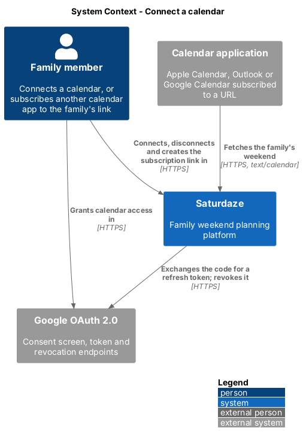
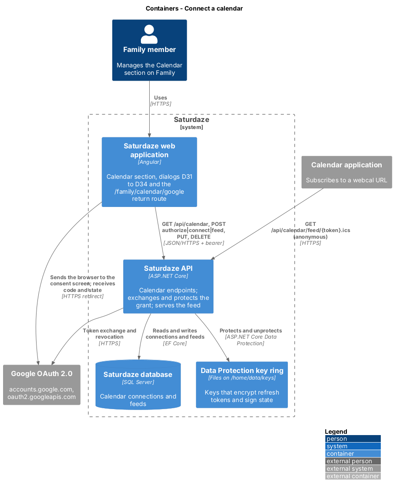
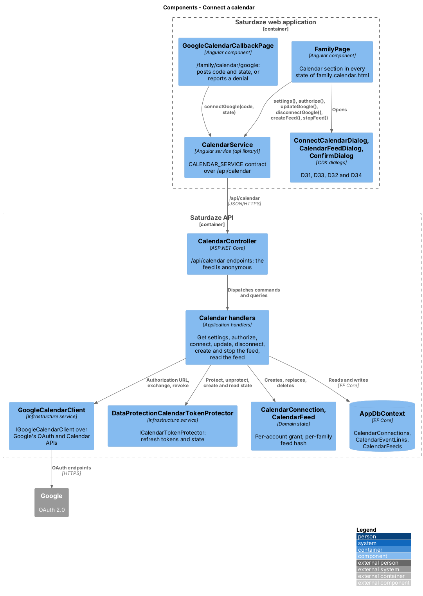
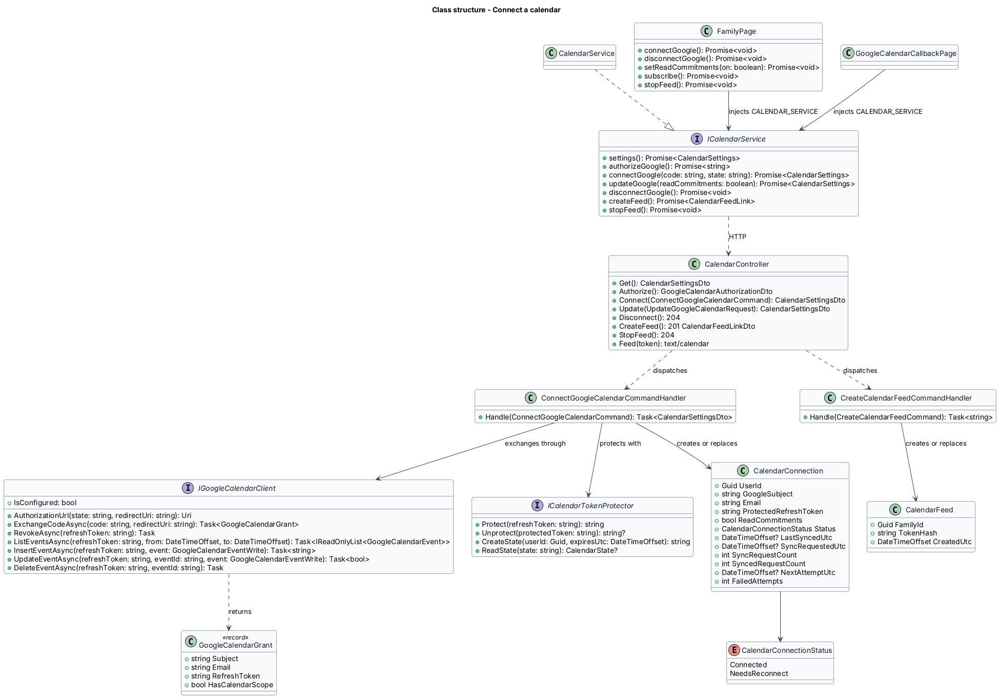
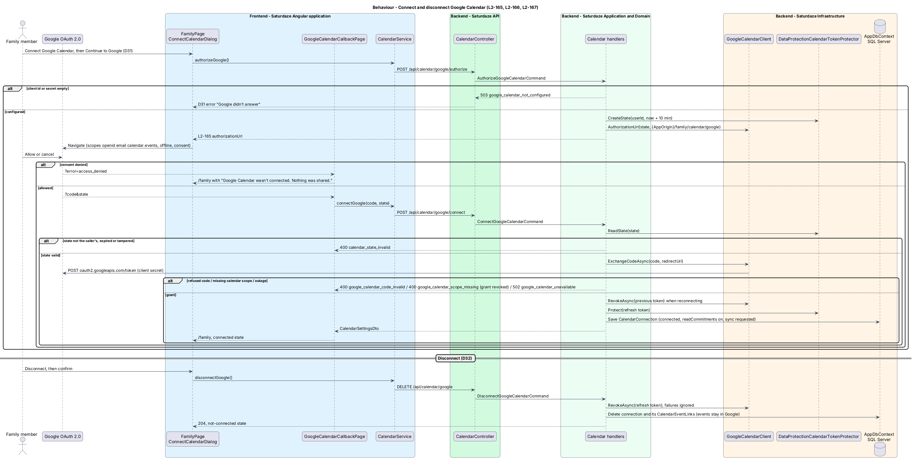
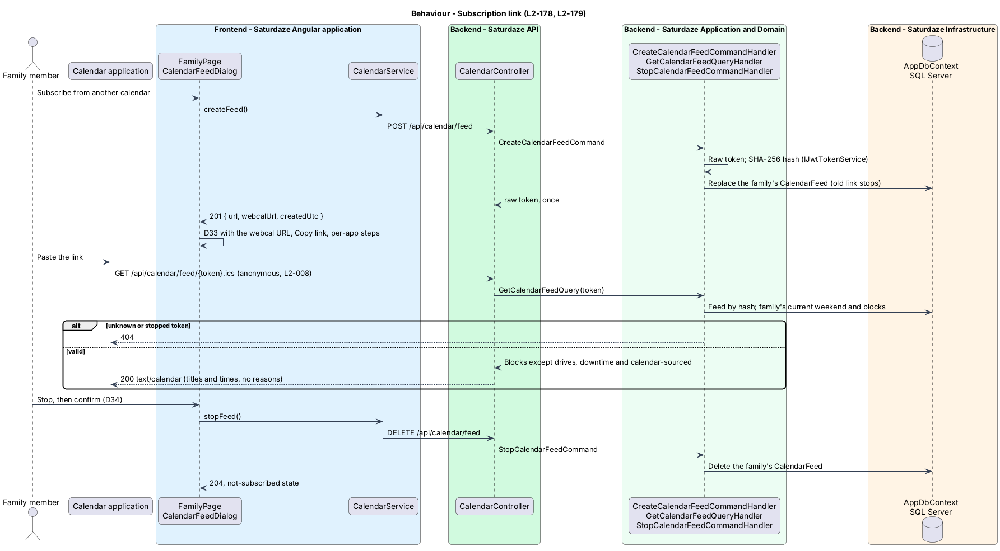

# Connect a calendar

## Overview

Saturdaze is a web application that plans personalized family weekends. Connecting a calendar keeps the family's planned weekend in a calendar the family already uses. It is optional, off by default and can be stopped at any time (L1-040). This design covers how a family member turns sync on and off; `weekend-planning/sync-weekend-to-calendar` covers what flows through the connection once it exists.

*connection* — a grant from one Saturdaze account to the primary calendar of one Google account, stored as an encrypted refresh token

*subscription link* (feed) — a private, read-only URL that serves the family's current weekend as `text/calendar`, for calendar applications other than Google

*state* — the opaque value Saturdaze sends to Google and receives back, which binds the consent round trip to the person who started it

Two paths exist. Google Calendar is connected through an OAuth 2.0 authorization code grant with offline access, exchanged by the API with the client secret, so Saturdaze can write the plan and read weekend events while the person is away (ADR-021). Every other calendar application subscribes to the family's subscription link, which needs no OAuth client and no per-provider code. Sign-in with Google (ADR-019) is a separate grant and is not changed.

## Description

`FamilyPage` renders a "Calendar" section after "Preferences" from `CalendarSettings`, which `CalendarService` (the `api` library, bound to `CALENDAR_SERVICE` through the `ICalendarService` contract) loads from `GET /api/calendar`. The section draws the states of `docs/mocks/pages/family.calendar.html`: not connected, Google not configured (the Google row is absent when `googleConfigured` is false), Google connected, subscription link on, needs reconnect and consent denied.

"Connect Google Calendar" opens `ConnectCalendarDialog` (D31) through the CDK `Dialog`. Its "Continue to Google" awaits the `start()` callback `FamilyPage` passes in, which calls `CalendarService.authorizeGoogle()` (`POST /api/calendar/google/authorize`) and assigns the returned `authorizationUrl` to the document's location; a failure keeps the dialog open with the warn banner "Google didn't answer. Nothing was connected. Try again in a minute." and relabels the primary action "Try again" (D31b). Google returns the browser to `/family/calendar/google`, routed to `GoogleCalendarCallbackPage` behind `requireAuth`. With `code` and `state` the page calls `CalendarService.connectGoogle(code, state)` (`POST /api/calendar/google/connect`) and navigates to `/family`; with `error`, or when the API refuses the code, it navigates to `/family?calendar=denied`, which shows the info banner "Google Calendar wasn't connected. Nothing was shared.". The connected row names the account's email and "synced just now", "synced N minutes ago", "synced N hours ago" or the date; the "Plan around my calendar" `sd-toggle` calls `CalendarService.updateGoogle(readCommitments)` (`PUT /api/calendar/google`). A `needs_reconnect` status shows the warn `sd-banner` (`role="alert"`) and a "Reconnect" button that opens D31. "Disconnect" opens the shared `ConfirmDialog` as D32 and calls `CalendarService.disconnectGoogle()` (`DELETE /api/calendar/google`).

"Subscribe from another calendar" and "Get a new link" call `CalendarService.createFeed()` (`POST /api/calendar/feed`) and open `CalendarFeedDialog` (D33) with the returned `webcalUrl` in an `sd-copy-field`, the Apple Calendar, Outlook and Google Calendar steps, "Stop the link" and "Done". "Stop" and "Stop the link" open `ConfirmDialog` as D34 and call `CalendarService.stopFeed()` (`DELETE /api/calendar/feed`). The section never shows a feed URL after the dialog closes; it shows "Subscription link is on" with the creation date.

`CalendarController` (`api/calendar`) dispatches MediatR requests; its feed action is `[AllowAnonymous]`, every other action uses the fallback bearer policy (ADR-008). `GetCalendarSettingsQueryHandler` returns `CalendarSettingsDto(GoogleConfigured, Google, Feed)`, where `Google` is the caller's own `CalendarConnection` (`GoogleCalendarConnectionDto(Email, Status, ReadCommitments, LastSyncedUtc)`) and `Feed` is the family's `CalendarFeed` (`CalendarFeedStatusDto(Active, CreatedUtc)`). `AuthorizeGoogleCalendarCommandHandler` answers `503 google_calendar_not_configured` through `AuthFlowException` when `IGoogleCalendarClient.IsConfigured` is false (an empty `GoogleOptions.ClientId` or `GoogleOptions.ClientSecret`), creates a state with `ICalendarTokenProtector.CreateState(userId, now + 10 minutes)` and returns `IGoogleCalendarClient.AuthorizationUrl(state, redirectUri)`, where `redirectUri` is `{Saturdaze:Share:AppOrigin}/family/calendar/google` (`CalendarOptions.RedirectUri`).

`ConnectGoogleCalendarCommandValidator` requires `Code` and `State`. `ConnectGoogleCalendarCommandHandler` reads the state with `ICalendarTokenProtector.ReadState()` and refuses a state that is unreadable, expired or issued to another user with `400 calendar_state_invalid`. It calls `IGoogleCalendarClient.ExchangeCodeAsync(code, redirectUri)`, which returns `GoogleCalendarGrant(Subject, Email, RefreshToken, HasCalendarScope)` or throws `GoogleCalendarCodeRejectedException` (`400 google_calendar_code_invalid`) or `GoogleCalendarUnavailableException` (`502 google_calendar_unavailable`). A grant without the calendar scope is revoked and refused with `400 google_calendar_scope_missing`. Otherwise the handler revokes the caller's previous grant when there is one, deletes its `CalendarEventLink` rows, and stores a `CalendarConnection` with `ProtectedRefreshToken = ICalendarTokenProtector.Protect(refreshToken)`, `Status = Connected`, `ReadCommitments = true` and `SyncRequestCount` raised, then calls `ICalendarSyncSignal.Notify()`, so the current weekend is written (`sync-weekend-to-calendar`). When the new grant names another Google account, the connection's `CalendarEventLink` rows are dropped first, because those events live in the other account's calendar. `UpdateGoogleCalendarCommandHandler` sets `ReadCommitments` on the caller's connection (404 when there is none). `DisconnectGoogleCalendarCommandHandler` unprotects and revokes the refresh token, logging and ignoring a failure, then deletes the connection; its `CalendarEventLink` rows cascade and the events stay in Google. All of these use `AuthFlowException` for their `{ code, message }` answers, as sign-in does.

`CreateCalendarFeedCommandHandler` mints a raw token with `IJwtTokenService.CreateRawRefreshToken()`, replaces the family's `CalendarFeed` with one holding `HashRefreshToken(raw)`, and returns the raw token once; the controller turns it into `CalendarFeedLinkDto(Url, WebcalUrl, CreatedUtc)` on the API origin. `StopCalendarFeedCommandHandler` deletes the family's feed. `GetCalendarFeedQueryHandler` hashes the token, finds the feed (404 otherwise), loads the family's weekend for `GetCurrentWeekendQueryHandler.ResolveUpcomingSaturday(today)` without generating one, and returns `CalendarFeedWeekend(WeekendOf, Events)` filtered by `CalendarEventSelection.Includes()` (no drives, downtime or calendar-sourced blocks). The controller writes it with `IcsWriter.ToIcs()`, the writer the `.ics` export and the share link's calendar also use (moved out of `WeekendsController`), and answers `Cache-Control: no-store`, so titles and times appear and reasons do not. `CalendarFeedTokenRedactor`, a Serilog enricher in the API, rewrites `/api/calendar/feed/{token}.ics` in every logged path property, because ASP.NET Core logs the request path with each event of the request and calendar applications fetch the link on a schedule (L2-177).

`GoogleCalendarClient` (Infrastructure) implements `IGoogleCalendarClient` over the named `HttpClient` `google-calendar`: the authorization URL on `https://accounts.google.com/o/oauth2/v2/auth`, the code exchange and refresh on `https://oauth2.googleapis.com/token`, revocation on `https://oauth2.googleapis.com/revoke`, and the Google Calendar API v3 on the `primary` calendar. It reads the Google subject and email from the ID token the token endpoint returns over TLS. `DataProtectionCalendarTokenProtector` implements `ICalendarTokenProtector` with the purposes `Saturdaze.CalendarSync.GoogleRefreshToken.v1` and `Saturdaze.CalendarSync.State.v1`; the key ring, from the `Microsoft.AspNetCore.DataProtection` package so the plain-runtime Worker can still load Infrastructure, persists to `Saturdaze:Calendar:KeyDirectory` when it is set. `CalendarFeed` is stored in `CalendarFeeds` (unique on `FamilyId` and on `TokenHash`, migration `AddCalendarFeeds`) and `CalendarConnection` in `CalendarConnections` (unique on `UserId`, cascade-deleted with the user, migration `AddCalendarConnections`; the sync columns arrive in `AddCalendarSync`). A connection has no family column: its family is its account's, so it follows the account, and removing a member deletes their connection with their account (L2-180).

Tests stand in for Google at both boundaries (ADR-021, decision 7). `FakeGoogleCalendarClient` replaces `IGoogleCalendarClient` in `CalendarConnectTests` and `CalendarFeedTests`; `GoogleCalendarClientTests` drive the real client through a fake `HttpMessageHandler`. In Playwright, `calendar-google.spec.ts` answers `/api/calendar` from route stubs and sends the browser straight to `/family/calendar/google?code=…&state=…` in place of Google's consent screen, and `calendar-feed.spec.ts` runs the subscription link against the real API through the `FamilyPage` page object.

## Requirements

The following L2 requirements refine the cited L1 capabilities. Implementation gaps stated in Description do not waive these obligations.

| L2 ID | Refines (L1) | Requirement |
|-------|--------------|-------------|
| `L2-172` | `L1-040`, `L1-001`, `L1-012` | A signed-in family member shall be able to connect the primary calendar of a Google account to their own Saturdaze account through an OAuth 2.0 authorization code grant with offline access (ADR-021). `POST /api/calendar/google/authorize` shall answer 200 with `{ authorizationUrl }`: Google's authorization endpoint with the configured client id (`Saturdaze:Google:ClientId`), `response_type=code`, `access_type=offline`, `prompt=consent`, the redirect URI `{Saturdaze:Share:AppOrigin}/family/calendar/google`, the scopes `openid email https://www.googleapis.com/auth/calendar.events` and nothing broader, and a `state` that is bound to the caller and expires after 10 minutes. `POST /api/calendar/google/connect` with `{ code, state }` shall check that the state was issued to the caller and has not expired (400 `calendar_state_invalid` otherwise), exchange the code at Google's token endpoint with the client secret (`Saturdaze:Google:ClientSecret`), and store the grant against the caller: the Google account id and email, the refresh token encrypted at rest, "plan around my calendar" on, and status `connected`. A code Google refuses shall answer 400 `google_calendar_code_invalid`; a grant without the calendar scope (the person unticked it on Google's consent screen) shall answer 400 `google_calendar_scope_missing` and be revoked; a Google outage shall answer 502 `google_calendar_unavailable`; none of them shall store anything. When either the client id or the client secret is empty, both endpoints shall answer 503 `google_calendar_not_configured`. The Google account may differ from the one the person signs in with (L2-163); the connection names its own email. Connecting again replaces the earlier grant, which is revoked. `GET /api/calendar` shall answer `{ googleConfigured, google, feed }`, where `google` is null or `{ email, status, readCommitments, lastSyncedUtc }` for the caller's own connection and `feed` is `{ active, createdUtc }` for the family (L2-178). API tests shall stand in for Google with a fake `IGoogleCalendarClient` (ADR-021). (Added 2026-10-20.) |
| `L2-173` | `L1-040`, `L1-002`, `L1-011`, `L1-014` | The family page shall show a "Calendar" section after "Preferences" in the states drawn in `docs/mocks/pages/family.calendar.html`. Not connected: a "Connect Google Calendar" row and a "Subscribe from another calendar" row; the Google row shall not render when `googleConfigured` is false. "Connect Google Calendar" shall open the connect dialog (D31), which states what Saturdaze writes and reads and that nothing else is touched, and whose "Continue to Google" sends the browser to the `authorizationUrl` (L2-172). Google returns the browser to `/family/calendar/google`: with `code` and `state` the page shall post them to `POST /api/calendar/google/connect` and land on `/family` showing the connected state; with `error` (consent denied) or a refused code it shall land on `/family` with the info banner "Google Calendar wasn't connected. Nothing was shared." and store nothing. Connected: a "Google Calendar" row naming the account's email and when it last synced, with "Disconnect" (L2-174), and the toggle "Plan around my calendar" ("Weekend events count as commitments") that saves through `PUT /api/calendar/google` with `{ readCommitments }`. Needs reconnect (L2-177): the warn banner "Google Calendar stopped accepting updates. Reconnect to keep this weekend in sync." (`role="alert"`) and a "Reconnect" button that opens D31. A failure to start the connection shall show D31's error state "Google didn't answer. Nothing was connected. Try again in a minute.". Playwright specs shall stand in for Google's consent screen and for the calendar endpoints at the API boundary, as L2-164 does for sign-in. (Added 2026-10-20.) |
| `L2-174` | `L1-040`, `L1-012` | `DELETE /api/calendar/google` shall revoke the caller's grant at Google's revocation endpoint, delete the stored tokens and every record of the events written for that connection, and answer 204; a revocation Google refuses or cannot answer shall not stop the deletion. The events already written shall stay in the person's calendar as they are: Saturdaze no longer updates or deletes them (the disconnect dialog D32 says so). From then on the planner shall not read that calendar (L2-176) and no change to the plan shall be written to it. Disconnecting one member's calendar shall not affect another member's connection or the family's subscription link. On the family page "Disconnect" shall open D32 ("Disconnect Google Calendar?", "Saturdaze stops writing and reading it. Events already there stay.") and, on confirm, show the not-connected state. (Added 2026-10-20.) |
| `L2-178` | `L1-040`, `L1-003`, `L1-012` | A signed-in family member shall be able to create a subscription link for the family: `POST /api/calendar/feed` shall mint a random token, store only its hash with the family, replace any earlier link (which stops working), and answer 201 with `{ url, webcalUrl, createdUtc }`, where `url` is `https://{api host}/api/calendar/feed/{token}.ics` and `webcalUrl` the same with the `webcal` scheme. The raw token shall be returned only by that response and never again (`GET /api/calendar` answers only `feed.active` and `feed.createdUtc`). `GET /api/calendar/feed/{token}.ics` shall be anonymous (L2-008) and answer `text/calendar` with the family's current weekend as `VEVENT`s, one per block except drives, downtime and calendar-sourced blocks, with titles and times and no reasons; a valid link to a family with no current weekend shall answer an empty calendar; an unknown or stopped token shall answer 404. `DELETE /api/calendar/feed` shall stop the link and answer 204. The feed is read-only and covers only the current weekend; it works whether or not Google is configured. (Added 2026-10-20.) |
| `L2-179` | `L1-040`, `L1-002`, `L1-011`, `L1-014` | "Subscribe from another calendar" (L2-173) shall create the link (L2-178) and open the subscription dialog (D33): the `webcal` URL in a copy field with "Copy link", instructions for Apple Calendar, Outlook and Google Calendar, the note "Read-only · this weekend's plan · anyone with the link can see it", "Stop the link" and "Done". The dialog's subtitle shall say "Copy it now. For your privacy it is not shown again." Once a link exists the section shall show "Subscription link is on" with when it was created and "Stop", and a "Get a new link" ghost row that replaces it and opens D33 with the new URL. "Stop" and "Stop the link" shall open D34 ("Stop the subscription link?", "Calendars subscribed to it stop getting this weekend.") and, on confirm, call `DELETE /api/calendar/feed` and return the section to the not-subscribed state. "Copy link" shall copy the URL and report it (`aria-pressed`), as the share dialog does. (Added 2026-10-20.) |
| `L2-180` | `L1-040`, `L1-012` | A Google connection shall belong to the account that made it: only that account can see its email, change its toggle or disconnect it, and only the calendar of a connection whose account belongs to the family is read when that family's weekend is planned (ADR-008). A family's subscription link shall serve only that family's weekend. Refresh tokens shall be stored encrypted with ASP.NET Core Data Protection (ADR-021) and never returned by any endpoint; feed tokens shall be stored only as hashes. When a member leaves or is removed from a family (L1-037) their connection shall be deleted with their sign-in. (Added 2026-10-20.) |
| `L2-008` | `L1-001`, `L1-012` | Every endpoint except `POST /api/auth/register\|login\|google\|refresh\|logout\|forgot-password\|reset-password\|verify-email\|resend-verification\|invitation\|accept-invitation`, `GET /api/weather` (no PII), `GET /api/weekends/shared/{token}`, `GET /api/weekends/shared/{token}/calendar.ics`, `GET /api/calendar/feed/{token}.ics` (L2-178; added 2026-10-20) and `GET /api/avatars/{token}` (capability URLs that browsers, `` elements and calendar clients fetch without a bearer) shall reject requests that lack a valid `Authorization: Bearer <jwt>` header. `GET /api/activities\|/api/restaurants\|/api/events` are personalized per family (votes, locks, novelty history) and therefore require a bearer too (ADR-008). Enforcement is a global fallback authorization policy; anonymous routes opt out explicitly. |

## Diagrams

### System context

The context view identifies the family member, the Saturdaze system, Google's OAuth service that issues and revokes the grant, and the calendar applications that subscribe to the family's link.

### Containers

The container view follows the consent round trip through the Angular application to the API, which exchanges the code with Google, protects the token with the Data Protection key ring and stores the connection in SQL Server. Calendar applications reach the API's anonymous feed directly.

### Components

The component view names the page, the return route, the dialogs, the calendar service, the controller, the handlers, the Google client, the token protector and the persisted state involved in this slice.

### Class structure

The class view shows the browser-side contract, the endpoints, the Google client abstraction and its grant, the protector abstraction, and the connection and feed the handlers create, replace and delete.

### Behaviour — connect and disconnect Google Calendar

The sequence view traces `L2-172` → `L2-174`: the unconfigured deployment, the denied consent, the refused state, code and scope, the stored grant, and the disconnect that revokes the grant and leaves the written events in place.

### Behaviour — subscription link

This sequence traces `L2-178` and `L2-179`: the raw token is shown once, the calendar application fetches the anonymous feed, and stopping the link makes it answer 404.

