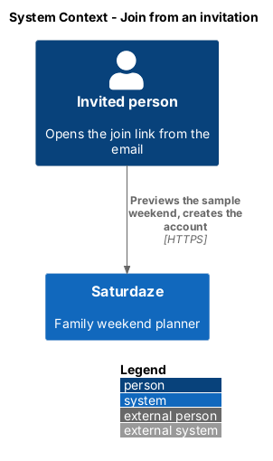
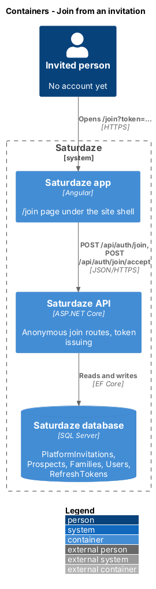
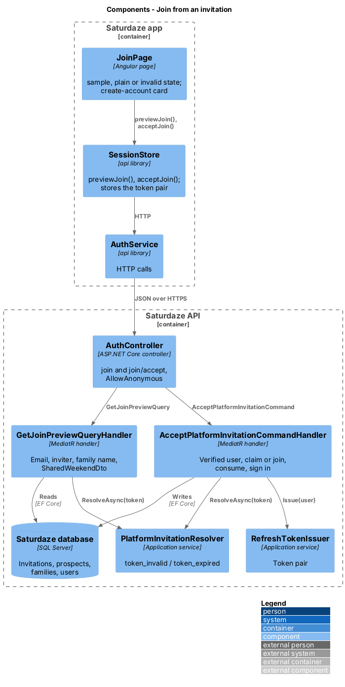
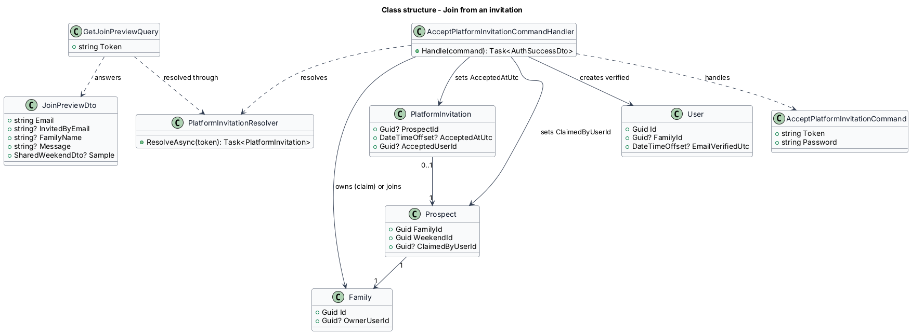
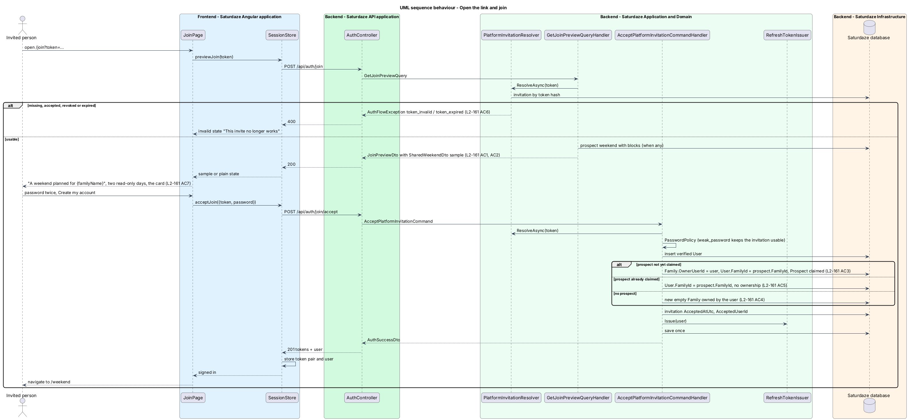

# Join from an invitation

## Overview

Saturdaze is a web application that plans personalized family weekends. An administrator can invite a prospective family by email (`invite-families-to-saturdaze`, administration) and attach a weekend planned for it (`build-sample-weekend`). This feature is the invitee's side of that link: the page the email opens, what it shows before any account exists, and the one step that creates the account, signs it in and makes the sample family and its weekend the invitee's own.

*platform invitation* — single-use, time-limited invitation an administrator sends to one email address to create a Saturdaze account

*join page* — `/join?token=…` in the family application, served under the site shell so a visitor sees the brand and a sign-in link

*claim* — the moment the first invitee accepts an invitation that carries a prospect: the account becomes the family's owner and the prospect records who claimed it

The flow mirrors `manage-family-members`' accept-invitation path (ADR-016): the token proves the invitee received the mail, so the account is created verified, and a used, revoked or expired link answers `token_invalid` or `token_expired` without revealing anything else. It differs in what the account lands in: a prospect family with a weekend already planned, or, for a plain invitation, a new empty family as registration creates.

## Description

### Application

`PlatformInvitationResolver` (`Saturdaze.Application/Auth/PlatformInvitationResolver.cs`) hashes the raw token with `IJwtTokenService.HashRefreshToken`, loads the matching `PlatformInvitation`, and throws `AuthFlowException(400, "token_invalid")` when there is no row or the row is accepted or revoked, and `AuthFlowException(400, "token_expired")` when `ExpiresAtUtc` is at or before now.

`GetJoinPreviewQuery(Token)` resolves the invitation and returns `JoinPreviewDto(Email, InvitedByEmail, FamilyName, Message, Sample)`. When the invitation references a prospect, the handler loads the prospect's weekend with blocks, maps it with `WeekendMapper.ToDto` and the forecast, and reduces it to `SharedWeekendDto.From(...)` so the anonymous caller receives the same read-only projection a share link does (L2-086 AC7); otherwise `Sample` and `FamilyName` are `null`.

`AcceptPlatformInvitationCommand(Token, Password)` resolves the invitation, enforces `PasswordPolicy`, refuses an email that meanwhile became an account (409 `email_in_use`), and creates the `User` with `EmailVerifiedUtc` set. With a prospect: when `Prospect.ClaimedByUserId` is null the handler sets `Family.OwnerUserId` to the new user, `User.FamilyId` to the prospect's family, and `Prospect.ClaimedByUserId` and `ClaimedAtUtc`; when the prospect is already claimed the handler sets `User.FamilyId` only, so the account joins the family as a member. Without a prospect: the handler inserts an empty `Family` owned by the new user, as `RegisterUserCommandHandler` does, and sends no verification mail. In neither case is a member created or linked for the new owner, and a prospect's members stay unlinked even when one carries the invitee's name: the owner adds themselves or says which listed member is them from the "Add yourself" row (L2-215, L2-216, L2-217, ADR-024). In every case it sets `AcceptedAtUtc` and `AcceptedUserId` on the invitation, issues tokens through `RefreshTokenIssuer`, saves once and returns `AuthSuccessDto`.

### API

`AuthController` gains `POST /api/auth/join` (`[AllowAnonymous]`, 200 `JoinPreviewDto`) and `POST /api/auth/join/accept` (`[AllowAnonymous]`, 201 `AuthSuccessDto`), beside the family-invitation pair.

### Frontend (`api` library)

`JoinPreview` and `AcceptJoinRequest` models; `IAuthService.previewJoin(token)` and `acceptJoin(request)`; `ISessionStore.previewJoin(token)` and `acceptJoin(request)`, the latter storing the token pair and user like `acceptInvitation`. `projectWeekend(asWeekendDto(preview.sample), 'ready')` reuses `SharedWeekendService`'s widening of a `SharedWeekendDto` into the `WeekendView` the days render from.

### Frontend (family application)

`JoinPage` (`/join`, route data `shell: 'site'`, `page: 'join'`) reads `token` from the query, previews it, and renders one of three states: `sample` (the hero with "A weekend planned for {familyName}", the invitation line, the create-account card and the two read-only `sd-day` sections), `plain` (the card alone under "Join Saturdaze"), or `invalid` ("This invite no longer works" with "Sign in"). The card is `sd-auth-card` with the email read-only, password with `sd-strength`, confirm password and the primary action ("Create my account" with a sample, "Join Saturdaze" without). On success the page navigates to `/weekend`, which shows the claimed sample weekend when it is the upcoming one. The `?state=` development override (`sample`, `plain`, `invalid`) mirrors the mock's three specimens.

### Tests

`Saturdaze.Api.Tests/Auth/JoinTests.cs` covers L2-161. `e2e/pages/join.page.ts` owns the page's selectors; `e2e/tests/join.spec.ts` mints an invitation through the admin API per test and drives the three states.

## Requirements

The following L2 requirements refine the cited L1 capabilities.

| L2 ID | Refines (L1) | Requirement |
|-------|--------------|-------------|
| `L2-161` | `L1-038` | `POST /api/auth/join` (anonymous) shall return, for a usable platform invitation token, `{email, invitedByEmail, familyName, message, sample}` where `sample` is the prospect's weekend as a `SharedWeekendDto` (L2-086 AC7) or `null`. `POST /api/auth/join/accept` (anonymous) shall create a verified account for the invited email with the chosen password, consume the invitation and sign the account in. When the invitation carries a prospect that nobody has claimed, the account shall become the owner of the prospect family and the sample weekend shall be the family's weekend; when an earlier invitee already claimed it, the account shall join that family as a member without ownership. Without a prospect, the account shall own a new empty family as registration does (L2-001), without a verification email. The invite link shall open `/join?token=…` under the site shell: with a sample, the heading "A weekend planned for {familyName}", the two days read-only, and the "Create your account" card; without one, the card alone; for an unusable link, "This invite no longer works" with a "Sign in" link. |
| `L2-215` | `L1-037`, `L1-001`, `L1-039` | Accounts that start a family without the sign-up form (Google sign-in, platform-invitation acceptance, the first profile save) give no name or age; their owners add themselves or claim a listed member from the "Add yourself" row (L2-216, L2-217). |

## Diagrams

### System context

The context view places the invited person, the family application and the API.

### Containers

The container view shows the family application's join page talking to the API's anonymous auth routes.

### Components

The component view names the page, the session store, the controller, the resolver and the two handlers.

### Class structure

The class view shows the resolver, the query and command, the preview DTO and the rows the accept path touches.

### Behaviour — open the link and join

The sequence follows the invitee from the email to the signed-in weekend, with the claim rule and the refusals (`L2-161`).

