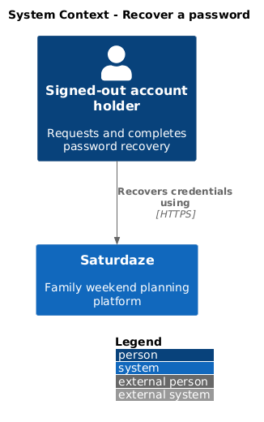
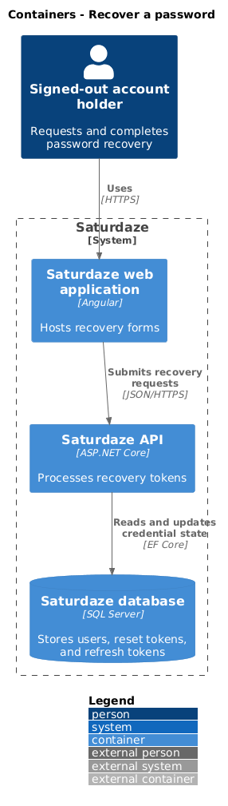
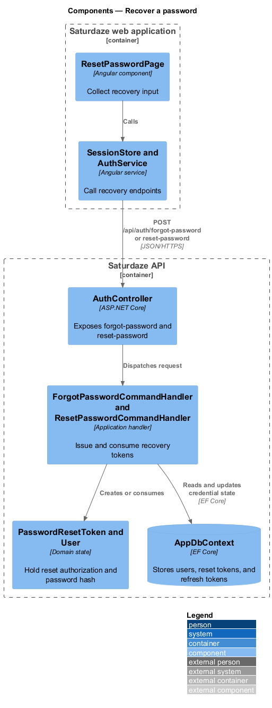
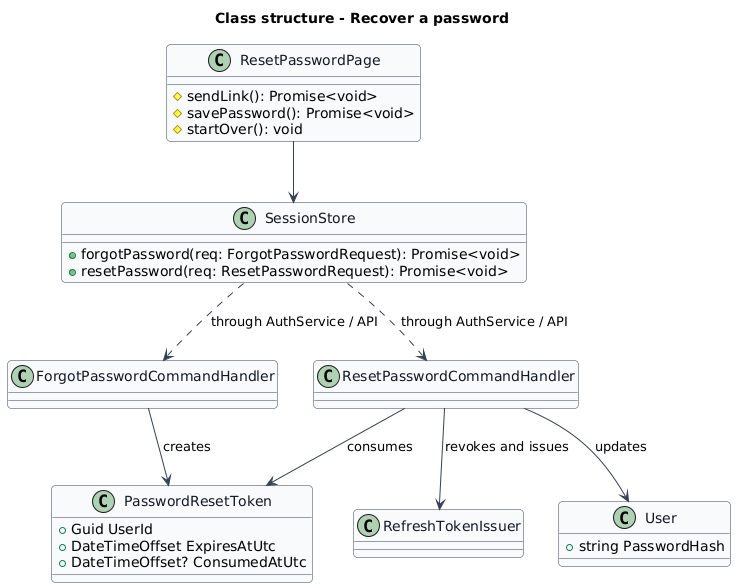
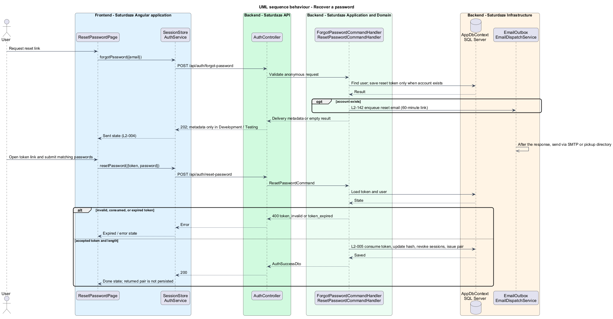

# Recover a password

## Overview

Saturdaze is a web application that plans personalized family weekends. Password recovery separates a non-disclosing email request from the token-authorized password reset.

*reset token* — single-use credential that authorizes one password change before expiry

The request path always presents the same response for registered and unregistered email addresses. The reset path validates token state and password rules before updating `User.PasswordHash`.

## Description

`ResetPasswordPage` at `/reset-password` presents request, sent, new-password, done, and expired states. Presence of `?token=` selects the new-password form; old recovery routes redirect here.

`SessionStore` and `AuthService` call the request and reset endpoints. The page presents sent state even when the request fails, preventing account-existence feedback in that UI.

`ForgotPasswordCommandHandler` invalidates earlier reset credentials and stores a hashed token expiring after 60 minutes. The sent and expired states quote that figure ("The link works for 60 minutes.", "Reset links last 60 minutes. Ask for a fresh one."), so the copy and the handler change together (L2-005 AC5, AC6). After saving, the handler enqueues the reset email (`AccountEmails.PasswordReset`, linking `{AppOrigin}/reset-password?token=…` and stating the 60-minute life) on `IEmailOutbox`; `EmailDispatchService` sends it after the response, so known and unknown addresses answer alike and an unknown address gets no mail (L2-004 AC2, L2-142). `AuthController.DevDelivery()` also returns the token in Development and Testing for automated tests; other environments return an empty accepted response.

`ResetPasswordCommandHandler` consumes a valid token, updates the password hash, revokes active refresh tokens, and returns a newly issued session. `AuthService.resetPassword()` returns the reset account; when this browser holds a session for that same account, `SessionStore.resetPassword()` clears it, since the server has just revoked it, and the done state asks the person to sign in with the new password (L2-005 AC7). The route guard `requireAnonymousUnlessToken` lets an emailed `?token=` link open in a signed-in browser; without a token the page stays signed-out only.

`PasswordPolicy` enforces the one password rule (8 or more characters including a number or symbol) and returns `weak_password` before the token is consumed (L2-143). The new-password state shows `sd-password-rules` above `sd-strength`, fed by `passwordRules()` from `shared/password-strength.ts`; the same function backs the form validator, so Save stays disabled until both rules are met and the confirmation matches. A mismatched confirmation shows "Passwords do not match." on that field (L2-005 AC3). Confirmation is checked in the browser, not a separate API field.

## Requirements

The following L2 requirements refine the cited L1 capabilities. Implementation gaps stated in Description do not waive these obligations.

| L2 ID | Refines (L1) | Requirement |
|-------|--------------|-------------|
| `L2-004` | `L1-001` | A signed-out user shall be able to request a password-reset link by entering their email. The system shall not reveal whether the email is registered. |
| `L2-005` | `L1-001` | The system shall accept a reset token plus a new password and confirmation, validate the token, enforce password complexity, and rotate any existing refresh tokens for that user on success. |
| `L2-142` | `L1-001` | The system shall email the account holder the link for every account token it issues: a verification link at registration and on resend, and a reset link on a forgot-password request. Mail shall be sent after the request is answered, so a response never waits on delivery and a delivery failure never fails the request. |
| `L2-143` | `L1-001` | The system shall accept a new password only when it is at least 8 characters long and contains at least one number or symbol (any character that is not a letter). The rule shall apply at registration, password reset and invitation acceptance, each rejecting a weaker password with `weak_password`. The registration form and the reset screen's new-password state shall show the two rules as a checklist, "8 or more characters" and "A number or symbol", that marks each rule met or not yet met as the user types. |

## Diagrams

### System context

The context view identifies the person using this capability and the Saturdaze system that owns the resulting state.

### Containers

The container view follows the interaction from the Angular web application through the API to SQL Server.

### Components

The component view names the page, client service, controller, handler, domain type, and persistence boundary involved in this slice.

### Class structure

The class view shows the request path and the state types used by the feature.

### Behaviour — request and complete password recovery

The sequence view traces the primary behaviour to `L2-004` and `L2-005`. Its alternate path shows how the feature returns a controlled failure.

