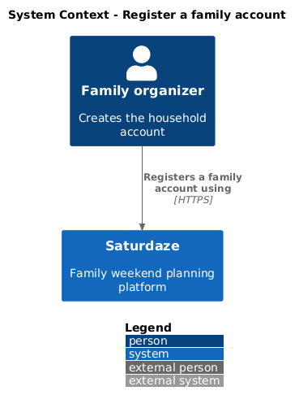
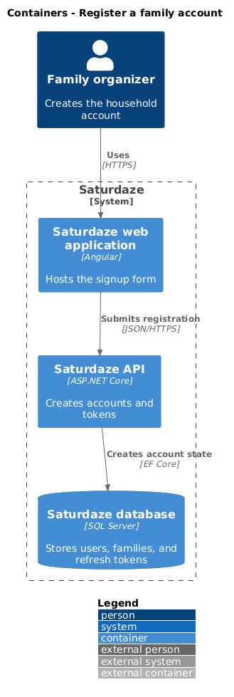
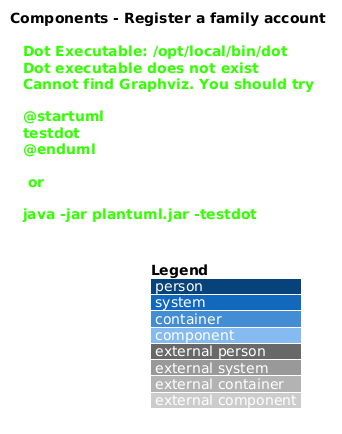
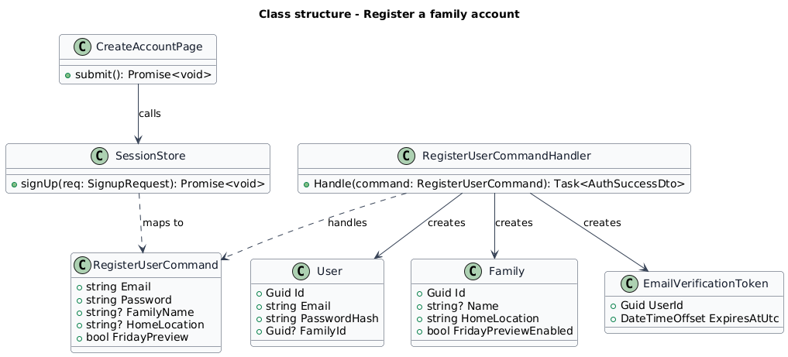
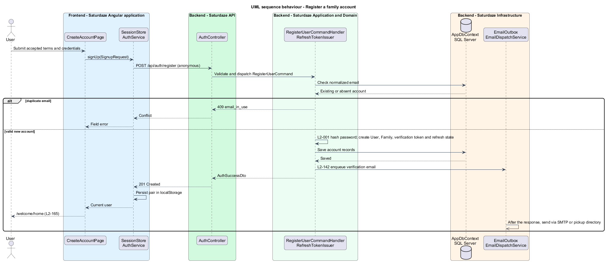

# Register a family account

## Overview

Saturdaze is a web application that plans personalized family weekends. Account registration creates the credentials and household boundary used by every personalized feature.

*family account* — user identity paired with the single family profile it owns

The signup flow collects credentials and a family name; the API treats family name and home location as optional. A successful transaction creates `User` and `Family` records before returning access and refresh tokens.

## Description

`CreateAccountPage` at `/create-account` validates credentials, terms acknowledgement and the owner's own "Your first name" (required, at most 100 characters) and "Your age" (required, 0–120, "Enter an age between 0 and 120.") and calls `SessionStore.signUp()` with `ownerName` and `ownerAge` (L2-215). It also sends the Friday-preview preference and then opens `/welcome/home`, the first step of the onboarding wizard (`family-profile/onboard-new-family`, L2-165).

`AuthController.Register()` dispatches `RegisterUserCommand` and returns 201 with `AuthSuccessDto`. `RegisterUserCommandValidator` requires `OwnerName` and `OwnerAge` together or not at all, a trimmed name of 1–100 characters and an age of 0–120. `RegisterUserCommandHandler` checks normalized email uniqueness, creates `User` and `Family` and, when the owner's name and age are given, the owner's `FamilyMember` linked to the new account (L2-214, ADR-024), adds a 24-hour `EmailVerificationToken`, and issues credentials through `RefreshTokenIssuer`.

`PasswordPolicy` refuses a password without 8 characters including a number or symbol with `weak_password`, and the form shows the same two rules as an `sd-password-rules` checklist (L2-143). `Pbkdf2PasswordHasher` stores salted password hashes. `SessionStore` persists registration credentials in local storage and sets the current user.

After saving, the handler enqueues a verification email built by `AccountEmails` on `IEmailOutbox`. `EmailDispatchService`, a hosted service, delivers it after the response through `IEmailSender`: `SmtpEmailSender` when `Saturdaze:Email:SmtpHost` is set, otherwise `PickupDirectoryEmailSender`, which writes `.eml` files. The link is `{AppOrigin}/verify-email?token=…`, with the origin taken from `Saturdaze:Email:AppOrigin` or `Saturdaze:Share:AppOrigin`. A delivery failure is logged by subject only and never fails registration (L2-142).

## Requirements

The following L2 requirements refine the cited L1 capabilities. Implementation gaps stated in Description do not waive these obligations.

| L2 ID | Refines (L1) | Requirement |
|-------|--------------|-------------|
| `L2-001` | `L1-001` | The system shall accept a signup payload (email, password, optional family name, optional home location, the owner's first name and age), create a `User` row, create a `Family` row owned by that user (with the owner as its first member when the name and age were given), issue an access token + refresh token, and return both with the user record. |
| `L2-215` | `L1-037`, `L1-001`, `L1-039` | The sign-up form shall ask for "Your first name" and "Your age", and `POST /api/auth/register` shall carry them as `ownerName` and `ownerAge`, validated as a member's are and only together; registration then creates the owner's member linked to the account (L2-214). |
| `L2-142` | `L1-001` | The system shall email the account holder the link for every account token it issues: a verification link at registration and on resend, and a reset link on a forgot-password request. Mail shall be sent after the request is answered, so a response never waits on delivery and a delivery failure never fails the request. |
| `L2-143` | `L1-001` | The system shall accept a new password only when it is at least 8 characters long and contains at least one number or symbol (any character that is not a letter). The rule shall apply at registration, password reset and invitation acceptance, each rejecting a weaker password with `weak_password`. The registration form and the reset screen's new-password state shall show the two rules as a checklist, "8 or more characters" and "A number or symbol", that marks each rule met or not yet met as the user types. |

## Diagrams

### System context

The context view identifies the person using this capability and the Saturdaze system that owns the resulting state.

### Containers

The container view follows the interaction from the Angular web application through the API to SQL Server.

### Components

The component view names the page, client service, controller, handler, domain type, and persistence boundary involved in this slice.

### Class structure

The class view shows the request path and the state types used by the feature.

### Behaviour — register a family account

The sequence view traces the primary behaviour to `L2-001`. Its alternate path shows how the feature returns a controlled failure.

