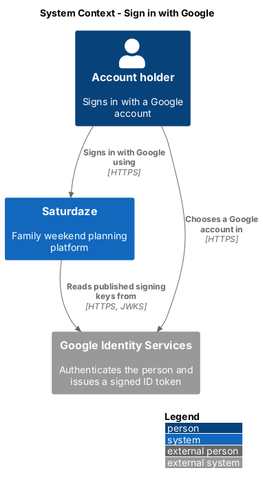
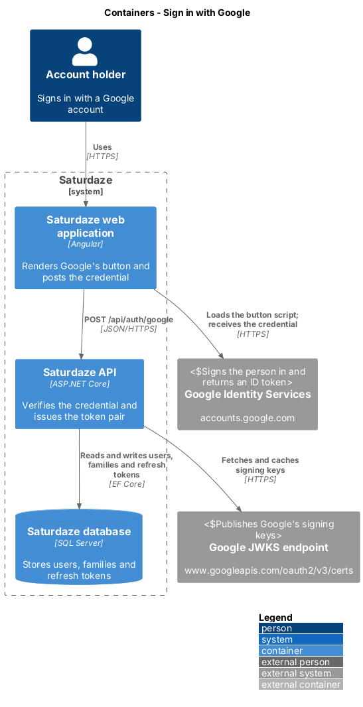
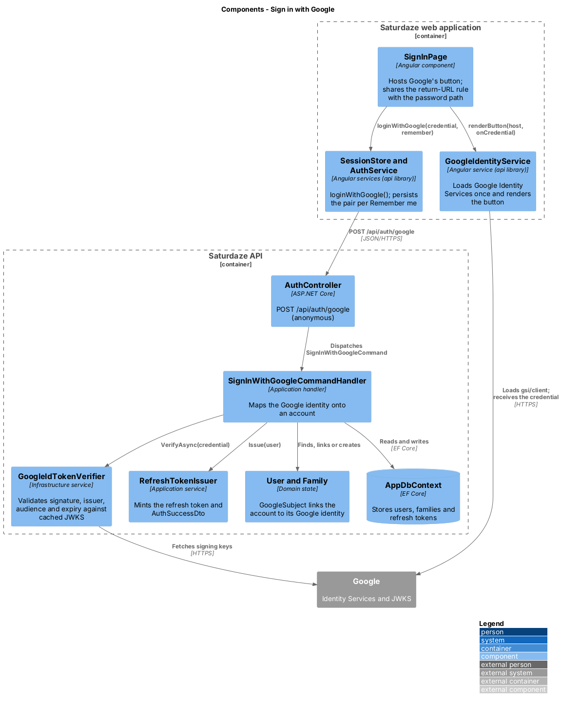
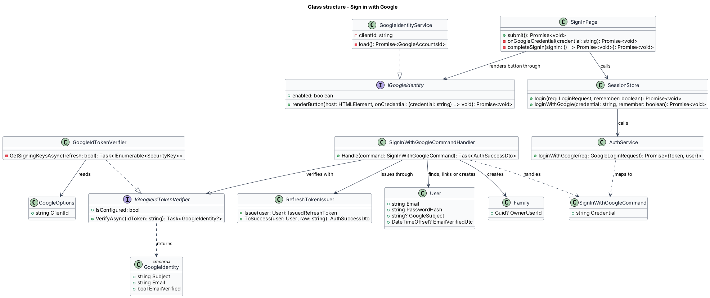
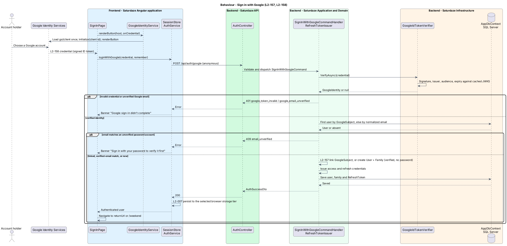
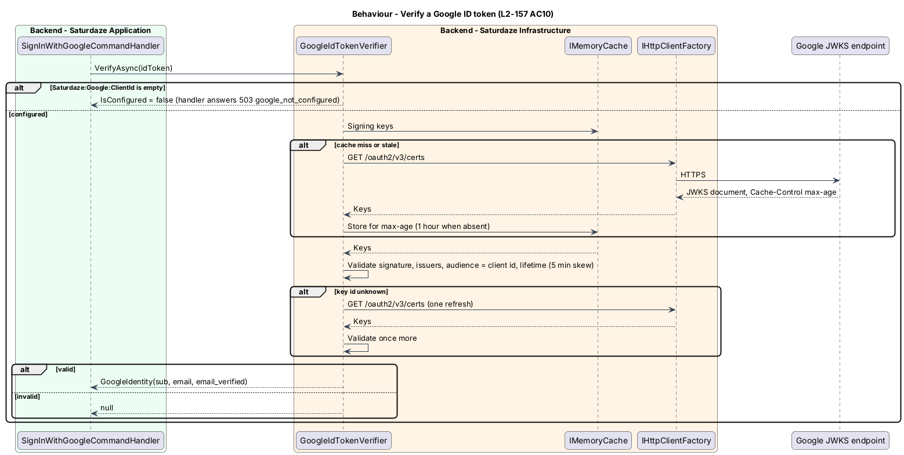

# Sign in with Google

## Overview

Saturdaze is a web application that plans personalized family weekends. Sign in with Google lets a person use their Google account instead of an email and password: the first Google sign-in creates the Saturdaze account and its family, and every later one signs in to it.

*credential* — signed ID token that Google Identity Services hands the browser after the person chooses a Google account

*Google subject* — stable identifier (`sub`) of a Google account inside the credential

The browser never holds a Google secret. Google's own button, rendered by Google Identity Services, returns the credential; the API verifies it offline against Google's published signing keys and maps the identity onto a `User` (ADR-019). Success issues the same access and refresh token pair as a password sign-in (ADR-007), and the browser persists it the same way (ADR-007, decision 3).

## Description

`SignInPage` at `/sign-in` shows, below the password form, an "or" divider and a host element for Google's button. `GoogleIdentityService` (the `api` library, bound to `GOOGLE_IDENTITY`) loads `https://accounts.google.com/gsi/client` once, calls `google.accounts.id.initialize` with `environment.googleClientId` (`GOOGLE_CLIENT_ID`), and renders the large "Continue with Google" button at the host's width, with the `filled_black` theme when the reader's colour scheme is dark. When the client id is empty, `enabled` is false and the page renders neither the divider nor the host.

On a credential, `SignInPage` calls `SessionStore.loginWithGoogle(credential, remember)`, which posts `{ credential }` to `POST /api/auth/google` through `AuthService.loginWithGoogle()`, persists the pair to the storage tier the "Remember me" toggle selects, remembers the email when the toggle is on, and sets the user. The page then navigates to the same-origin `?returnUrl=` or `/weekend`, through the same `completeSignIn()` path as a password sign-in. A rejection shows the warn banner (`role="alert"`) with "Google sign-in didn't complete. Try again." for `google_token_invalid` and `google_email_unverified`, and the verify-first message for `email_unverified`; the fields are not marked invalid.

`AuthController.Google()` is anonymous and dispatches `SignInWithGoogleCommand`. `SignInWithGoogleCommandValidator` requires a non-empty credential. `SignInWithGoogleCommandHandler` first checks `IGoogleIdTokenVerifier.IsConfigured` (`503 google_not_configured` when `Saturdaze:Google:ClientId` is empty), then calls `VerifyAsync(credential)`, which returns a `GoogleIdentity` (subject, email, whether Google verified the email) or `null` (`401 google_token_invalid`). An identity whose email Google has not verified is refused with `401 google_email_unverified`. The handler then resolves the account in this order: the user whose `GoogleSubject` equals the subject; else the user whose `NormalizedEmail` equals the email, linked by setting `GoogleSubject` when `EmailVerifiedUtc` is set, or refused with `409 email_unverified` when it is not; else a new `User` with `GoogleSubject`, `EmailVerifiedUtc` set to now and an empty `PasswordHash`, owning a new empty `Family` with the Friday preview enabled, as `RegisterUserCommandHandler` does. No verification email is sent. The handler issues the pair through `RefreshTokenIssuer.Issue()` and returns `ToSuccess()`; the controller answers 200.

`GoogleIdTokenVerifier` (Infrastructure) validates the credential with `JsonWebTokenHandler`: required signature, issuers `https://accounts.google.com` and `accounts.google.com`, audience `GoogleOptions.ClientId`, lifetime with 5 minutes of skew. Signing keys come from `https://www.googleapis.com/oauth2/v3/certs` through the named `HttpClient` `google-jwks`, parsed with `JsonWebKeySet`, and cached in `IMemoryCache` for the response's `Cache-Control: max-age` (1 hour when absent, never less than 5 minutes). A token whose key id is not in the cache triggers one refresh before it is refused. `email_verified` is read as a boolean or the string `"true"`.

`LoginCommandHandler` refuses an account whose `PasswordHash` is empty with `invalid_credentials`, so a Google-created account has no password sign-in until `POST /api/auth/reset-password` sets one. `User.GoogleSubject` is stored in `Users.GoogleSubject` (`nvarchar(64)`, unique where not null; migration `AddGoogleSubject`).

Tests stand in for Google at both boundaries (ADR-019, decision 7). `FakeGoogleIdTokenVerifier` maps credential strings to identities for `GoogleSignInTests`; `GoogleIdTokenVerifierTests` sign tokens with a throwaway RSA key and serve the JWKS from a fake `HttpMessageHandler`. The Playwright fixture installs a fake `window.google.accounts.id` before every page loads, drawn to the same branding rules as the mock's stand-in button, and `sign-in-google.spec.ts` answers `POST /api/auth/google` from a route stub with a pair minted by a real `POST /api/auth/login`.

## Requirements

The following L2 requirements refine the cited L1 capabilities. Implementation gaps stated in Description do not waive these obligations.

| L2 ID | Refines (L1) | Requirement |
|-------|--------------|-------------|
| `L2-157` | `L1-001`, `L1-012` | `POST /api/auth/google` (anonymous) shall accept a Google ID token (`credential`) that the browser obtained from Google Identity Services and shall verify it offline against Google's published signing keys: the signature, the issuer (`https://accounts.google.com` or `accounts.google.com`), the audience (the configured client id, `Saturdaze:Google:ClientId`) and the expiry. A credential that fails any of those checks shall be refused with 401 `google_token_invalid`; a credential whose email Google has not verified shall be refused with 401 `google_email_unverified`; when no client id is configured the endpoint shall answer 503 `google_not_configured`. For a verified credential the system shall, in this order: sign in the account already linked to the Google account id (`sub`); otherwise link the Google account to the existing account with the same email when that account's email is verified, and sign it in; otherwise, when the existing account's email is not verified, refuse with 409 `email_unverified` and change nothing; otherwise create an account for the email, verified, with no password, owning a new empty family, and sign it in. Every success shall issue a token pair through the same path as `POST /api/auth/login` (ADR-007) and answer 200 with `AuthSuccessDto`. An account created through Google shall have no password until it sets one through the password-reset flow, so `POST /api/auth/login` shall refuse it with 401 `invalid_credentials`. |
| `L2-158` | `L1-001`, `L1-011`, `L1-014` | `/sign-in` shall show, below the "Sign in" button and above "New here?", an "or" divider followed by Google's own sign-in button, rendered by Google Identity Services with the client id from `environment.googleClientId`, in the large size with the text "Continue with Google", spanning the card's width and taking the dark theme when the reader's colour scheme is dark (L2-130). When no client id is configured, neither the divider nor the button shall show. When Google hands back a credential, the page shall send it to `POST /api/auth/google`, persist the session according to the "Remember me" toggle (L2-007), remember the email when the toggle is on, and land on the same-origin `?returnUrl=` or `/weekend`, exactly as a password sign-in does. A refused credential shall show the warn banner (`role="alert"`, L2-136) above the form with "Google sign-in didn't complete. Try again." for `google_token_invalid` and `google_email_unverified`, and "That email already has a Saturdaze account that hasn't verified its email. Sign in with your password to verify it first." for `email_unverified`; the email and password fields shall not be marked invalid by a Google failure. Playwright specs shall stand in for Google Identity Services at the browser boundary and for `POST /api/auth/google` at the API boundary (the credential cannot be obtained without a Google account; L2-157 covers the API). |
| `L2-008` | `L1-001`, `L1-012` | Every endpoint except `POST /api/auth/register\|login\|google\|refresh\|logout\|forgot-password\|reset-password\|verify-email\|resend-verification\|invitation\|accept-invitation`, `GET /api/weather` (no PII), `GET /api/weekends/shared/{token}`, `GET /api/weekends/shared/{token}/calendar.ics` and `GET /api/avatars/{token}` (capability URLs that browsers, `` elements and calendar clients fetch without a bearer) shall reject requests that lack a valid `Authorization: Bearer <jwt>` header. `GET /api/activities\|/api/restaurants\|/api/events` are personalized per family (votes, locks, novelty history) and therefore require a bearer too (ADR-008). Enforcement is a global fallback authorization policy; anonymous routes opt out explicitly. |

## Diagrams

### System context

The context view identifies the account holder, the Saturdaze system and Google Identity Services, the external system that authenticates the person and publishes the keys Saturdaze verifies with.

### Containers

The container view follows the credential from Google through the Angular web application to the API, which fetches Google's signing keys and writes the account state to SQL Server.

### Components

The component view names the page, the Google Identity Services wrapper, the session services, the controller, the handler, the verifier, the token issuer, the domain types and the persistence boundary involved in this slice.

### Class structure

The class view shows the browser-side contract for Google's button, the request path, the verifier abstraction and its record, and the account state the handler links or creates.

### Behaviour — sign in with Google

The sequence view traces the primary behaviour to `L2-157` and `L2-158`. Its alternate paths show the refused credential, the unverified existing account and the three success cases that end in one issued pair.

### Behaviour — verify a Google ID token

This sequence records how the verifier caches Google's signing keys, refreshes them once for an unknown key id, and reports a missing client id so the handler can answer `503 google_not_configured`.

