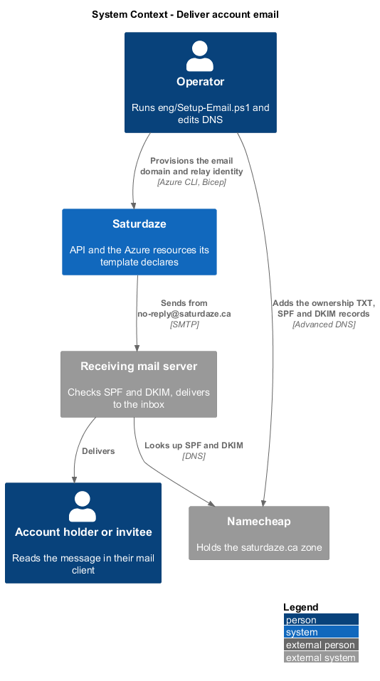
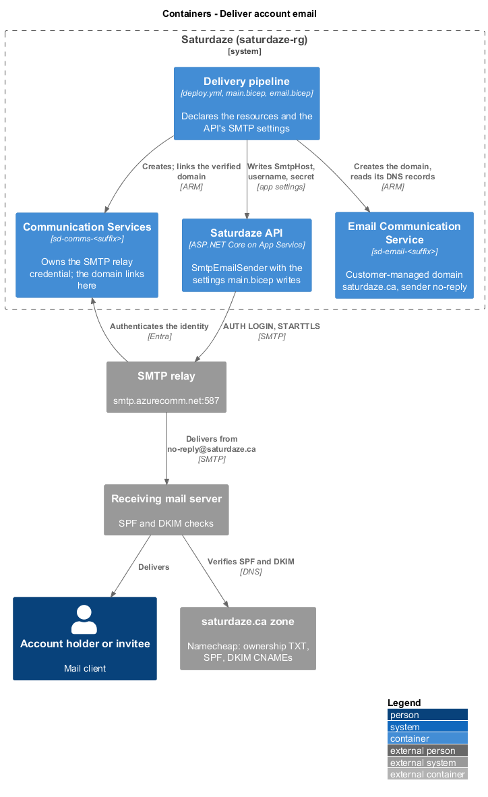
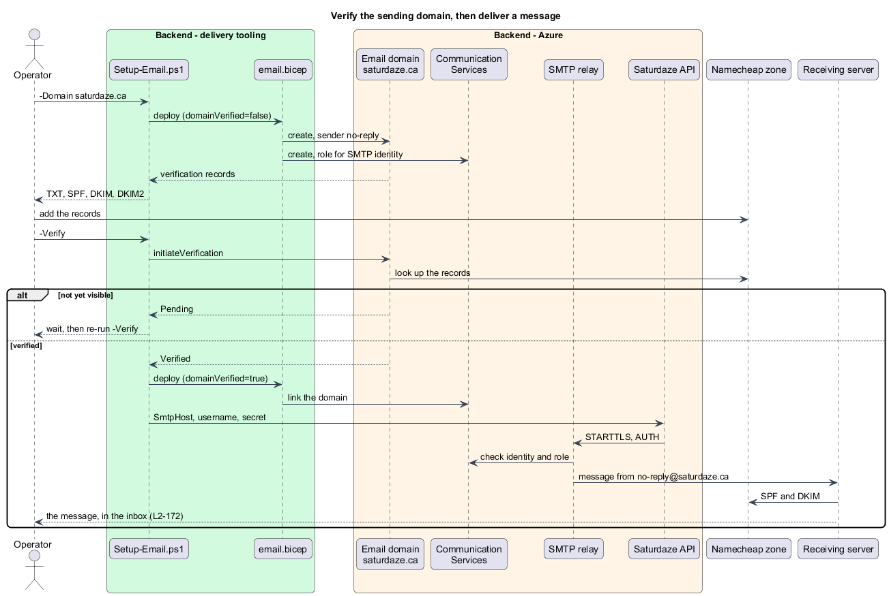

# Deliver account email

## Overview

Saturdaze is a web application that plans personalized family weekends. It sends a handful of transactional emails: verification and password-reset links, suggestion outcomes and platform invitations (`send-branded-email`). This feature is the production delivery of those messages: an Azure Communication Services email domain for `saturdaze.ca`, an SMTP relay the API authenticates to, and the DNS records at the registrar that let receiving servers trust the sender. Without it the production API writes every message as an `.eml` file to a directory nobody reads.

*sending domain* — the domain in the `From` address, `saturdaze.ca`, which Azure must see proven by DNS before it sends on its behalf

*SMTP relay* — `smtp.azurecomm.net`, the mail server Azure Communication Services exposes, which accepts a message from an authenticated client and delivers it from the linked domain

*SMTP identity* — the Entra application the API presents to the relay: its client id in the username, its client secret as the password, and a role on the Communication Services resource

The feature sits in operations because it is hosting plumbing (ADR-020): no application code changes, only the resources the template declares and the settings it writes.

## Description

### Template

`eng/infra/email.bicep` is a module of `eng/infra/main.bicep`. It declares an Email Communication Service (`sd-email-<suffix>`), the customer-managed domain named by `emailDomain`, a `no-reply` sender username on it, and a Communication Services resource (`sd-comms-<suffix>`). The domain's `verificationRecords` (ownership TXT, SPF, DKIM, DKIM2) and `verificationStates` are outputs, and `deploy.yml` prints the records in the run summary. The module links the domain to the Communication Services resource only when `domainVerified` is true, because Azure refuses to link a domain it has not verified; the same flag, read from the `EMAIL_DOMAIN_VERIFIED` repository variable, turns on the API's SMTP settings. When `smtpPrincipalId` is given, a role assignment grants the SMTP identity **Communication and Email Service Owner** on the resource.

`main.bicep` composes the API's app settings from the SMTP values when `emailDomain`, `emailDomainVerified`, `smtpClientId` and `smtpClientSecret` are all present: `Saturdaze__Email__From`, `SmtpHost=smtp.azurecomm.net`, `SmtpPort=587`, `SmtpStartTls=true`, `SmtpUsername=<resource>.<client id>.<tenant id>` and `SmtpPassword`. Otherwise it writes only `Saturdaze__Email__PickupDirectory`, as before. `deploy.yml` fails the `infra` job when the verified flag is set but the relay is not configured, so a misconfiguration cannot deploy as silence.

### Script

`eng/Setup-Email.ps1` performs the steps the template cannot: it creates the `saturdaze-smtp` app registration and service principal, issues a client secret when `.deploy/azure.env` has none, deploys the module, prints the records, and stores the variables and the secret in the GitHub repository. With `-Verify` it posts `initiateVerification` for each record type, waits for the domain to verify, redeploys with the link, and writes the SMTP settings to the Web App directly so mail flows before the next push.

### Registrar

The zone at Namecheap gains the ownership TXT on `@`, the two DKIM CNAMEs, and `include:spf.protection.outlook.com` merged into the existing SPF record, which keeps the registrar's forwarding include. A `_dmarc` TXT with `p=none` asks receivers to report rather than reject.

### Runtime

Nothing in the API changes. `DependencyInjection.cs` already chooses `SmtpEmailSender` when `Saturdaze:Email:SmtpHost` is set and `PickupDirectoryEmailSender` otherwise; `EmailDispatchService` sends off the request path and logs a failure by subject and exception type only (L2-142 AC5).

## Requirements

The following L2 requirements refine the cited L1 capabilities.

| L2 ID | Refines (L1) | Requirement |
|-------|--------------|-------------|
| `L2-172` | `L1-016`, `L1-001` | The production stack shall deliver the mail of L2-142, L2-149 and L2-157 from `no-reply@saturdaze.ca` through an Azure Communication Services email domain the template provisions and an SMTP relay the API authenticates to. The domain's DNS records are held at the registrar; until the domain is verified the API keeps writing `.eml` files, and the switch to SMTP is a deployment setting, never a code change. A verified flag without relay credentials shall fail the deployment. |

## Diagrams

### System context

The context view places the operator, the registrar and the receiving mailbox around the stack.

### Containers

The container view shows the API, the relay, the email domain and the registrar's zone.

### Behaviour — set up the domain, then send

The sequence follows the operator through the two script runs and a message from the API to the inbox (`L2-172`).

