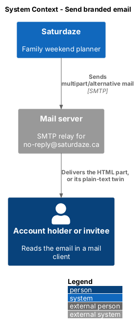
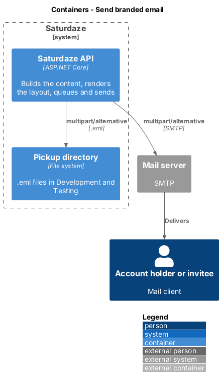
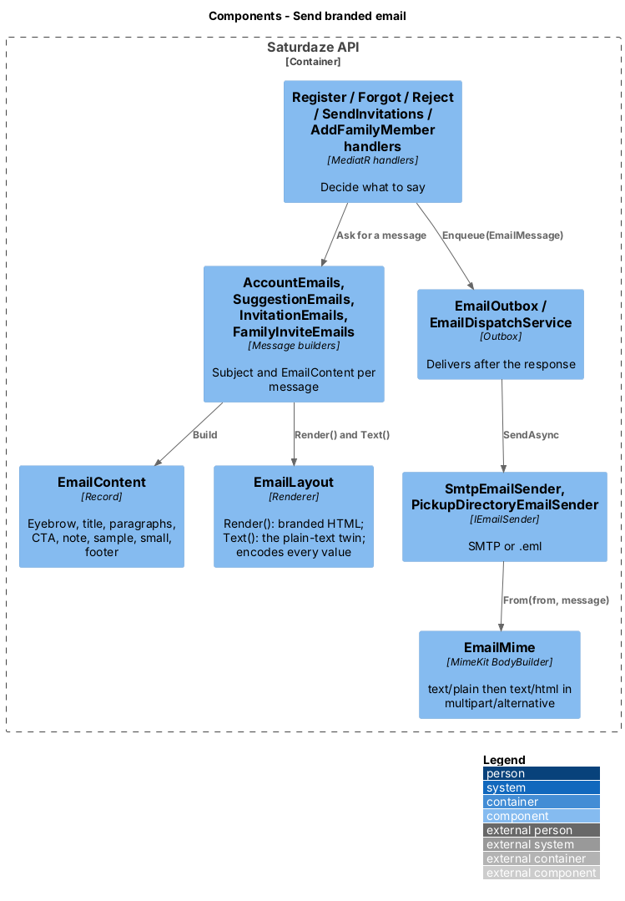
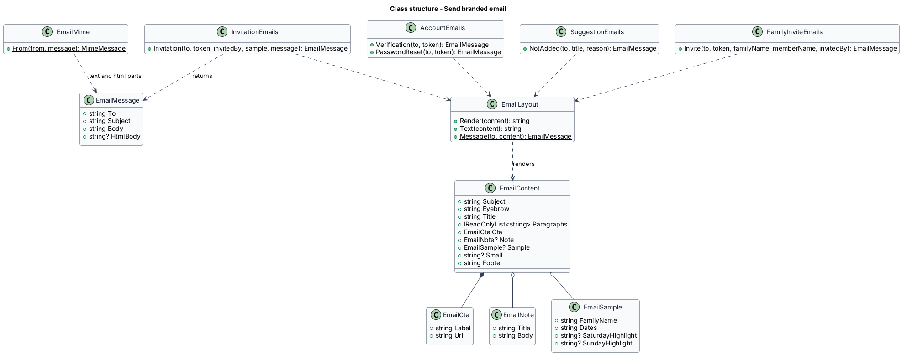
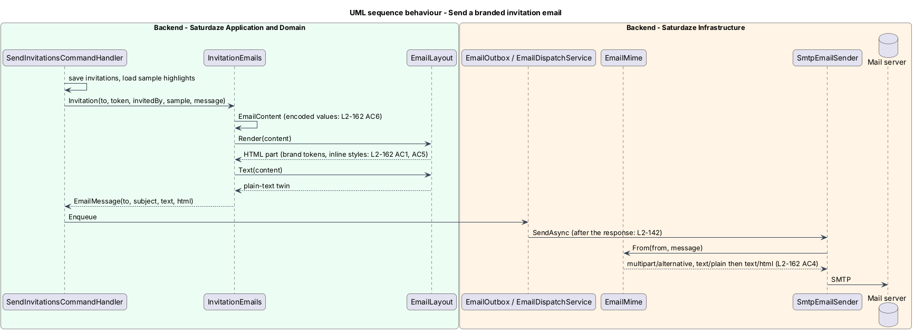

# Send branded email

## Overview

Saturdaze is a web application that plans personalized family weekends. It sends a handful of transactional emails: the verification and password-reset links of an account (`verify-email`, `recover-password`), the outcome of an event suggestion, the platform invitations an administrator sends (`invite-families-to-saturdaze`), and the family invite an owner sends to a member (`manage-family-members`, L2-183). Until now each message was plain text. This feature gives every message one HTML layout on the Saturdaze brand, with a plain-text twin for clients that show no HTML, so that an invitation reads like the product it invites a family into.

*transactional email* — message the API sends to one person because of something that happened to their account or invitation

*branded layout* — the single-column HTML frame every message is rendered into: brand mark and wordmark, a white card on the warm background, one primary call to action, a footer

*plain-text twin* — the `text/plain` part of the same message, carrying the same words and links

Email clients load no stylesheet, so the layout inlines the light theme's token values from the design system (`frontend/projects/components/src/lib/tokens/`); `docs/mocks/emails/_layout.html` is the reference template and its comment lists the values. The feature sits in operations because it is delivery plumbing shared by three subsystems; the subject and wording of each message stay with the feature that sends it.

## Description

### Application

`EmailMessage` (`Saturdaze.Application/Email/EmailMessage.cs`) gains `HtmlBody` (nullable). `EmailContent` (`EmailContent.cs`) is the typed description of one message: `Subject` (also the HTML document's title), `Eyebrow`, `Title`, `Paragraphs`, `Cta` (label and URL), `Note` (title and body), `Sample` (family name, dates, Saturday and Sunday highlights), `Small` (the validity sentence), and `Footer`. `EmailLayout.Render(content)` turns it into the HTML document: a 600 px table, the header row with the mark drawn as a brand-coloured cell, the card, the optional sample card and note, the button and the footer. Every string that came from a person goes through `WebUtility.HtmlEncode`; the layout never emits `<script`, `<link`, `<img` or `@import`. `EmailLayout.Text(content)` renders the same content as the plain-text twin so the two parts never drift, and `EmailLayout.Message(to, content)` pairs them into the `EmailMessage`.

`AccountEmails`, `SuggestionEmails` (now an instance with the app origin, so the suggestion mail can link to Ideas), `InvitationEmails` and `FamilyInviteEmails` build an `EmailContent` and return `EmailLayout.Message(to, content)`. `InvitationEmails.Invitation` takes an `InvitationSample` (family name, `WeekendOf`, Saturday and Sunday highlight titles); `SendInvitationsCommandHandler` loads the highlights (the first `Activity` block of each day by `SortOrder`) once per prospect before enqueueing. `FamilyInviteEmails.Invite(to, token, familyName, memberName, invitedBy)` builds the family invite of `docs/mocks/emails/family-invite.html` ("Join {family}" to `/accept-invite?token=…`, works for 7 days); `AddFamilyMemberCommandHandler` enqueues it after the invitation is saved (L2-183).

### Infrastructure

`EmailMime.From` builds the MIME message with MimeKit's `BodyBuilder`: `TextBody` from `Body` and `HtmlBody` from `HtmlBody`, which yields `multipart/alternative` with the text part first. `SmtpEmailSender` and `PickupDirectoryEmailSender` are unchanged; the pickup `.eml` shows both parts.

### Tests

`Saturdaze.Application.Tests/Email/EmailLayoutTests.cs` covers encoding and the forbidden markup; `Saturdaze.Infrastructure.Tests/Email/MultipartTests.cs` covers the MIME shape; `Saturdaze.Api.Tests/Admin/AdminInvitationsTests.cs`, `Auth/AccountEmailTests.cs` and `Families/FamilyInviteEmailTests.cs` capture the messages the handlers send and check their HTML parts (L2-162).

## Requirements

The following L2 requirements refine the cited L1 capabilities.

| L2 ID | Refines (L1) | Requirement |
|-------|--------------|-------------|
| `L2-162` | `L1-038` | Every email Saturdaze sends (platform invitations of L2-157, the verification and reset mail of L2-142, the suggestion outcome of L2-149, the family invite of L2-183) shall be a `multipart/alternative` message with an HTML part laid out on the Saturdaze brand and a plain-text part that carries the same words and links. The HTML part shall use the design system's light theme values: the warm page background, a white card with the large radius, ink and soft-ink text, and one primary call-to-action button in the brand fill with on-brand text. It shall be a single-column, 600 px wide, table-based layout with inline styles only: no stylesheet link, no script, no web font and no image request. An invitation that carries a sample weekend shall show a sample card with the family name, the weekend dates and the Saturday and Sunday highlights; an administrator's message shall show in a note. Every value that came from a person shall be HTML-encoded. |
| `L2-183` | `L1-037`, `L1-038`, `L1-001`, `L1-012` | When the owner invites a member to sign in, the system shall also email the invitation to the invited address after the invitation is saved, as a branded `multipart/alternative` message whose button "Join {family name}" links to the same `{Share:AppOrigin}/accept-invite?token=…` link the response still returns; every person-supplied value shall be HTML-encoded, and a delivery failure shall not fail the request (L2-142 AC5). |

## Diagrams

### System context

The context view places the people who receive mail around the API and the mail server.

### Containers

The container view shows the API composing both parts and the mail server delivering them.

### Components

The component view names the content record, the layout renderer, the four message builders, the outbox and the MIME builder.

### Class structure

The class view shows `EmailContent`, `EmailLayout`, `EmailMessage` and the builders that use them.

### Behaviour — send an invitation email

The sequence follows an invitation from the handler through the layout, the outbox and the MIME builder to the mail server (`L2-162`).

