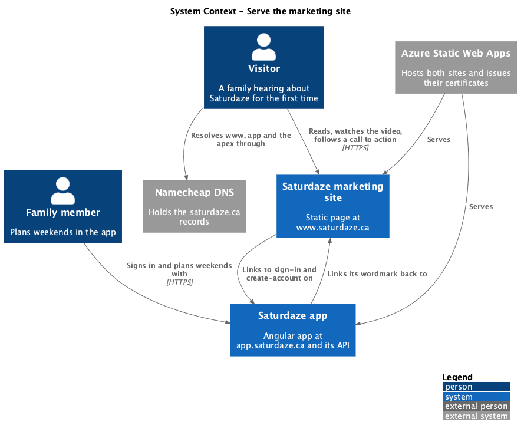
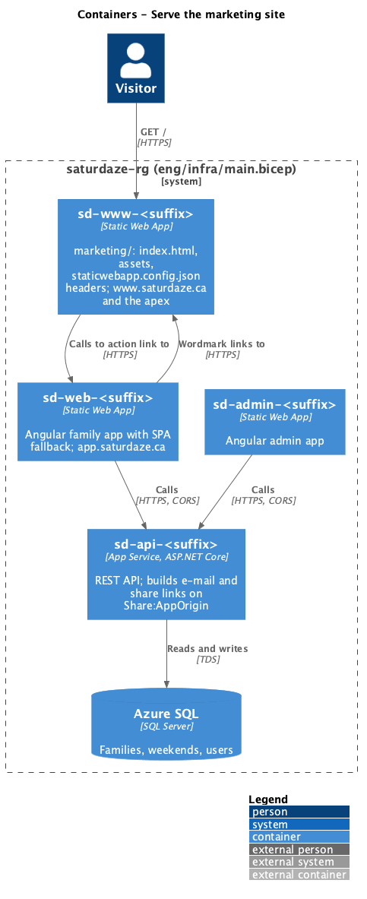
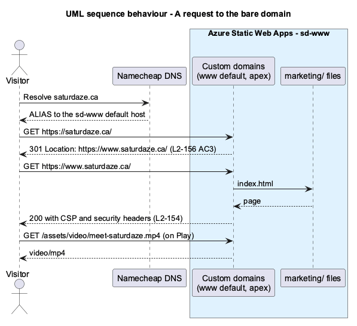
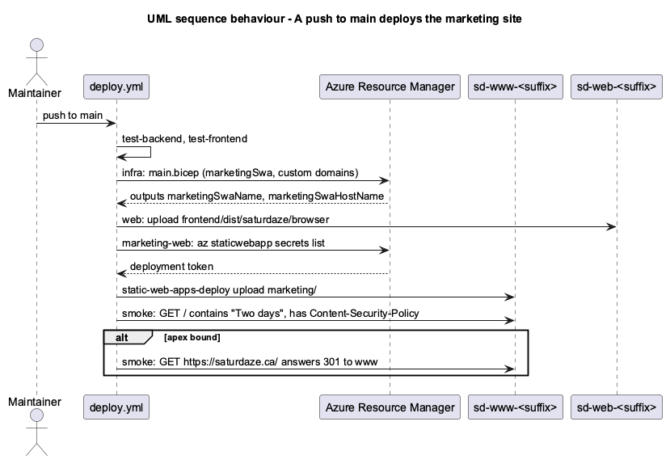

# Serve the marketing site

## Overview

Saturdaze drafts a family's weekend around its commitments, the weather and the places nearby. Until now the only page that explained it lived inside the Angular app at `/`, so it shipped with the app, could carry no metadata of its own, and had no room for a video or screenshots.

This feature, part of the `web-experience` subsystem, moves that page to a static site at `https://www.saturdaze.ca` and moves the app to `https://app.saturdaze.ca` (ADR-018). The page follows Shelfie's marketing page: one HTML file, one stylesheet, one small script, a one-minute brand video and real screenshots of the app. It lives outside the Angular workspace, so the components-library rule does not apply to it.

*marketing site* — `marketing/` at the repository root, served at `https://www.saturdaze.ca/` from the Static Web App `sd-www-<suffix>`

*app host* — `app.saturdaze.ca`, bound to the family Static Web App through `APP_CUSTOM_DOMAIN`

*bare domain* — `saturdaze.ca` with no subdomain, which only redirects to `www`

*site URL* — `environment.siteUrl` in the family app: `https://www.saturdaze.ca` in production, `http://localhost:4500` in development

## Description

### The page

`marketing/index.html` holds, in order: a skip link; a sticky header with the wordmark, anchor links (How it works, Inside the app, For families), "Open the app" and a menu button; the hero ("Two days. Already planned.", "Create your account", "Free during the beta.", "See how it works") beside a screenshot of the Weekend screen inside a browser frame; "Saturdaze in one minute." with the brand video; the three steps carried over from the retired landing page; "Inside the app", four tinted cards with real screenshots; "For families", a grid on commitments, ideas within a short drive, errands and weather; a final call to action; and a footer with Terms, Privacy, Sign in and the year (`L2-150`). Every call to action is an absolute link to `https://app.saturdaze.ca`.

`marketing/assets/tokens.css` is written by `npm run tokens` from the TypeScript theme (ADR-013), next to `_tokens.scss`, and `tokens:check` fails when it is stale. Light and dark follow the device exactly as in the app (`L2-150` AC9). `marketing/assets/saturdaze.css` reads only those tokens by role (`--colorBrandBackground` for fills, `--colorNeutralForeground2` for soft text). Card washes are classes (`tint-bg-*`), never inline styles, so `style-src 'self'` holds. The page uses the app's system font stack and ships no fonts. Below 64rem the anchor links give way to the menu button (`L2-151`).

`marketing/assets/saturdaze.js` adds `reveal-ready` to `<html>`; toggles the menu, keeping `aria-expanded`, the button's name and the menu's `inert` in step, and closes it on Escape, on a menu link and when the window grows past 64rem; marks the header once scrolled; reveals `[data-reveal]` sections with an `IntersectionObserver`, or all at once under reduced motion; and writes the footer year (`L2-151`, `L2-152`).

The head carries a title, description, `theme-color` per scheme, a canonical link, Open Graph and Twitter `summary_large_image` tags with `assets/social-card.png` (1200x630) and `assets/icon.svg`; `robots.txt` and `sitemap.xml` sit beside it (`L2-153`).

### Headers

`marketing/staticwebapp.config.json` declares `globalHeaders`: the Content-Security-Policy (`default-src 'self'`, `script-src 'self'`, `style-src 'self'`, `img-src 'self' data:`, `frame-ancestors 'none'`, `object-src 'none'`), `Strict-Transport-Security`, `X-Content-Type-Options`, `Referrer-Policy` and `Permissions-Policy` (`L2-154`). It has no navigation fallback, so an unknown path is a 404. A few muscle-memory paths (`/sign-in`, `/create-account`, `/legal`, `/weekend`) redirect to the app host; e-mailed links never use them, because the API builds them on `Share:AppOrigin`.

### Media

The video is `docs/videos/44-meet-saturdaze`, recorded from the real app with `tools/video-record` and narrated with Azure Speech `en-US-JennyNeural` (`cheerful`, `-5%`) through the `azure` engine of `tools/video-audio/generate-audio.mjs`. The built MP4 is copied to `marketing/assets/video/meet-saturdaze.mp4`, and its poster is one frame taken with `ffmpeg`. The page's `<video>` has `controls`, `playsinline`, `preload="metadata"` and a poster, and no `autoplay` (`L2-150` AC7). `tools/marketing-screenshots/capture.mjs` signs in the seeded family, captures the Weekend, Ideas, Family and Past screens and renders `social-card.html` to `assets/social-card.png`.

### The app

`app.routes.ts` loses the landing route: `/` and `**` redirect to `/weekend`, so `requireAuth` sends an anonymous visitor to `/sign-in?returnUrl=%2Fweekend` (`L2-155` AC1, AC2). `Sitebar` and `AuthShell` gain a `homeHref` input, `/` by default, rendered as a plain `href` on the wordmark and on "Back to Saturdaze"; the family app passes the site URL, the admin app keeps the default (`L2-155` AC3). The legal page, the shared weekend and the dialogs gallery keep the site shell.

`saturdaze.app` becomes `saturdaze.ca` everywhere: the e-mail sender, the admin app's family-app link, the seed accounts and the sample URLs in stories. `Share:AppOrigin` already derives from `APP_CUSTOM_DOMAIN`, so share and invite links follow the variable (`L2-155` AC5).

### Hosting and deploy

`eng/infra/main.bicep` declares `marketingSwa` (`sd-www-<suffix>`, the same SKU as the others) with two optional custom domains, `marketingCustomDomain` and `marketingApexDomain`, and outputs its name and host. `deploy.yml` passes `MARKETING_CUSTOM_DOMAIN` and `MARKETING_APEX_DOMAIN` to the template, adds a `marketing-web` job that uploads `marketing/` like the `web` job uploads the Angular build, and extends `smoke` to load the page, check its headline and CSP header and, when the apex is bound, its redirect (`L2-156`).

### DNS

At Namecheap: `CNAME app` to the family app's default host, `CNAME www` to the marketing app's default host, `ALIAS @` to the marketing app's default host, and the `_dnsauth` TXT records Static Web Apps asks for. In the portal, `www.saturdaze.ca` is made the default domain so the apex redirects to it; if that does not hold, the apex is left unbound and a Namecheap URL redirect does the job (ADR-018).

### Tests

`e2e/fixtures/marketing-server.mjs` serves `marketing/` on port 4500 with the headers from `staticwebapp.config.json`, so a test sees what production would block. The Playwright project `marketing` runs `e2e/tests/marketing/`, with selectors in `e2e/pages/marketing.page.ts`: `marketing.spec.ts` covers the sections, links and video (`L2-150`), `marketing-layout.spec.ts` sideways scroll, the keyboard menu and reduced motion (`L2-151`, `L2-152`), and `marketing-metadata.spec.ts` the tags, robots, sitemap and a load under the policy with no violations and no off-origin requests (`L2-153`, `L2-154`). `marketing.visual.spec.ts` compares the page with `docs/mocks/pages/marketing.html` (ADR-010). `route-guards.spec.ts`, `legal.spec.ts`, `sign-in.spec.ts` and `shared-weekend.spec.ts` cover `L2-155`.

## Requirements

| L2 ID | Refines (L1) | Requirement |
|-------|--------------|-------------|
| `L2-150` | `L1-011` | Marketing page sections and calls to action to `app.saturdaze.ca` |
| `L2-151` | `L1-011`, `L1-014` | No sideways scroll at phone, tablet and desktop widths; labelled, keyboard-operable, `inert` mobile menu |
| `L2-152` | `L1-011`, `L1-014` | Reveal on scroll, switched off under reduced motion |
| `L2-153` | `L1-011` | Meta, Open Graph, Twitter and canonical tags; `robots.txt`; `sitemap.xml` |
| `L2-154` | `L1-012` | Strict CSP and security headers; no third-party requests |
| `L2-155` | `L1-011` | The app at `app.saturdaze.ca` without the landing page; links back to the marketing site |
| `L2-156` | `L1-016` | A fourth Static Web App, its domains, its deploy job and smoke checks |

## Diagrams

### System context

Visitors read the marketing site; family members use the app; Namecheap holds the records; Static Web Apps serves both sites.

### Containers

Four Static Web Apps and the API in one resource group. The marketing site never calls the API.

### Behaviour — a request to the bare domain

The apex answers with a permanent redirect to `www`, which serves the page with its security headers.

### Behaviour — a push to main deploys the marketing site

The template converges the fourth app; `marketing-web` uploads the folder; `smoke` checks the page and the redirect.

