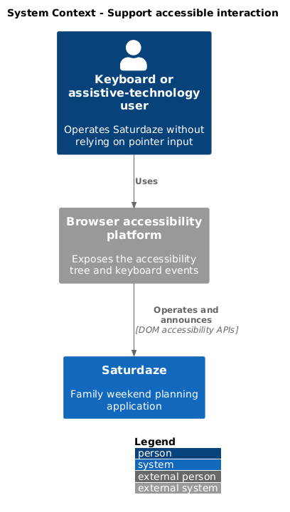
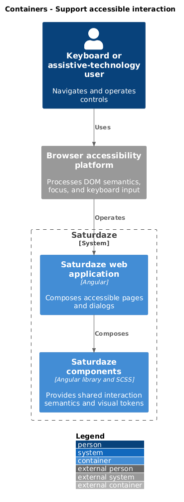
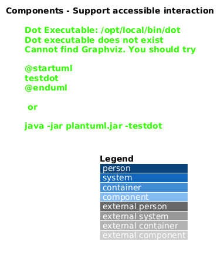
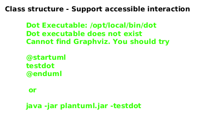
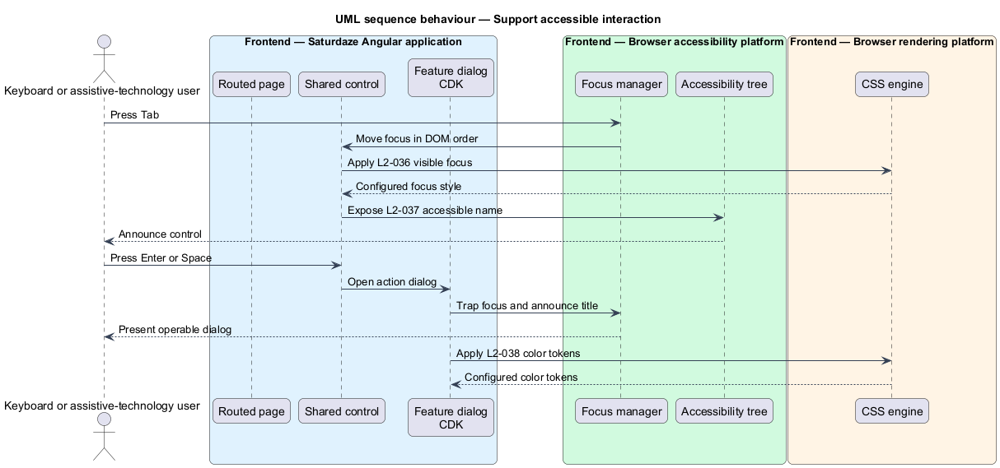

# Support accessible interaction

## Overview

Saturdaze combines an Angular web application, an ASP.NET Core API, SQL Server persistence, and administrative delivery tooling. The accessible interaction slice makes navigation, controls, dialogs, text, and meaningful imagery perceivable and operable without a pointing device.

*accessible name* — programmatic label exposed to assistive technology for a meaningful element

Shared components centralize keyboard behavior, labels, focus styles, and color tokens. Routed pages compose those controls and supply content-specific labels and alternative text.

## Description

The feature crosses the application and platform boundaries needed to deliver its observable outcome.

- **`Button`** — Shared Angular controls with native button semantics and icon-only labelling.
- **`TextInput`** — Shared Angular form control that associates visible labels and validation text.
- **`Dialog`** — Presentational panel inside the Angular CDK dialog container; CDK owns focus trapping and restoration.
- **`FilterChip and Toggle`** — Shared interactive controls with keyboard and state semantics.
- **`_tokens.scss and _global.scss`** — Shared color and focus styles used by component SCSS. `_tokens.scss` is generated from the Fluent UI v9 TypeScript theme in `components/src/lib/tokens/` (ADR-013); `_global.scss` applies the shared `:focus-visible` outline.
- **`Routed page templates`** — Feature templates that provide descriptive labels and image alternatives.
- **`SkipLink`** — `sd-skip-link`, the first element both app shells render (`app.html` in the family app for the app, site and bare shells, and in Admin for the sign-in screen and every screen behind the admin navigation; the non-admin gate has no `<main>` and no navigation to skip, so it has none). It is the design system's `.skip-link`: off screen at rest, 16px from the top left on `:focus-visible`, above every bar. Because both apps use `<base href="/">`, a bare `href="#main"` would resolve to `/#main` and leave the route, so the component handles the click: it cancels the navigation, gives the target `<main id="main">` `tabindex="-1"` and focuses it (the browser scrolls it into view, and the global `scroll-padding-top` keeps it clear of the sticky bar). The programmatically focused `main` draws no outline (L2-036 AC4 and AC5, drift D22).

- **`Dark theme`** — `createDarkTheme(brand)` in `components/src/lib/tokens/utils/` builds a second theme from the same roles as `createLightTheme` (Fluent's `webDarkTheme` model): the colour and shadow tokens only, from the umber ramp and the dark tone tints in `global/colors.ts`, using the design system's dark values. `scripts/generate-tokens.mjs` writes the tokens that differ from light into `_tokens.scss` under `@media (prefers-color-scheme: dark) { :root { … } }`, after the light `:root` and its responsive retunes, and `_global.scss` declares `color-scheme: light dark` so native controls and scrollbars follow. Components already read tokens by role, so no component knows which theme is active; the only component changes are role corrections that light hid: the photo-pick name pills read `colorNeutralForegroundStaticInverted` (text over a photo) instead of `colorNeutralForegroundOnBrand`, and the cover scrim reads `colorBackgroundOverlayStrong` instead of a mix of `colorNeutralForeground1`, which turns light in dark. There is no in-app switch: the theme follows the system setting (L2-130, drift D25).

- **`Reduced motion`** — `durations.ts` in `components/src/lib/tokens/global/` gains `durationShimmer` (1400ms, one skeleton sweep) and `durationSpin` (900ms, one spinner turn); `sd-skeleton-row` and `sd-spinner` read them instead of literal times. `themes/reducedMotion.ts` exports `reducedMotionOverride`, which `scripts/generate-tokens.mjs` writes into `_tokens.scss` under `@media (prefers-reduced-motion: reduce) { :root { … } }`: `durationFast`, `durationNormal` and `durationShimmer` drop to 0.01ms (not 0, so `transitionend` and `animationend` still fire) and `durationSpin` is left alone. `_global.scss` no longer cuts every animation and transition to 0.001ms with `!important`, which had frozen the spinner on "Working through your locks"; each kind of motion now decides through its token: transitions and the shimmer stop, the spinner keeps turning because it reports status. The skeleton and tooltip still drop their animation under reduced motion (L2-131, drift D29).

- **`Tooltip bubble`** — `sd-tooltip` (the panel `[sdTooltip]` renders into its CDK Overlay) reads Fluent tokens by role, matching the design system's `.tooltip`: `colorNeutralBackgroundInverted` behind `colorNeutralForegroundInverted`, `spacingVerticalXS` / `spacingHorizontalS` padding, `borderRadiusSmall`, `shadow16`, `fontFamilyBase` at `fontSizeBase200` in `fontWeightMedium` with `lineHeightSnug`, and a `durationFast` / `curveEasyEase` fade. It had still read `--sd-*` names that ADR-013 retired, which no longer resolve, so the bubble rendered with no fill. Because the inverted pair has dark values, the bubble flips to cream on dark text in the dark theme with no component change (L2-132, drift D30).

- **`New-tab links`** — `sd-button` with `target="_blank"` appends visually hidden text " (opens in a new tab)" (the global `.sd-visually-hidden` utility) after its projected content, or to its `label` when one names it, and sets `rel="noopener"`; so the cards' Map, See menu and Details and the calendar dialog's Download .ics announce the new tab without each consumer repeating it. `sd-details` and `sd-leg` render the same hidden text in their own anchors, and the day map's OpenStreetMap credit carries it too. `sd-icon` gains `external` (the design system's arrow leaving a box), which replaces `arrow_right` after a submission's Link in `sd-details` and after an event card's Details (L2-133, drift D31).

- **`Error summary`** — `sd-error-summary` (`components/src/lib/error-summary/`), the design system's `.error-summary`: an alert panel (`role="alert"`, `tabindex="-1"`) with a title and a list of links, one per problem; it takes `problems` (`{ id, message }[]`) and focuses itself when it appears. Form dialogs (`SubmitEventDialog`, `FamilyMemberDialog`) keep their primary action enabled; the click handler builds the problem list, sets `error` on the invalid `sd-text-input`s, and shows the summary instead of submitting. A link's click focuses the field by id; editing a field removes its problem. (L2-134)

Automated structural checks do not establish complete keyboard or WCAG contrast conformance. The obligations below remain subject to dedicated accessibility verification.

## Requirements

The following L2 requirements refine the cited L1 capabilities. Implementation gaps stated in Description do not waive these obligations.

| L2 ID | Refines (L1) | Requirement |
|-------|--------------|-------------|
| `L2-036` | `L1-014` | Every button, link, form control, and dialog action shall be reachable via Tab order and operable with Enter/Space, and the visible focus indicator shall meet WCAG 2.1 AA contrast. |
| `L2-037` | `L1-014` | Icon-only buttons shall carry `aria-label`, form fields shall have associated labels, and images carrying meaning shall have descriptive `alt` text. |
| `L2-038` | `L1-014` | All text, including chip labels and disabled controls used to convey state, shall meet a 4.5:1 contrast ratio against its background (3:1 for large text ≥18 pt or 14 pt bold). |
| `L2-130` | `L1-011`, `L1-014` | Every page shall follow the reader's colour scheme: the dark theme, built from the same roles as light, when the system prefers dark; the light theme otherwise. |
| `L2-131` | `L1-014` | Under reduced motion, decorative motion (transitions, the dialog rise, the skeleton shimmer) shall stop while loading spinners keep turning. |
| `L2-132` | `L1-011`, `L1-014` | A tooltip shall show as an opaque inverted bubble (dark on light, light on dark) whose text meets 4.5:1 on its fill. |
| `L2-133` | `L1-014` | Every link that opens a new tab shall say so in its accessible name ("(opens in a new tab)"), and address and Details links shall show the external icon. |
| `L2-134` | `L1-014` | A form dialog's primary action stays enabled and names the action; activating it with problems shows a focused error summary whose lines link to the invalid fields. |

## Diagrams

### System context

The context view identifies the person using or operating the capability and the participating system boundary.

### Containers

The container view shows the deployable applications, platform services, or data stores that carry the feature.

### Components

The component view names the runtime or delivery components that implement the slice.

### Class structure

The class view shows selected code and configuration relationships. Cancellation parameters and unrelated members are omitted.

### Behaviour — operate a labelled dialog by keyboard

The sequence view traces the primary behaviour to `L2-036`, `L2-037`, and `L2-038`. Its alternate path shows the controlled non-success outcome.

