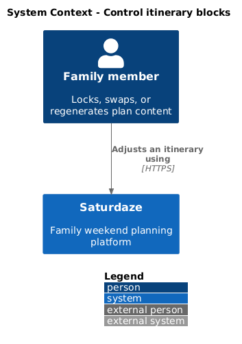
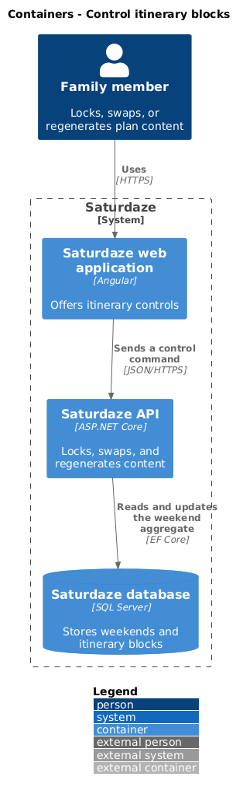
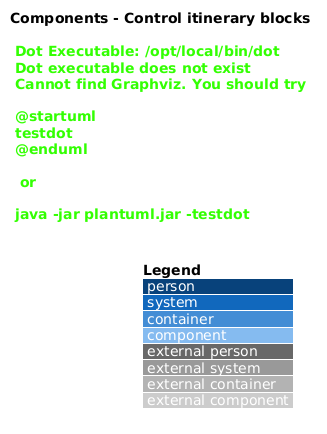
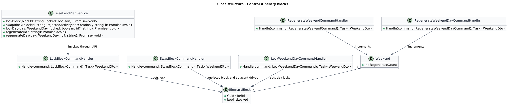
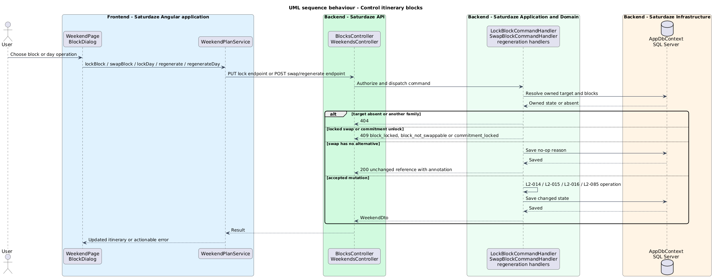

# Control itinerary blocks

## Overview

Saturdaze is a web application that plans personalized family weekends. Block control lets a family protect chosen plans and replace flexible suggestions without displacing protected content.

*locked block* — itinerary block excluded from swap and regeneration changes

The slice combines block-level lock and swap endpoints with weekend regeneration. Handlers authorize ownership before mutating the `Weekend` aggregate.

## Description

`WeekendPage` and `BlockDialog` expose locking, server-selected swaps, and regeneration through `WeekendPlanService`. The API returns the refreshed parent WeekendDto after changes.

`LockBlockCommandHandler` sets lock state after checking family ownership. Commitments cannot be unlocked. `SwapBlockCommandHandler` selects another fitting activity and honors supplied rejected IDs, activities already on the weekend, and the current activity. Locked blocks return 409 `block_locked`, non-activity blocks return 409 `block_not_swappable`, and no alternatives yield an annotated 200 no-op. A successful swap updates the target block in place, so it keeps its ID and takes the new activity's reference, title, times and stop (L2-015 AC1); only the adjacent drive blocks are replaced with new ones.

`RegenerateWeekendCommandHandler` and `RegenerateWeekendDayCommandHandler` load common inputs through `PlannerInputLoader` and invoke `IWeekendPlanner.Plan()`. Both increment `RegenerateCount`. Both carry every locked block over by ID and content, commitment blocks included; the planner materializes a profile commitment only when no carried-over commitment block on that day already represents it (same title, or an overlapping window). Day regeneration leaves the other day in persistence untouched.

`LockWeekendDayCommandHandler` sets all selected-day locks while retaining commitment locks. No client alternatives-list endpoint exists.

`sd-day` renders the day header's lock toggle as a pressed-state `sd-button` whose visible label is "Lock day" or "Unlock day". Its `aria-label` starts with that label and appends the day title after a colon, "Lock day: Saturday" or "Unlock day: Saturday", so the accessible name contains the visible label (L2-085 AC3, WCAG 2.5.3). The Regenerate button already follows the rule ("Regenerate Saturday").

Locked blocks, commitments among them, retain identity, time and content during regeneration (L2-011 AC2, L2-016 AC1). A commitment added to the profile after the weekend was planned gains a block on the next regeneration; a commitment removed from the profile keeps its locked block until the user unlocks the day or the weekend is regenerated from scratch through Repeat or Remix.

## Requirements

The following L2 requirements refine the cited L1 capabilities. Implementation gaps stated in Description do not waive these obligations.

| L2 ID | Refines (L1) | Requirement |
|-------|--------------|-------------|
| `L2-014` | `L1-004` | `PUT /api/blocks/{id}/lock` shall set `ItineraryBlock.IsLocked` to the request value and return the parent weekend. |
| `L2-015` | `L1-004` | `POST /api/blocks/{id}/swap` shall replace the activity referenced by a block with the next-best candidate, optionally excluding a list of rejected activity IDs supplied by the client. |
| `L2-016` | `L1-004` | `POST /api/weekends/{id}/regenerate` shall rebuild every unlocked block, leave every locked block in place, and increment `Weekend.RegenerateCount`. |
| `L2-085` | `L1-004` | The family-scoped day lock and regeneration endpoints shall operate on the selected Saturday or Sunday. Day unlocking shall preserve commitment locks, and day regeneration shall retain locked blocks and the other day's plan. |

## Diagrams

### System context

The context view identifies the family member using the capability and the Saturdaze system that owns the weekend state.

### Containers

The container view follows the interaction from the Angular web application through the API to SQL Server.

### Components

The component view names the page, client service, controller, handler, domain type, and persistence boundary involved in the slice.

### Class structure

The class view shows the request path and the state relationships used by the feature.

### Behaviour — change flexible itinerary content

The sequence view traces the primary behaviour to `L2-014`, `L2-015`, and `L2-016`. Its alternate path preserves valid existing state when the request cannot proceed.

