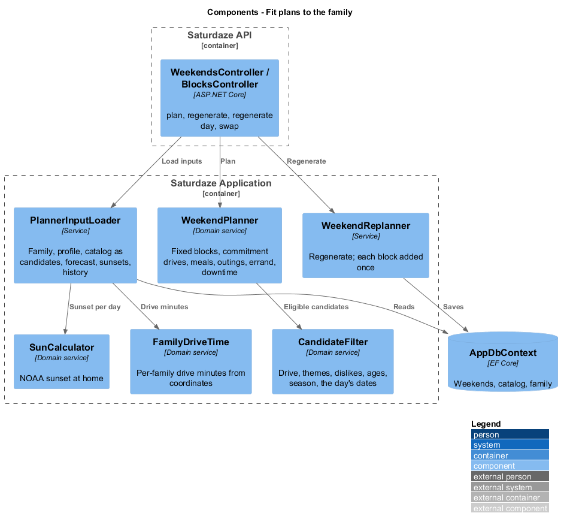
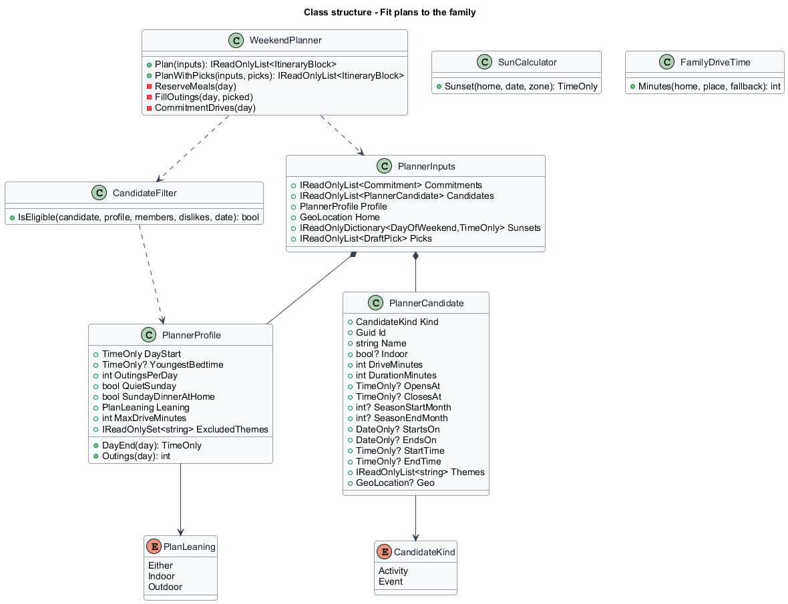
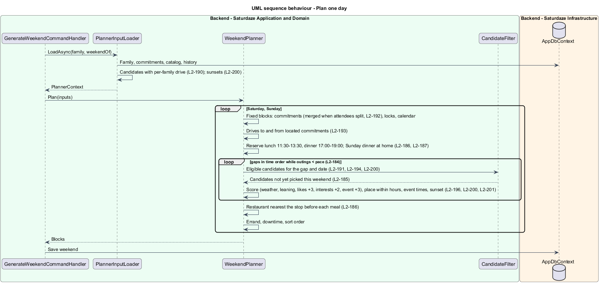

# Fit plans to the family

## Overview

Saturdaze is a web application that plans personalized family weekends. `WeekendPlanner` is the rule-based planner that builds Saturday and Sunday around the family's commitments (`weekend-planning/generate-current-weekend`). The schedule generation evaluation (`docs/schedule-generation-evaluation.md`) found eleven defects in it. This design fixes the ones that block a good plan, with or without agents. It also makes the planner the validator that agent drafts must pass (`weekend-planning/plan-with-agents`, L1-041).

*candidate* — a catalog activity or a published local event the planner may place in a gap, with its drive time computed for this family

*outing* — one activity or event block on a day; the family's pace caps outings per day

*meal window* — the times a meal may start: lunch 11:30–13:30, dinner 17:00–19:00

*fixed block* — a block the planner places around rather than chooses: commitments, locked blocks, calendar events and the drives to located commitments

*sunset* — the time the sun sets at the family's home on a date, from the NOAA sunrise equation

## Description

### Inputs

`PlannerInputLoader.LoadAsync` returns a `PlannerContext` that now carries:
- the family's `PlannerProfile` (`DayStart`, `YoungestBedtime`, `OutingsPerDay`, `QuietSunday`, `SundayDinnerAtHome`, `Leaning`, `MaxDriveMinutes`, `ExcludedThemes`; `family-profile/set-planning-boundaries`);
- the family's home (`Family.HomeCoordinates`, else `HomeLocationOptions`);
- the sunset per weekend day (`SunCalculator.Sunset(home, date, TimeZoneInfo)` in the time zone `Saturdaze:Calendar:TimeZone`, America/Toronto by default);
- the catalog as `PlannerCandidate` records.

`PlannerCandidate.FromActivity` and `FromEvent` copy what the planner needs: kind, id, name, category, tags, description, indoor, ages, duration (events 120 minutes), hours, season, event dates and times, themes and coordinates. `DriveMinutes` is `FamilyDriveTime.Minutes(home, place.Geo, place.DriveMinutes)` (L2-190). `PlannerContext.ToInputs` passes all of it to `PlannerInputs`, which keeps its existing fields for the swap, idea and errand paths.

`PlannerProfile.DayEnd(day)` is the earlier of 21:00 and 30 minutes before `YoungestBedtime` on Saturday. On Sunday it is the earlier of 19:30 and 30 minutes before `YoungestBedtime`. `Outings(day)` is `OutingsPerDay`, except 1 on a quiet Sunday. `PlannerTimes` keeps the defaults; `IdeaPlacementService` and `PlaceErrand` read the day bounds from the profile, so every path agrees on the day.

### One day, in order

`WeekendPlanner.PlanDay` runs these steps:

1. **Fixed blocks.** Commitments come first. Overlapping commitments with split attendees become one fixed span (`family-profile/describe-commitment-attendees-and-places`), and a commitment keeps its own block. Locked blocks follow, then calendar events (unchanged, L2-177). `EnsureNoOverlap` now ignores overlaps between two commitments that the validator already allowed.
2. **Drives to commitments (L2-193).** For each commitment with coordinates, the planner adds "Drive to {title}" before and "Drive home from {title}" after, each `FamilyDriveTime` minutes long. Consecutive commitments at the same coordinates less than 30 minutes apart share the drives. A drive is clipped to the previous fixed block's end and the day's start.
3. **Meals reserved (L2-186, L2-187).** For lunch and dinner, `ReserveMeal` searches quarter-hour starts from the preferred time (12:00, 17:30) up to the window's latest start, then back to its earliest start. It takes the first start where 60 free minutes fit before the day's end. A commitment overlapping the window whose title contains lunch, brunch, dinner or supper counts as the meal. A meal that does not fit is left out. On Sunday with `SundayDinnerAtHome`, the dinner is "Dinner at home" (no ref, no stop, reason "Sunday dinner at home"). The reserved meals are fixed for the rest of the day.
4. **Outings (L2-184, L2-185, L2-201, L2-200, L2-196).** `ComputeGaps` runs over the fixed blocks and reserved meals, from `DayStart` to `DayEnd(day)`. Gaps are filled in time order while the day has fewer than `Outings(day)` outings and the gap has at least 90 minutes free.
   - **Eligibility.** For each gap, `CandidateFilter.IsEligible` drops candidates already picked this weekend (a set shared across both days and seeded with locked activities). It also drops those beyond `MaxDriveMinutes`, those with an excluded theme or a matching dislike (an "Indoor" or "Outdoor" dislike reads the indoor flag), those with two or more members outside the ages, those out of season on that date, events that do not run that date, and pending submissions.
   - **Fit.** `FitInGap` places the candidate. The start is the gap's start plus the drive, moved to `OpensAt` or to the event's `StartTime` when later. The end is the earlier of start plus duration, `ClosesAt`, `EndTime`, the start plus 120 minutes for events, and, for an outdoor or unknown candidate, the sunset. The candidate fits when at least 30 minutes remain (60 for an event) and the drive home fits before the gap's end.
   - **Score.** Today's weather and age terms stay. Leaning matches add 2, each like 3, each member interest 2, and an event 3. Recency and try-new are unchanged. Ties break by name, then by the seeded pick.
   - **Reason.** The winner's reason lists the weather term, "on this weekend only" for events, "first time trying this — variety on" only when the try-new bonus applied (L2-189), "open {opens}–{closes}" when hours shaped it, "back before sunset {time}" when daylight did, and the duration fit.
5. **Restaurants.** Each reserved restaurant meal gets the eligible restaurant (wife-approved, right slot, within the max drive) nearest the stop before it by `TravelEstimator.DistanceKm`, or nearest home. The reason is "near {stop}" or "near home".
6. **Errand, downtime and sort order.** These are unchanged, with day bounds from the profile.

`WeekendPlanner.PlanWithPicks(inputs, picks)` runs the same day pipeline. Before step 4, each pick becomes an anchored outing placed by `FitInGap` at the pick's start, or at the earliest fit when it has none. The agent's reason replaces the planner's. Step 4 then fills only what the picks left, up to the pace. `PlanValidator` (`weekend-planning/plan-with-agents`) uses the same eligibility and fit functions, so the agents and the planner agree on every rule.

### Regenerate response

`WeekendReplanner.RegenerateAsync` and `RegenerateWeekendDayCommandHandler` add each new block through `weekend.Blocks.Add` only. Adding it to `_db.ItineraryBlocks` as well, with `WeekendId` set, made EF's relationship fix-up add it to `weekend.Blocks` a second time, so the response listed it twice (L2-188).

### Swap

`PickActivityForGap` takes the weekend's other-day activities into `rejected` (L2-185). It uses the same eligibility, so a swap never brings back an excluded theme or an out-of-season place.

## Requirements

The following L2 requirements refine the cited L1 capabilities.

| L2 ID | Refines (L1) | Requirement |
|-------|--------------|-------------|
| `L2-184` | `L1-041`, `L1-003` | Before it places activities, `WeekendPlanner` shall reserve each day's meals; it shall then fill the gaps in time order, refilling a gap while at least 90 minutes remain, until the day reaches the family's pace (default 2; 1 on a quiet Sunday); an event pick counts as an outing. |
| `L2-185` | `L1-041`, `L1-003` | An activity or event picked for Saturday shall not be picked again on Sunday; locked blocks count as picked; swap shall skip activities already on the other day. |
| `L2-186` | `L1-041`, `L1-003` | Lunch shall start between 11:30 and 13:30 and dinner between 17:00 and 19:00, or be left out; a meal-like commitment counts as that meal; the restaurant shall be the eligible one nearest the stop before the meal, reasoned "near {stop}" or "near home". |
| `L2-187` | `L1-041`, `L1-003` | Sunday shall get a dinner ending by the wind-down: "Dinner at home" with no `refId` when "Sunday dinner at home" is on (the default), otherwise a restaurant dinner. |
| `L2-188` | `L1-041`, `L1-004` | The regenerate and regenerate-day responses shall list each block exactly once, matching `GET /api/weekends/{id}`. |
| `L2-189` | `L1-041`, `L1-003` | "First time trying this — variety on" shall appear only when "Try something new" is on and the family never had that activity. |
| `L2-193` | `L1-041`, `L1-003` | For a commitment with coordinates, the planner shall add "Drive to {title}" before it and "Drive home from {title}" after it, shared between consecutive commitments at the same place less than 30 minutes apart, never overlapping another fixed block. |
| `L2-200` | `L1-041`, `L1-003` | An activity shall be placed only inside its opening hours and in its season; an outdoor block shall end by sunset at home; reasons shall say when hours or daylight shaped a block. |
| `L2-201` | `L1-041`, `L1-003`, `L1-007` | An eligible event running on a weekend day shall be a candidate, placed at its times (at least 60 minutes, at most two hours) or, untimed, like a two-hour activity between 10:00 and 17:00, scoring +3 "on this weekend only". |

## Diagrams

The context and container views are those of `weekend-planning/generate-current-weekend`; this slice changes no container, so only the component view is drawn.

### Components

The component view shows the loader assembling per-family candidates and sunsets, the filter shared by the planner and the agents' validator, and the regenerate path that no longer double-adds blocks.

### Class structure

The class view shows the new planner inputs: the profile, the candidates and the sunsets. It also shows the filter, the sun and drive calculators, and the planner's day pipeline methods.

### Behaviour — plan one day

This sequence traces `L2-184` → `L2-201` through one day: fixed blocks, commitment drives, reserved meals, outings to the pace, then restaurants, errand and downtime.

