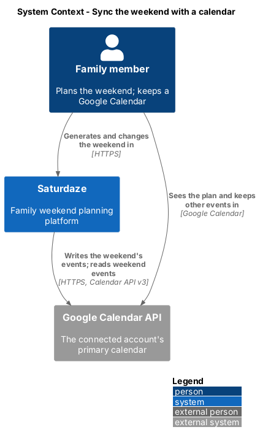
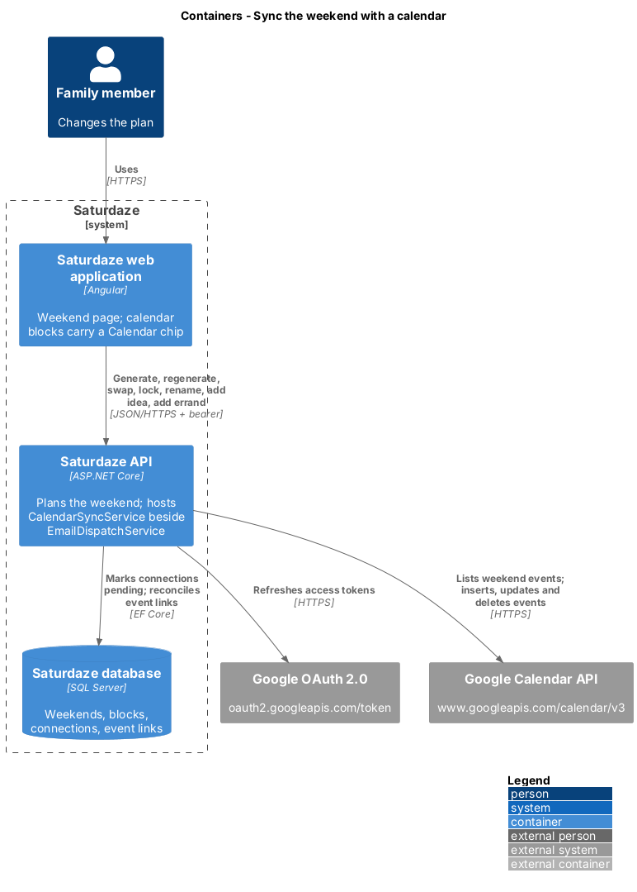
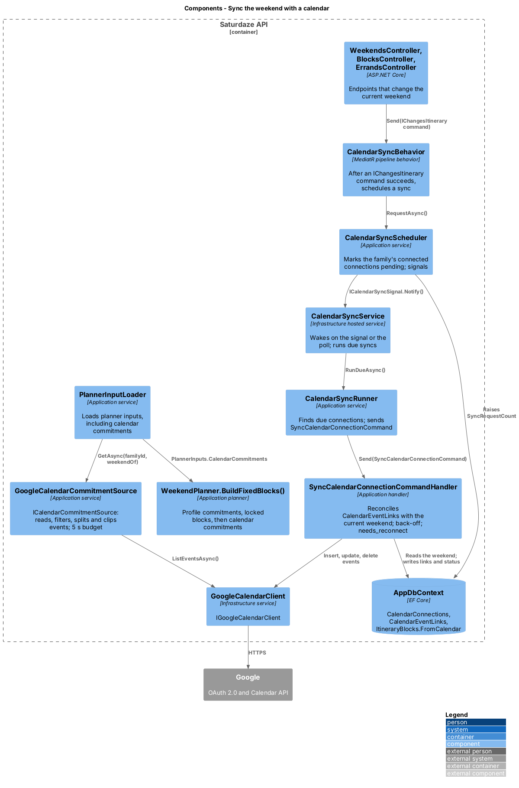
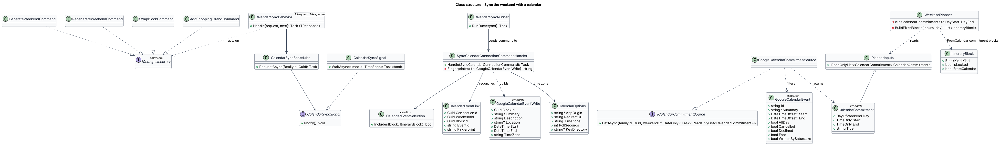
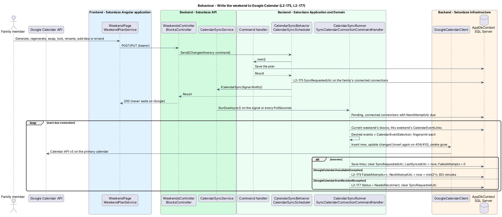
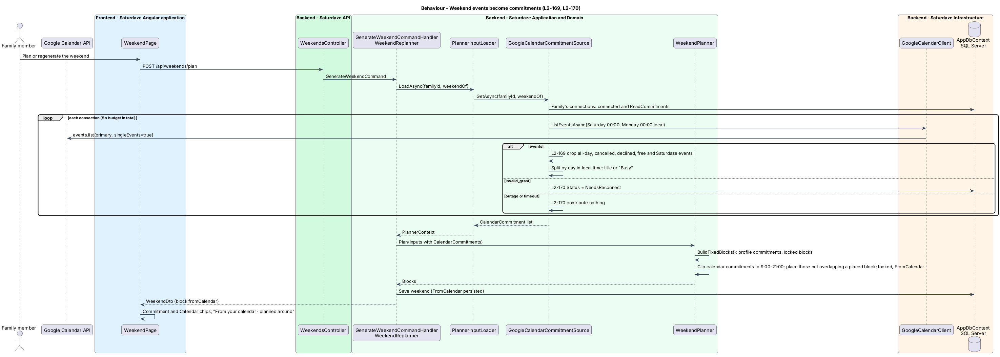

# Sync the weekend with a calendar

## Overview

Saturdaze is a web application that plans personalized family weekends. Once a family member has connected a Google Calendar (`identity-and-access/connect-calendar`), the weekend flows both ways: the plan is written into that calendar and follows every change, and the events already in that calendar on the upcoming Saturday and Sunday are planned around like the family's recurring commitments (L1-039).

*write direction* — keeping one Google event per planned block of the current weekend, created, updated and deleted as the plan changes

*read direction* — turning timed weekend events from the connected calendar into locked commitment blocks before the planner fills the free time

*calendar block* — an itinerary block that came from a calendar event; it behaves as a commitment block and is marked `FromCalendar`

*event link* — the stored pairing of a block and the Google event id written for it, with a fingerprint of what was written

The write runs after the family's request returns and recovers on its own (ADR-020, decision 4); the read joins the planner's single fixed-block path (decision 5). A calendar that fails never stops planning (L2-170).

## Description

**Write direction.** The commands that change the current weekend implement the marker interface `IChangesItinerary`: `GenerateWeekendCommand`, `RegenerateWeekendCommand`, `RegenerateWeekendDayCommand`, `ReuseWeekendCommand` (repeat and remix), `LockWeekendDayCommand`, `RenameWeekendCommand`, `LockBlockCommand`, `SwapBlockCommand`, `AddIdeaToWeekendCommand`, `AddShoppingErrandCommand` and `MarkErrandDoneCommand`. `CalendarSyncBehavior<TRequest, TResponse>`, a MediatR pipeline behavior registered after validation, awaits the handler and, for those requests only, calls `CalendarSyncScheduler.RequestAsync(familyId)` with the caller's family from `ICurrentFamilyAccessor`. The scheduler sets `SyncRequestedUtc` on every `CalendarConnection` whose `Status` is `Connected` and whose account belongs to the family (and `NextAttemptUtc` to now, unless a write is already backing off, so a change never jumps the back-off), and calls `ICalendarSyncSignal.Notify()`; a family without connections costs one query. A failure to schedule is logged by request name and never fails the family's request.

`CalendarSyncService` (Infrastructure, a `BackgroundService` registered beside `EmailDispatchService`) waits on `CalendarSyncSignal`, the singleton behind `ICalendarSyncSignal` whose notifications collapse into one wake, for at most `CalendarOptions.PollSeconds` (60 by default) and then calls `CalendarSyncRunner.RunDueAsync()` in a new scope. The runner selects connections with `SyncRequestedUtc` set, `Status = Connected` and `NextAttemptUtc` at or before `IDateTimeProvider.UtcNow`, and sends `SyncCalendarConnectionCommand(connectionId)` for each. Because the pending flag is a column, a restart picks up any sync that was due.

`SyncCalendarConnectionCommandHandler` unprotects the refresh token (`ICalendarTokenProtector.Unprotect`; an unreadable token is treated as a revoked grant), loads the family's weekend for `ResolveUpcomingSaturday(today)` with its blocks, and builds one `GoogleCalendarEventWrite` per block that `CalendarEventSelection.Includes()` accepts (every kind except `Drive` and `Downtime`, and never a `FromCalendar` block): summary = block title; start and end = the block's day and times as local times in `CalendarOptions.TimeZone` (`America/Toronto` by default); description = "Part of {weekend title}. Planned with Saturdaze." (the weekend title is its `Title`, or "This weekend" when unnamed); location = the block's stop address; and a private extended property `saturdazeBlock` = block id. It compares a SHA-256 fingerprint of those fields with the connection's `CalendarEventLink` rows for that weekend: a new block is inserted (`IGoogleCalendarClient.InsertEventAsync` returns the event id, stored in a new link); a changed block is updated (`UpdateEventAsync`; `false` for an event deleted in Google, which is then inserted again); a link whose block is gone is deleted from Google (`DeleteEventAsync`, which treats 404 and 410 as done) and from the table. Links for other weekends are not touched. Each insert, update or delete is saved as it happens, so a pass cut short by an outage keeps what it wrote. On success the handler clears `SyncRequestedUtc` unless a newer change arrived during the pass, sets `LastSyncedUtc` and resets `FailedAttempts`. `GoogleCalendarUnavailableException` increments `FailedAttempts` and sets `NextAttemptUtc` to now plus 1, 2, 4, 8, 16, 32 and then 60 minutes. `GoogleCalendarGrantRevokedException` sets `Status = NeedsReconnect` and clears the flag; connecting again (`ConnectGoogleCalendarCommandHandler`) sets the flag so the weekend is written in full. Failures are logged with the connection id and the exception type only.

`CalendarDialog` (D6) receives `googleSynced` from `WeekendPage`, which reads `CALENDAR_SERVICE.settings()`; when the caller's connection is `connected` the dialog shows the success banner of D6b above the file. The `.ics` download and the share link's calendar (L2-086) are unchanged.

**Read direction.** `PlannerInputLoader.LoadAsync()` calls `ICalendarCommitmentSource.GetAsync(familyId, weekendOf)` and passes the result through `PlannerContext.CalendarCommitments` into `PlannerInputs.CalendarCommitments`. `GoogleCalendarCommitmentSource` loads the family's connections that are `Connected` with `ReadCommitments` on, and for each calls `IGoogleCalendarClient.ListEventsAsync(refreshToken, from, to)` with Saturday 00:00 and Monday 00:00 in the configured time zone, under one `CancellationTokenSource` of 5 seconds for the whole read. Each `GoogleCalendarEvent` is dropped when it is `AllDay`, `Cancelled`, `Declined` by the account, `Free` (transparent) or `WrittenBySaturdaze` (it carries the `saturdazeBlock` property). The rest are converted to the configured time zone and split at midnight into one `CalendarCommitment(Day, Start, End, Title)` per weekend day they touch (`PlannerInputs.CalendarCommitments`); the title is the summary trimmed to 160 characters, or "Busy". `GoogleCalendarGrantRevokedException` marks the connection `NeedsReconnect`; any other failure or the timeout contributes nothing. No title or time is logged.

`WeekendPlanner.BuildFixedBlocks()` places profile commitments and carried-over locked blocks as before (`materialize-commitments`), then clips each calendar commitment of that day to `PlannerTimes.DayStart`–`PlannerTimes.DayEnd`, drops it when nothing is left, and in start order places each that does not overlap a block already in the list, as a locked `BlockKind.Commitment` block with `FromCalendar = true` and the reason "from your calendar". `EnsureNoOverlap()` therefore never sees a calendar conflict. `ItineraryBlock.FromCalendar` is persisted (`ItineraryBlocks.FromCalendar`, migration `AddItineraryBlockFromCalendar`), copied wherever planned blocks are saved (`GenerateWeekendCommandHandler`, `WeekendReplanner`, `RegenerateWeekendDayCommandHandler`, `CreateProspectCommandHandler`), carried over with the block it marks, and mapped to `ItineraryBlockDto.FromCalendar`. `ReuseWeekendCommandHandler` (repeat and remix) leaves a past weekend's calendar blocks out, since those events are not this weekend's. `CalendarEventLinks` and the connection's sync columns arrive in migration `AddCalendarSync`. Because calendar blocks are commitments, `LockBlockCommandHandler` refuses to unlock them (`commitment_locked`), the swap path refuses them, and regeneration carries them over. `SharedWeekendDto.From()` titles them "Busy" (L2-169 AC7).

In the browser, `weekend-projection.ts` maps `fromCalendar` onto the block row: the rail icon `calendar`, the subtitle "From your calendar · planned around", and the chips "Commitment" (accent, lock) and "Calendar" (default, calendar). The `components` library is unchanged: `sd-block` already renders any chip list and icon.

Tests stand in for Google (ADR-020, decision 7). `CalendarWriteTests` and `CalendarCommitmentTests` in `Saturdaze.Api.Tests` drive the real API, background service and database against `FakeGoogleCalendarClient`, whose in-memory calendars record every call and can fail on demand; `WeekendPlannerCalendarTests` in `Saturdaze.Application.Tests` cover the overlap and clipping rules on the planner alone. `weekend-calendar.spec.ts` checks the calendar block's chips and the D6b banner against a stubbed weekend through the `WeekendPage` page object.

## Requirements

The following L2 requirements refine the cited L1 capabilities. Implementation gaps stated in Description do not waive these obligations.

| L2 ID | Refines (L1) | Requirement |
|-------|--------------|-------------|
| `L2-168` | `L1-039`, `L1-003`, `L1-004`, `L1-008` | While a member's Google connection is `connected`, the family's current weekend shall be written to that account's primary calendar. Every block shall become one event except drives, downtime and blocks that came from a calendar (L2-169). An event's summary shall be the block's title, its start and end the block's day and times in the configured time zone (`Saturdaze:Calendar:TimeZone`, default `America/Toronto`), its description "Part of {weekend title}. Planned with Saturdaze." and its location the block's stop address when it has one; it shall carry a private extended property naming the Saturdaze block so the planner never reads it back as a commitment. The id Google assigns shall be stored against the block and the connection, so later writes update or delete that same event. The write shall happen after the plan is generated, regenerated (whole weekend or one day), repeated or remixed, a day is locked or unlocked, a block is locked, unlocked or swapped, the weekend is renamed, an idea is added to a day, or an errand is added or done; it shall run off the request path (ADR-020), add events for new blocks, update events whose block changed, and delete events whose block is gone. A write that fails because Google is unavailable shall be retried with back-off (1, 2, 4 … up to 60 minutes) until it succeeds, without failing or slowing the family's request; an event the person deleted in Google shall be created again on the next write. Events written for earlier weekends shall stay as they are. The person's own calendar download and the share link's calendar (L2-086) shall not change. When a member is connected, the "Add to calendar" dialog shall add, above the file, the success banner "Your Google Calendar already has this weekend and keeps up with changes." (D6b). (Added 2026-10-20.) |
| `L2-169` | `L1-039`, `L1-002`, `L1-003`, `L1-004` | When the planner loads a family's inputs for a weekend (generate, regenerate, regenerate a day, swap), it shall read, from every connection in the family that is `connected` and has "plan around my calendar" on, the events of that account's primary calendar between Saturday 00:00 and Monday 00:00 in the configured time zone, with recurring events expanded. All-day events, cancelled events, events the person has declined, events marked "free" (transparent) and events Saturdaze wrote (L2-168) shall be left out. Each remaining event shall be split by day, clipped to the planner's day (9:00 to 21:00), and dropped when nothing is left. The result shall join the planner's fixed blocks through `WeekendPlanner.BuildFixedBlocks()`, after the profile commitments (L2-011) and the carried-over locked blocks: an event that overlaps any fixed block already placed that day (a profile commitment, a locked block or an earlier event) shall be left out, so profile commitments win and fixed blocks never overlap. Each event shall become a locked commitment block whose title is the event's summary (or "Busy" when it has none, truncated to 160 characters) and which is marked as coming from a calendar. Such blocks behave as commitment blocks (L2-011): they cannot be unlocked or swapped, and regeneration carries them over, so a calendar change takes effect on a newly generated weekend. The weekend page shall show such a block with the "Commitment" chip and a "Calendar" chip and the line "From your calendar · planned around". The share link's projection (L2-086) shall title such a block "Busy". A read that fails shall not fail or delay planning beyond 5 seconds (L2-170). (Added 2026-10-20.) |
| `L2-170` | `L1-039`, `L1-015` | A grant Google reports as expired or revoked (`invalid_grant`) on a write or a read shall set the connection's status to `needs_reconnect`, stop writes and reads for it, and show the error state on the family page (L2-166); connecting again (L2-165) shall return it to `connected` and write the current weekend. A Google outage, timeout or unexpected answer shall never fail or change the status code of the family's request: a read gives up after 5 seconds and the plan is made without that calendar; a write is retried (L2-168). No calendar content (event titles, times, attendees), token or authorization code shall be written to the logs; a failure shall be logged by connection id and error kind only. (Added 2026-10-20.) |
| `L2-011` | `L1-002`, `L1-004` | Every `Commitment` on the family profile shall materialize as a locked itinerary block on every generated weekend at the commitment's day and time window. |
| `L2-086` | `L1-003`, `L1-012` | An authenticated owner shall be able to create a read-only weekend share link and stop sharing it. A share link shall carry a random token stored only as a hash, last 7 days, and stop working once sharing stops. The shared-weekend and shared calendar endpoints shall accept the share token anonymously and return only what a read-only viewer needs; the owner's own calendar export shall require sign-in. |

## Diagrams

### System context

The context view identifies the family member, the Saturdaze system and the Google Calendar API that holds the connected account's primary calendar.

### Containers

The container view shows the API handling the family's change, marking the connection pending in SQL Server and writing to Google from its hosted service, and the planner reading weekend events through the same API.

### Components

The component view names the pipeline behavior, scheduler, hosted service, runner and sync handler of the write direction, and the loader, commitment source and planner of the read direction.

### Class structure

The class view shows the marker interface and some of the commands that carry it, the write pipeline with its event link and event shape, and the read pipeline from Google events to calendar commitments and `FromCalendar` blocks.

### Behaviour — write the weekend to Google Calendar

The sequence view traces `L2-168` and `L2-170`: the request returns without waiting, the hosted service reconciles the calendar, and failures either back off or mark the connection for reconnecting.

### Behaviour — weekend events become commitments

This sequence traces `L2-169` and `L2-170`: the planner's loader reads and filters the weekend's events within its budget, and `BuildFixedBlocks()` places those that do not overlap a profile commitment or a locked block.

